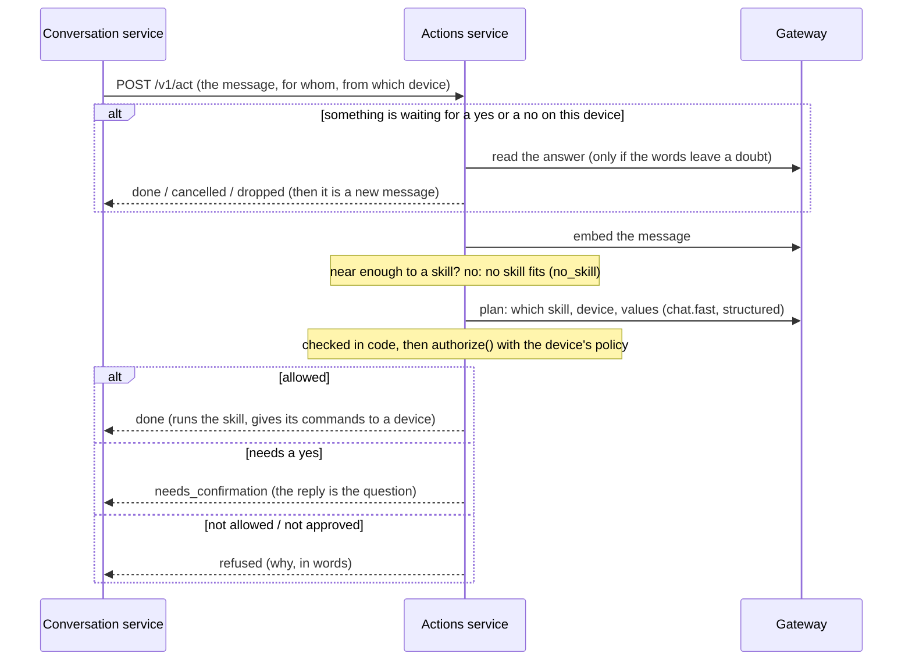

# The actions service

What a message asks to be **done**. The conversation service asks it, before it searches the
documents, whether a message is a request ("turn on the living room lamp") and not a question; if it
is, the actions service chooses the skill that does it, decides whether this device may have it done,
asks for a yes when it must, runs it and audits it. It **knows no model and no key** (a small model
reads the messages through the gateway, in the `chat.fast` role), and it **never runs anything on a
model's word**: the model proposes, and code decides ([ADR 0014](decisions/0014-actions-the-model-proposes-the-code-decides.md)).

*Implemented* (slice 5a): skills as folders in versions that never change, a catalog with review and
enabling, matching a message with the skills by meaning, the planner and the checks on what it says,
the decision with the policy of the device, confirmations (a yes or a no), approvals that fail
closed, the audit trail, English and Italian replies, the HTTP API, a container image, and the
asking from the conversation service. *Implemented* (slice 5b): **running a skill** (its script runs
in the isolated `runner`, [`runner.md`](runner.md)) and **doing what a skill answers with on a
device** (over the edge). *Implemented* (slice 6): **skills that are instructions**, which have no
script: a model writes a plan from the notes, code checks it, and the platform runs it in the
sandbox ([`skills.md`](skills.md), [ADR
0016](decisions/0016-skills-that-are-instructions-a-model-writes-a-plan-the-code-decides.md)).
*Implemented* (slices 7b-7d): the hub registers devices and the skills bound to them and keeps the
secrets a skill is given ([`hub.md`](hub.md)), once configured, in place of a file. *Not yet*:
approvals have no way to be asked (ADR 0007), and a skill that needs a linked account does not run;
the hub already issues the tokens every service checks (slice 7a, [`hub.md`](hub.md)).

## A message



The conversation service asks about **every** message. `NO_SKILL` is what most of them get, and it
costs one embedding and no model call when the message is far from every skill. It does not mean
*answer it as a question*: a model answers nothing by itself ([ADR
0028](decisions/0028-the-model-alone-does-nothing-a-request-is-satisfied-by-skills-or-declined.md)),
and what a message that no skill fits comes to is the conversation service's to say (the documents, if
they have something relevant; else a sentence that says that nothing fits and nothing is relevant:
[`conversation.md`](conversation.md)).

## Skills

A skill is a folder with a `SKILL.md` and, if it runs code, the scripts. The `SKILL.md` is YAML
frontmatter (the manifest of [ADR 0006](decisions/0006-skills-and-sandboxed-execution.md): name,
description, examples, target, parameters, required, device parameters, permissions, effect, confirm,
approval, entrypoint) between two lines of three dashes, then instructions or notes in markdown.
[`skills/`](../skills/README.md) has six worked examples: a lamp, a garage door, the weather and a
router restart, each showing a different way an action is decided, and two that are only
instructions (a scene for a movie, the air quality). How to write one is in
[`skills.md`](skills.md). What the platform itself does (an announcement) is not an example but a
skill of the platform, [below](#skills-of-the-platform).

* **Versions never change.** A version is identified by the SHA-256 of the `SKILL.md` and of every
  other file, so changing a script is a new version and reading the same folder again is not one.
  Line ends and a byte-order mark make no difference. What is in a folder is limited (50 files,
  1 MB each, 5 MB in all), links are refused and a path cannot leave it.
* **One version runs, and enabling it is the review.** Installing a skill does nothing. An
  administrator reads what it declares (the catalog shows it) and *enables* a version: what that
  version declares (the hosts it may reach, the secrets it may be given, the accounts it may use) is
  granted as it is, and it becomes the version that runs. A new version does not run until it is
  enabled in its turn. Enabling an older version is going back.
* **Whose it is.** A person's skill is theirs and nobody else sees it, not even an administrator. The
  tenant's skills are its administrators' to manage and everybody's to use. Nothing about skills is
  managed through a device (ADR 0004): a call that arrives from one is refused.
* **Text or a folder.** `POST /v1/skills` takes the text of a `SKILL.md`, which cannot have scripts
  and so is for skills that only carry instructions (with no `entrypoint`, a skill is in
  *instructions* mode: it is followed by a model, see below). A skill with scripts comes from a folder
  (`FACTOTUM_ACTIONS_SKILLS_DIR`), read again with `POST /v1/skills/reload`. In development
  `FACTOTUM_ACTIONS_ENABLE_SKILLS_DIR=true` enables what is read as it is read, as if it had been
  reviewed: the service refuses to start with it anywhere else.
* **What a skill says about itself is what finds it.** Its description and each example are embedded
  with the embedding model of its owner and kept in that model's space. Enabling a version indexes it;
  one that could not be indexed (no model, the gateway away) is offered to the model unscored until it
  can be, so a skill works the moment it is enabled.

The protocol of a script is: parameters and the device's own parameters come in as JSON on standard
input (`{"params": ..., "device_params": ...}`), secrets it was granted as environment variables, and
it answers **one JSON object** `{"message", "data", "commands"}` on standard output, exits with 0, and
logs to standard error. A command is *data*: the platform gives it to a device after the checks, so
the sandbox needs no way back into the platform. **What is read is exactly those three fields**: a
script that misspells a key is a failure that names the key, and a script cannot say that nothing was
run. The examples follow it, and a test runs each of them as it is.

What loads is what can run: the entrypoint is a **Python** file, every file in the folder has a name a
container can be given (letters, digits, `.`, `-`, `_`), and a secret cannot be called what the runner
sets or what changes how a program starts (`PATH`, `HTTPS_PROXY`, `PYTHON*`, `LD_*`, `FACTOTUM_*`). A
script has the standard library and nothing installed.

## Skills of the platform

Some skills are not a folder: they are code of this service, and the platform gives every tenant
the same ones ([ADR
0026](decisions/0026-saying-something-on-a-device-play-audio-speak-through-the-edge-and-core-skills.md)).
They are for what a sandbox and a plan cannot do (a skill of a person has no voice of its own: it
gives a device a `speak`, and has no way to ask the gateway for anything) and for what other skills
may use later. A skill of the platform is **found, chosen, authorized, confirmed and audited as any
skill is**: it has a `SKILL.md`, which is what the matcher and the planner read, and a function that
runs it, in this process, with what this service has (`factotum.actions.core`).

* **What makes a version the platform's is its text.** A stored version is the platform's skill when
  its name and the hash of its content are those of the `SKILL.md` that the code carries. Anybody can
  write a manifest, so nothing in a manifest says "core": a person's skill that is called `announce`
  and says something else is a skill of theirs, run in the sandbox as any is, and the very same text
  is the platform's and gains nothing by it.
* **A tenant has them from the first time it is asked for**: the first message that is asked about,
  or the first time its administrators list, install or read the skills. They are installed and
  enabled (`enabled_by` is nobody: the platform did it) and indexed by meaning at once, so that the
  first message is matched as every other is (a skill that is enabled and not indexed is offered to
  the model unscored, and the model is asked about every message until the index is made), once for a
  tenant for as long as the service runs. One that an administrator **disabled stays disabled**, whatever the service does at a start;
  a version that the platform did not carry before (a new text) is enabled where it ships; one that
  was installed and never enabled (the service stopped between the two) is enabled. A skill of the
  tenant of the same name gets the platform's text as a new version, and an administrator who enables
  their own back is not overruled at the next start.
* **Nothing about them is a model's**: no plan is written for one and nothing is run in a sandbox,
  so they work with no runner (a dry run is what a skill that is run by the runner comes to without
  one). What they give a device is commands, which go through the same checks (the device declared
  what a command needs, the one that was named or the one that was spoken to) as any.
* **What they ask of the platform is a port, not the service**: `announce` is given a
  `SpeechMaker` (the voice of a text, as the gateway makes it), and a clip costs a model's time, so
  every skill of the platform limits what it makes and reads what it is given as the input that it
  is: it is called with what a message said, and later with what other skills say. A skill calling
  another is not built (ADR 0026 leaves it for a decision of its own).

**`announce`** says something out loud on a device: *tell the kitchen that dinner is ready*. It acts
on a system device (the one that was named, or the one that was spoken to), is `reversible`, reaches
nothing on the network, and is granted nothing. What it says is not the reply to the person (that is
*Done*, as every action's is, and goes the way an answer goes): it is the message, for the device.

* The message is cut into sentences as an answer is (`factotum.common.sentences`), the sentences are
  put together in blocks of at most 400 characters, and the gateway is asked for the voice of each
  block at the same time as the others (`tts`, of the tenant for a device of the household and of the
  person for a device of their own). A person says a phrase (a value of a skill is at most 500
  characters), so it is one clip or two; what other skills ask for later may be up to 2000
  characters, and more is `failed`.
* The device is given a `play_audio` for each block, in order ([`edge.md`](edge.md#audio-out-a-clip-that-a-command-carries)):
  nothing is given until every voice is made, and **none if one cannot be** (`failed`; the trail says
  `the voice could not be made (gateway_unavailable)` and never what the gateway said). The commands
  are given in order and **the first that is not done stops the rest**: the second half of a message
  is not said without the first.
* The trail says what was said and in how many clips (`said 'dinner is ready' in 1 clip`), never
  the sound. `FACTOTUM_ACTIONS_SPEECH_TIMEOUT_S` is how long the gateway is waited for each block (the
  first voice after a start is loaded when it is asked for: seconds on a processor), and the skill's
  own limit is 60 seconds, which is what the whole of it is given.

**The sound of a device** ([ADR 0029](decisions/0029-the-skills-for-what-a-device-does-are-the-interface-between-the-model-and-the-device.md)): `volume` (*set the volume to 30*, *al massimo*), `volume-change`
(*alza il volume*, *abbassa di venti*), `mute` (*metti in muto*, *togli il muto*) and `volume-status`
(*che volume c'è?*, *sei in muto?*). Each is the interface between a model and the speaker of a device:
it passes on what was said as a command (`set_volume`, `adjust_volume`, `set_mute`, `get_state`) and
tells the device no number of its own, so that how far *turn it up* goes is the step of the device.
They are `reversible` (`volume-status` is `read_only`), act on the device that was named or spoken
to, and run here, in this process, with no sandbox and no runner: they really do it.

* **What the device answers is read here, in code.** A result may carry `data` (the level the volume
  came to, how the device is), and the skill says it in a sentence of `core/phrases.py` in the
  language of the person (`CoreResult.after`): *Volume al 60 per cento*, *L'audio è in muto. Il
  volume è al 40 per cento*. A device that does not answer what the skill needs is a skill that
  failed (*The volume-status skill failed*), not a guess; a model never reads the answer.
* **Mute keeps the level.** Setting or turning the volume brings the sound back, as on a television.

**Timers and alarms** (same decision): `timer` (*set a timer for five minutes*, *metti un timer di
mezz'ora*), `timer-cancel` (*annulla il timer*, *stop the timer*) and `timer-status` (*quanto manca
al timer?*), and `alarm` (*sveglia alle sette e mezza*, *wake me at 6 tomorrow*), `alarm-cancel` and
`alarm-status`. The device keeps the time on a clock of its own and rings by itself (the sentence that
rings is made a voice by the gateway when the timer or the alarm is set, and travels with the command:
`set_timer` and `set_alarm` carry a clip, and so are the platform's only); the skill is the interface.

* **A model copies words, code does the sums.** A timer takes the *words* of how long (a number of
  seconds that a model wrote would be one that nobody said: ADR 0028), an alarm those of the hour and
  of the day. `core/when.py` reads them, in English and Italian: *un'ora e mezza*, *2h30*, *half an
  hour*, *alle sette meno un quarto*, *7:30 pm*, *domani*, *lunedì*, *il 15 ottobre*. What it does not
  understand is not guessed: the skill says so in words of its own (*Non ho capito di quanto tempo
  parli*), and a time that is counted from now (*tra dieci minuti*) is not an alarm.
* **The day is not a date.** The platform has no clock. The skill passes on *tomorrow*, *Monday* or
  *the 15th of October* as a way of saying a day (`AlarmDay`), and the device, which has the calendar
  and the time of the place it is in, works out the next time that fits and answers with the moment it
  chose, which the skill says (*Sveglia impostata per domani alle 7*). A moment that has gone by, a
  date that never comes and a device that is full are answered with their reason and said in words.
* **Which one a cancel stops** is the device's: the one named by its length or its hour, else the ones
  that ring, else the next to ring. A device holds up to eight of each, and loses them when its
  program stops.
* **A ring goes through a mute, not through the volume.** The device plays it as an alert: a muted
  speaker rings, at the level its volume is at (and a volume of zero is silent).

**Changing and stopping what was set** (same decision: what lasts comes with the means to change it
and to stop it): `alarm-postpone` (*rimanda la sveglia di dieci minuti*, *ancora cinque minuti*,
*snooze the alarm*), `alarm-change` (*sposta la sveglia alle otto*, *sposta la sveglia delle sette
alle otto*, *move the alarm to 7:30 tomorrow*) and `stop` (*basta*, *ferma*, *zitto*, *enough*). The
timer stays as it is: set, cancel, status.

* **How long a snooze is belongs to the device.** The words of how long (*dieci minuti*, *half an
  hour*) are read by code, as for a timer, and passed on only when a person said them: *snooze* alone
  puts the alarm off by the snooze of the device (`timekeeping.snooze_minutes`, 10), and a length that
  a model wrote and nobody said is left out (ADR 0028). An alarm that rings is silenced and rings
  again after that long from now; one that has not rung is moved later by it.
* **Moving an alarm is one command**, not a cancel and a new alarm: if the new moment has gone by, or
  the date never comes, the old alarm is still there. The new hour and day are said as for a new
  alarm, and which alarm is moved (the one named by its hour, *sposta la sveglia delle sette alle
  otto*, else the one that rings, else the next to ring) is the device's choice.
* **Stop is not cancel.** `stop` stops what rings on the device that was spoken to, a timer or an
  alarm alike, without saying which; it never touches what has not rung. With nothing ringing the
  person is told so (*Non sta suonando niente*). `timer-cancel` and `alarm-cancel` are for what has
  not rung.
* **Nothing to change is a thing to say**, as for a cancel (*Non c'è nessuna sveglia da cambiare*);
  a moment that has gone by or a date that never comes is a skill that failed, in its own words.

**The clock** (same decision): `clock` (*che ore sono?*, *what day is it today?*, *dimmi l'ora*). The
only clock there is, is the device's: the platform has none and a model has none (ADR 0028), so
nobody but the device tells the time. The skill asks the device how it is (`get_state`, as
`volume-status` and `timer-status` do) and says what its wall shows, in a sentence of the code in
the language of the person: *Sono le 14 e 32*, *È l'una e 5*, *È mezzogiorno*, *It is 2:32 PM*,
*Oggi è mercoledì 14 ottobre 2026*. It is `read_only` and changes nothing.

* **The time, the day, or both.** `about` is `time`, `date` or `both`, the model's reading of what
  was asked (a choice is not searched for in the words of the message); a person who asks for neither
  in particular is told both, and a model that is not given `both` writes it anyway (measured), which
  is a value that is not one of the choices and so a value that is missing. Anything else is a skill
  that failed.
* **The wall as it shows.** What the device answers is the civil time of the place it stands in
  (`TimeState.now`, no zone), and the skill says it as it shows it: it works out nothing, and a device
  that does not answer its wall is a skill that failed, not a guess. The first of the month is
  *primo* in Italian, which a digit would not be read as.
* **Only now.** It tells the time where the device is and the date of today: not the time in another
  city and not the day of another date (*che giorno è domani*), which nothing in the platform can
  work out without a calendar of its own.

## Mock skills

Whether a skill works is one thing, and whether the assistant chooses it and calls it as its manifest
says is another. The second can be measured, and listened to, with skills that do nothing, if what
they answer is plausible. A skill with a `mock.yaml` beside its `SKILL.md` ([`skills.md`](skills.md))
says what it answers in each language; where no runner is set, `FACTOTUM_ACTIONS_MOCK_RUNNER=true`
(development and tests only, and refused where a runner is set) makes the service answer from it
(`MockRunner`): a weather is a weather, an action is *done* with what it was done with. A skill with
no `mock.yaml` is answered as the dry run does. The runner is told the language of the person
(`RunRequest.language`, which a script is not given), and nothing is run: the file is data.

`skills/mocks` has 17 of them, written plainly and with nothing in the planner about them, for the
shapes a manifest can have (a number in a range, a choice from a list, a yes or a no, a decimal, text
that was said, everything optional, a policy that refuses a shared speaker and one that asks for a
yes), and for pairs that are near each other on purpose (the thermostat and the oven, the blinds to a
percentage and open or shut, the shopping list and the reminder, the door and the garage). Their
corpus is `factotum.actions.mock_cases` (the messages, and what a model that reads them well does
with each), tested like the other: with a planner that reads every message as it is meant the whole
service comes to what each case expects and answers as the mock says.

## Choosing a skill

1. **Candidates by meaning.** The message is embedded and compared with what each enabled skill of
   the caller says about itself (the tenant's and their own). The skills that are at least
   `FACTOTUM_ACTIONS_MATCH_THRESHOLD` (0.45) near go on, the nearest first, up to six. If the
   message cannot be embedded the skills that could not be measured go on unscored, up to twelve.
   With no candidates the answer is `NO_SKILL` and no model is asked.
2. **A plan from a small model.** The model in `chat.fast` reads the message and the candidates (each
   with its values: their kind, and what the skill says each is for), with the names of the devices
   the caller may use, and answers a structured `Plan`: *why* (a few words,
   which is what makes a small model get the rest right), which skill or none, which device, which
   values (only what the message says, or what the description of the skill says it is in that
   case), the language, what to ask for a yes and what to ask for a missing value (in the language of
   the message). It is shown 19 examples as turns of the conversation it is in, and **it is never
   shown the conversation**, a
   document or a page: what plans an action is the message and nothing else. It is asked with the
   temperature at zero and cut off after 10 seconds.
3. **Checked in code.** The skill must be one of those offered. A skill that acts on a system device
   is aimed at the one named or, without a name, at the one that was spoken to (a name that is
   ambiguous is asked about). A skill that acts on an external device is aimed at the one named, or
   at the only one the caller may use that the skill is bound to; more than one is asked about, none
   is *there is no device set up for that*. Values are checked against what the skill declares:
   `"30"` for an integer becomes 30 and `"On"` becomes `"on"`, and a value outside the bounds or the
   choices, or a required one that is not there, is *needs more* and the reply asks for it.
   **A value must also be one that the person said** (ADR 0028, `grounding`): a number is one that
   the message gives, in digits or in words (English and Italian, up to 999; *per cento* is a percent
   and not a hundred), or an end or the middle of the range the skill declares, said as people do
   (*al massimo*, *at full*, *a metà*), and a text is made of words that the message has. One that
   is not there is *left out*: a value that the skill does not require is not passed on, so the
   skill, or the device, applies its own default (*alza il volume* turns it up by the step of the
   device; a level of 100 that a model thought of is never run), and one that it requires is asked
   for. A choice from a list (`on`, `off`) is the model's reading of the words and is not searched
   for. The names of what was left out are in the log, never the values. A sentence the model wrote
   to be spoken must be one printable line of moderate length or it is not said, and the question
   that asks for a missing value must also be in the language of the message (read in code, as the
   conversation service does): a model that was shown a question in English asks in English whatever
   it is spoken to in, and the sentence of the code is said instead. **A plan that does not pass is
   not an action.**

A message the planner cannot read (the gateway is away, the model does not answer in time or with
something that is not a plan) is `NO_SKILL` with `degraded` set: nothing runs, the conversation
service leaves it to the documents, and the turn says in a warning that it could not be told whether
a skill fits (and, if the documents have nothing either, that the skills could not be reached).

## Deciding

What is left goes to `authorize()` (`factotum.common.authorization`), the one function that decides
whether an action may happen, with the policy of the device that was **spoken to**.

| The decision is | When | What happens |
| --- | --- | --- |
| **deny** | the skill or a device is not visible to the caller; the device's policy forbids the skill or its effect | refused, with the reason in words; audited |
| **require approval** | the skill asks for it (`approval: required`) or the device does | an approver is asked; none is set up, so refused (ADR 0007) |
| **require confirmation** | the effect is irreversible, the skill says `confirm: ask` for something with an effect, or there was untrusted text in the turn | the person is asked a plain yes or no |
| **allow** | otherwise | it is run |

The effect that counts is the more severe of the skill's and the device's: a garage door registered
with `sensitivity: irreversible` makes every action on it irreversible whatever the skill declares. A
shared device may by default start what can be undone (`max_effect: reversible`); a personal one may
start anything; a device may be given more or less in the file of devices.

With the example home: *"open the garage door"* to the **kitchen speaker** is refused (it may not
start what cannot be undone); to the **living room display**, whose administrator allowed it, the
answer is a question, and only a yes opens it; to the **phone** it is the same. The lamp is done at
once from any of them.

## A yes or a no

When the answer is to ask, what was understood is kept (the skill and its version, the values, the
device, the decision) for 60 seconds, **one at a time for a person on a device**, and the next
message on that device is read as the answer. It is read by its words where they leave no doubt
(*yes, sure, go ahead, sì, certo, fai pure...* and *no, don't, cancel, lascia stare, non ora...*)
and by the small model where they do, and **whatever is not clearly a yes is not one**: an answer
that adds something, a question, a message of more than 200 characters, a model that does not
answer are *other*, and *other* drops the question and takes the message as a new one.

* A yes is taken **once**: however many arrive, or however quickly, the thing is done once.
* When a yes is taken **nothing is assumed**. The version may have been disabled or replaced, the
  device removed, the policy made stricter: the action is decided again, and what is no longer
  possible is refused (`skill_not_enabled`).
* A yes authenticates nobody: it protects against a misunderstanding and against words that are not
  the person's own, and that is all it is asked to do (ADR 0004).
* A shared device has no history but it has this: what is asked on it is waited for on it.

## Approvals

An action that needs an approval goes to an `Approver`. There is no mechanism yet, so the
approver of a deployment answers *unavailable* at once and the action is refused: *"That needs
somebody's approval, and I have no way to ask for it."* Nothing is restarted by mistake because a
mechanism is missing. When there is one, an approval replaces the spoken yes, and the trail records
who approved.

## Running, and what a device is told

Two interfaces, each with a real implementation and a stand-in for when nothing is set up (what is
not set is not there, and the service says so when it starts):

* `SkillRunner.run(RunRequest) -> RunResult` runs a version of a skill with the values that were
  checked, the device's own parameters, what was granted and a time limit (the skill's own, and a
  margin). **`RemoteRunner`** runs the script in the runner service
  (`FACTOTUM_ACTIONS_RUNNER_URL`). **`DryRunRunner`**, without one, says what would have been run,
  marks it as such, and the trail records it as *not executed*.
* `CommandDispatcher.dispatch(tenant, device, command) -> CommandResult` gives a device a command
  the skill answered with, after checking that the device declared what the command needs.
  **`EdgeDispatcher`** gives it through the edge (`FACTOTUM_ACTIONS_EDGE_URL`, acting for the tenant).
  `NullDispatcher`, without one, reaches no device: the command is not done, and the person is told.
  The commands of one run are given **in order, and the first that is not done stops the rest**.

**What is settled on this side of the wire, before a script runs** (the runner knows nothing of
skills, tenants or devices):

* **The files** are those of the version that was enabled, read from the store: never what a caller
  sent, and never a newer version that has not been reviewed.
* **The secrets** are the ones the version declared, that were granted when it was enabled, and that
  are **its owner's own**. A skill a person wrote for themselves that asks for `HA_TOKEN` is given
  that person's, or does not run; it is never given the household's, however it is granted. A secret
  that is not set fails the run and is named (`the secret HA_TOKEN is not set`), never shown.
* **The hosts** are what the grant names, with the device's own host where it says `${device.host}`
  (one host, never a pattern, whatever the binding says). No hosts means no network.
* **A skill that needs a linked account** fails and says so: accounts come with the hub.

**What comes back** is read as a `SkillOutput` (`message`, `data`, `commands`, and nothing else) and
believed no further than that. A script that did not end well (a code that is not 0, too slow, killed
for memory), that printed something that is not one JSON document, or whose document is not one a
skill gives, is a failure of the skill, and **what the failure says is the platform's sentence that
names the skill (*The weather skill failed*) and never what the script happened to write**. A script
that ended well and says in an `error` why it could not do what was asked is heard in those words,
as a `message` is (ADR 0028). A command is given to a device only if the device declared what it
needs, and a script cannot choose the device: it is the one the skill was aimed at, or the one that
was spoken to. What the runner did not or could not do (unreachable, busy, does not know us) is
`runner_unavailable`, told to the person as *I cannot run the weather skill right now*.

**A skill that is instructions** goes through the same runner and the same `RunRequest`, and what is
different is what is run and how it came to be. There is no script: the notes are given to a model in
the `chat.main` role (`PlanWriter`), with the values the message gave, the *names* of what the skill
may reach and be given, and the language of the message, and it writes a **plan** (data: at most eight
steps, each a request or a command for a device, and what to say). `checks` decides whether the plan
may be run, against what the version was granted, before anything is sent, and the runner is given
`executor.py`, the program that does what a plan says, and the plan, in place of a script. What it
prints is read as a script's output is, and the commands go to a device the same way.
[`skills.md`](skills.md) is the language of a plan and what is checked. What is settled here:

* **The plan is written before the question.** When the decision is to ask a yes or a no, the plan is
  written and checked first, and kept in the confirmation with the rest of what was understood; the
  yes is read by its words as it always is, and when it comes the plan is checked once more against
  what is granted then. Nothing that a model writes comes after a yes.
* **A model is asked twice at most** for a plan (`FACTOTUM_ACTIONS_PLAN_ATTEMPTS`): a plan that the
  checks refuse is given back with which step and why, and the second is checked the same way.
  `FACTOTUM_ACTIONS_PLAN_TIMEOUT_S` is how long each question is waited for. A plan that could not
  be had is a `failed` outcome with a plain sentence, and the trail says `no plan: <why>`; what was
  run is `plan: POST host, ...`, without a value.
* **Without a runner, or without a gateway to ask, it is a dry run** as every skill is. The service
  starts to write plans only with `FACTOTUM_ACTIONS_RUNNER_URL` set.
* **The requests go out from the sandbox**, through the proxy, with the hosts the grant names: the
  actions service has no way to reach a network for a plan, so a plan cannot do what a skill that
  was not granted the host could not.

Everything before and after is as it was: the choice, the checks, the decision, the confirmation, the
reply, the trail. A skill that fails, times out or cannot be run is a `failed` outcome with a plain
sentence, and is audited; the log says why (which secret, which exit code, which status), with
nothing a script wrote but the end of its error output.

## The audit trail

Each step leaves a record: **asked** (the question was put), **declined**, **refused**, **executed**
(or *not executed*: a dry run, or something that was not there any more). A record has the skill, the
device that was spoken to and the one that was acted on, whom it acted for, the values (masked
where they look like a secret), the decision and its reasons, the confirmation, the approval and the
result. The contract refuses a record that says something ran without the confirmation or approval its
decision required, and there is no way to change or delete one. A trail that cannot be written is
logged; it does not turn an answer into an error.

Only the tenant's administrators read it (`GET /v1/audit`), never through a device, and
what each person did is theirs to see in the web app (slice 9).

## Replies

The answer to a request is not generated: it is one of a few sentences that say what happened, in the
language of the message, which the small model reads out of it. English and Italian are in
`phrases.py`; another language is answered in English until somebody adds it, and a test says that no
sentence is missing from either. What a skill says about its own result, and the question the model
wrote to ask for a yes, are said as they are.

## What goes wrong

| What | What happens |
| --- | --- |
| The gateway is away, or has no `chat.fast`, or the model is slow | no skill is found: `no_skill` with `degraded`, nothing runs, and the turn warns |
| No embedding model, or it is slow | the skills that could not be measured go to the model unscored; without any, no action |
| The message is from a device that is not known | refused if it is an action, and nothing is done for it |
| A skill is disabled between the question and the yes | refused: *that is not available any more* |
| A skill fails or takes too long | `failed`, a sentence that names the skill (*The weather skill failed*), audited; the log says why |
| A script reports why it could not do it (`error`) | `failed` with `skill_failed`, in the script's own words; the trail keeps them |
| The runner cannot be reached, is busy or does not know the service | `failed` with `runner_unavailable`: *I cannot run the weather skill right now* |
| A secret is not set, or the skill needs a linked account | `failed`; the log names the secret, never its value |
| A command is not done (the device is not connected, is slow, or the edge is away) | `failed` with `command_failed`: *I asked the device to run the weather skill, and it did not do it*; the commands after it are not given |
| The voice of an announcement cannot be made (no `tts` bound, the gateway away or slow) | `failed` with `skill_failed`, nothing is given to a device; the trail says `the voice could not be made (code)` |
| The actions service is away (seen from the conversation service) | the turn goes on with the documents and says so in a warning (and in the sentence, if they have nothing relevant) |
| The database is away | `/readyz` says so, and the calls fail |

## The HTTP API

Everything is under `/v1` and needs an authenticated caller: the hub's token once
`FACTOTUM_HUB_TOKEN_SECRET` is set ([`hub.md`](hub.md)), development headers otherwise.

| Route | What |
| --- | --- |
| `POST /v1/act` | `{message, untrusted_content_in_turn}` → the outcome: `status` (`no_skill`, `done`, `needs_confirmation`, `needs_more`, `cancelled`, `refused`, `failed`), the `reply`, a `code` and the `reasons`; for `no_skill`, `degraded` says the message could not be read |
| `GET /v1/skills`, `GET /v1/skills/{id}` | what is installed, which version runs, what was granted |
| `POST /v1/skills` | install the text of a `SKILL.md` (201; 200 if it is the very same skill) |
| `POST /v1/skills/reload` | read the folder of skills again (the tenant's, so an administrator's) |
| `POST /v1/skills/{id}/enable` | review a version (the latest, or `{"version": n}`) and enable it |
| `POST /v1/skills/{id}/disable`, `DELETE /v1/skills/{id}` | nothing runs of it / delete it with its versions |
| `GET /v1/audit` | the trail, the latest first: `before`, `limit` (up to 200), `skill`, `device` |
| `GET /healthz`, `GET /readyz` | liveness, and readiness (the database) |

Errors are `{"error": {"code", "message", "details"}}` like the other services. A skill that is
not there and one that is another person's are the same `404`.

## Configuration

`FACTOTUM_ACTIONS_*`, and the database is `FACTOTUM_POSTGRES_*`. Everything is documented in
[`.env.example`](../.env.example).

| Variable | Default | |
| --- | --- | --- |
| `_HOST`, `_PORT` | `127.0.0.1`, `8085` | loopback unless told otherwise |
| `_GATEWAY_URL` | `http://127.0.0.1:8081` | where the gateway is |
| `_RUNNER_URL` | none | where the runner is; without it a skill is a dry run |
| `_EDGE_URL`, `_EDGE_TIMEOUT_S` | none, `15` | where the edge is (without it commands are not done), and how long it is waited for to say what became of one (a `speak` is waited for until every sentence of it has been taken, so a long text on a slow voice wants more) |
| `_SECRETS_FILE` | none | the secrets skills are given, for development (`config/secrets.example.yaml`); overridden by the hub once it is configured, below |
| `_DEVICES_FILE` | none | the file of devices, for development, the one the edge reads too; overridden by the hub once it is configured, below |
| `_HUB_URL` | none | where the hub is; once `FACTOTUM_HUB_TOKEN_SECRET` is also set, its devices, bindings and secrets replace the two files above |
| `_SKILLS_DIR` | none | a folder of skills, read on `POST /v1/skills/reload` |
| `_ENABLE_SKILLS_DIR` | `false` | enable what is read as it is read (development only) |
| `_MOCK_RUNNER` | `false` | with no runner, answer a skill from its `mock.yaml` (development only; see [Mock skills](#mock-skills)) |
| `_MATCH_THRESHOLD` | `0.45` | how near, by meaning, a message must be to a skill (0 to 1) |
| `_MATCH_CANDIDATES` | `6` | how many skills the model is shown |
| `_MATCH_TIMEOUT_S`, `_INDEX_TIMEOUT_S` | `4`, `8` | embedding a message, embedding a skill |
| `_PLANNER_TIMEOUT_S`, `_READER_TIMEOUT_S` | `10`, `6` | reading a message, reading a yes or a no |
| `_CONFIRMATION_SECONDS` | `60` | how long a yes or a no is waited for |
| `_APPROVAL_WAIT_S`, `_APPROVAL_MINUTES` | `20`, `10` | how long a turn waits for an approver, and how long a request is open |
| `_RUN_MARGIN_S` | `5` | added to the time limit of a skill |
| `_SPEECH_TIMEOUT_S` | `60` | how long the gateway is waited for to make the voice of one block of an announcement |
| `_PLAN_TIMEOUT_S`, `_PLAN_ATTEMPTS` | `30`, `2` | how long a model is waited for to write the plan of a skill that is instructions (each try), and how many tries it has when the checks refuse a plan |
| `_MAX_DEVICES_SHOWN` | `10` | other devices the model is shown by name |

The conversation service is pointed at it with `FACTOTUM_CONVERSATION_ACTIONS_URL` (without one, no
skill is asked for: every message is left to the documents, and a message they have nothing relevant
for is told that no skill fits) and told how long to wait with
`FACTOTUM_CONVERSATION_ACTIONS_TIMEOUT_S`.

## Storage

Postgres, schema `actions`, migrations applied on start. Every table carries the tenant and every
query filters by it. `skills` (with the enabled version), `skill_versions` (the manifest, the
instructions, what was granted and by whom), `skill_files` (so that a version is whole),
`skill_vectors` (what a skill says about itself, by meaning, in the space of its owner's embedding
model), `confirmations` (one row at a time for a person on a device) and `audit` (only ever added
to). The vectors are compared exactly, not through an index: a home has tens of skills.

There are two implementations of the store, in memory and in Postgres, and the same tests run
against both.

## Trying it

The devices are those of [`config/devices.example.yaml`](../config/devices.example.yaml): copy it to
`config/devices.dev.yaml`, and put in it, as the `host` of the lamp and the garage door, where your
Home Assistant is (an address, or a name the DNS of the machine knows; `host.docker.internal` for one
on this machine). The secrets they need are in [`config/secrets.example.yaml`](../config/secrets.example.yaml):
copy it to `config/secrets.dev.yaml` and put your token in it. Bindings for the models are in
`config/bindings.dev.yaml` (see [model-gateway.md](model-gateway.md)); `chat.fast` and `embedding` are
the roles used here, and `chat.main` for the skills that are only instructions (it writes their plans:
bind it to the same model to start). The engine must be running (a script runs in a container of its
own), and the stack needs a key for the grants of the egress proxy, which is yours to make. In
production the devices, their bindings and the secrets above come from the hub instead
(`FACTOTUM_HUB_TOKEN_SECRET` and `FACTOTUM_ACTIONS_HUB_URL`, [`hub.md`](hub.md)): register and set
them there, and neither file is read.

```bash
export FACTOTUM_POSTGRES_PASSWORD=dev FACTOTUM_ENVIRONMENT=development
export FACTOTUM_EGRESS_KEY=$(python -c "import secrets; print(secrets.token_urlsafe(48))")
export FACTOTUM_ACTIONS_ENABLE_SKILLS_DIR=true      # development: what is read is enabled
docker compose --profile services up -d --build --wait

# The examples are installed and enabled (and indexed by meaning), as an administrator:
curl -s -X POST http://127.0.0.1:8085/v1/skills/reload
curl -s http://127.0.0.1:8085/v1/skills | python -m json.tool

# A message, as the living room display (a device that may start what cannot be undone). The id of
# a device follows from its hardware id, so it is the same on every machine:
DISPLAY_ID=fa54fa4e-e63e-5b9a-b760-92a9c52f77bb
curl -s http://127.0.0.1:8083/v1/turns -H 'content-type: application/json' \
     -H 'x-factotum-dev-subject: tenant' -H "x-factotum-dev-device: $DISPLAY_ID" \
     -d '{"message": "open the garage door"}'
# ...a question ("Do you really want me to open the garage door?"), and the next message answers it
# (and the garage door is opened, through your Home Assistant, by a script in a container):
curl -s http://127.0.0.1:8083/v1/turns -H 'content-type: application/json' \
     -H 'x-factotum-dev-subject: tenant' -H "x-factotum-dev-device: $DISPLAY_ID" \
     -d '{"message": "yes"}'
```

Or as a device, which is how it will be used: `uv run factotum-terminal --profile smart-display`
and say *turn on the lamp*, *open the garage door* (it asks; say *yes*), *what is the weather in
Rome*, *restart the router* (it cannot be approved yet), *apri il garage*; and to the `speaker`
profile *set the volume to 30*, which the terminal shows as a command it was given (`[do] volume 30`).
The three skills that are only instructions are tried the same way: to the speaker, *tell everyone that
dinner is ready* (a `speak` command, no request), *set the movie scene* (two calls to the Home
Assistant that its notes name: change `homeassistant.local`, in the notes and in the permissions, to
where yours is) and *how is the air quality in Rome* (two requests to Open-Meteo, which needs no key).
Without `FACTOTUM_ACTIONS_RUNNER_URL` everything that is done is a dry run, and `GET /v1/audit` shows
the trail in either case: for these skills it says what the plan did (`plan: POST
homeassistant.local:8123, POST homeassistant.local:8123`), or why there was none (`no plan: ...`).

## Tests

`uv run pytest` runs all of them, with no network and no model: the models are doubles that answer
what a test says, and every rule (the checks on a plan, the values, the decision, the confirmation,
the audit) is tested on its own and through the service. The store has one set of tests that runs
against both implementations; the ones that need Postgres are `integration` and skip without it. A
corpus of 196 messages (`factotum.actions.plan_cases`: 143 that ask for something, for the skills
that come with the project and for those of the platform, and 53 that do not) is run through the whole
service with a planner that reads every one as it is meant, to keep the expectations honest, and
judged by the same code (`factotum.actions.measure`) that `tests/live` measures a real model with: a
harness that cannot give a perfect score to a perfect planner measures itself. It judges what the
service made of a reading (the skill, and the values that skill was called with, which are in the
audit trail whichever kind of skill it is) and not what a device then did, so the device of the
test answers as a plausible one does and need not be a good one:

```bash
FACTOTUM_LIVE_TESTS=1 uv run pytest -m live services/actions/tests/live -s
# a model to try as the small one, and another way to embed:
FACTOTUM_LIVE_PLAN_MODELS=llama3.2:3b-instruct-q8_0,gemma3:4b  ...same command...
```

The plans of the skills that are instructions have a live test of their own
(`tests/live/test_live_instructions.py`, [`skills.md`](skills.md#what-was-measured)); the same file
says what a real model makes of a message for the platform's own `announce`. The skills of the
platform have tests of their own: the registry (`test_actions_core.py`: installed once for each
tenant, left alone when disabled, found by the hash of the text), the skill (`test_actions_announce.py`:
the blocks, whose voice, all at once, what is left when a voice fails) and the service with them
(`test_actions_core_service.py`: authorized, confirmed, audited, two tenants).

## Measured

On an RTX 3060 Ti (8 GB) with Ollama on Windows 11: `bge-m3` for the embeddings and a chat model in
the `chat.fast` role. The card was measured in two states, because it was in both: **shared** (something
else was using it, over half busy with nothing of ours running, so the models wrote 10 to 13 tokens
a second) and **idle** (60 tokens a second). The answers are the same in both, because the models
are asked with the temperature at zero, and the times are not, so they are given for each. One run of
each: read them as what to expect, not as exact figures. `tests/live` measures it again, and
measures any model you bind. The messages of slice 5a were the 61 that `factotum.actions.plan_cases`
had then, for five skills: 39 that ask for something to be done (some in the words of the skill's own
examples, some far from them, in English and Italian, said to the speaker, the display and the phone)
and 22 that do not, half of them worded to look like commands ("how do I turn on the lamp with Home
Assistant?", "should I close the garage door at night?"). Slice 6 added three skills and 21 messages,
and [its numbers](#eight-skills-slice-6) are further down.

### Telling commands from questions (slice 5a: five skills, 61 messages)

| | `llama3.1:8b-instruct-q4_K_M` | `llama3.2:3b-instruct-q8_0` |
| --- | --- | --- |
| Commands read exactly as meant (skill, device, values, what became of it) | 37 of 39 | 35 of 39 |
| Commands with the right skill | 39 of 39 | 38 of 39 |
| Questions left as questions | **21 of 22** | **14 of 22** |
| A message that is acted on, median (90th percentile), idle card | 2.5 s (2.9 s) | 0.83 s (0.93 s) |
| The same on the shared card | 8.1 s (9.1 s) | 4.4 s (4.8 s) |
| A yes or a no read as it was meant (22 replies, in both languages) | 22 of 22 | 20 of 22 |
| A yes or a no that a model has to read, median, idle card | 0.33 s | 0.20 s |
| A reply read as a yes that was not one | 0 | 0 |

The 8B model clears the bar the live test sets for a model in this role (85% of the questions left
as questions, 85% of the commands with the right skill, 75% exactly right). **The 3B model does not**:
it takes eight questions for requests, and that is the one mistake that matters, because it is the
one that does something nobody asked for. The checks in code stopped most of them (five ended as
*needs more*, three as *refused*), but one, a question about the weather in August, was *done*. A
model that small is fine for reading a yes or a no (it never took an answer for a yes that was not
one: what it got wrong, it got wrong on the safe side) and not for planning; both are the
`chat.fast` role, so the binding is one model, and the 8B is the one to bind.

What the 8B model got wrong, out of 61:

* *metti la luce al 50 per cento* was *needs more*: it left out that the lamp is to be **on**. The
  first example had `state` as a required value with nothing to say that a brightness alone means on
  (in English, the 40 percent one, it was right); the example now says so.
* *make the volume a bit lower* was **done**: it made up a level. No level was said, and the model
  was told never to make one up; the check in code could not tell a made-up 20 from a said one,
  because it is a valid value. (It can since ADR 0028: a number must be in the message.)
* *what is the weather usually like in Rome in August?* was **done** as a request for the weather now.

### The meaning search

How near each message is, by `bge-m3`, to what the skills say about themselves (1 is the same):

| | Lowest | Median | Highest |
| --- | --- | --- | --- |
| A command, to the skill it asks for | 0.69 | 0.91 | 1.00 |
| A question, to the nearest skill | 0.37 | 0.65 | 0.86 |

| Threshold | Commands that go on to the model | Questions that do too |
| --- | --- | --- |
| 0.35 | 39 of 39 | 22 of 22 |
| 0.40 | 39 of 39 | 21 of 22 |
| **0.45** | 39 of 39 | 20 of 22 |
| 0.50 | 39 of 39 | 19 of 22 |
| 0.55 | 39 of 39 | 17 of 22 |
| 0.60 | 39 of 39 | 14 of 22 |

Meaning is **topic, not intent**. *How do I reset the router to factory settings?* is at 0.78 from
*restart the router*, and *should I close the garage door at night?* at 0.79 from *close the
garage*: no threshold separates a question about a lamp from a request to switch it, and the
questions in the corpus are chosen to be exactly those. What the threshold does is to spare the model
the questions about something else, which are nearly all of them (*what does the manual say about the
warranty?* never gets near). The nearest a command was to its skill was 0.69, a paraphrase; the
threshold is 0.45, so that no command is lost at the price of asking the model about the questions
that are on the subject of a skill. Raise it (0.55 loses no command here and lets through 17 of the
22 questions instead of 20) once you have seen where your messages fall; another embedding model puts unrelated texts
somewhere else.

### The cost of a message

A message that is far from every skill costs one embedding (0.07 s warm on the idle card, 0.15 to
0.6 s on the shared one). One that is near costs the model as well: 2.5 s with the 8B model on the
idle card, 0.8 s with the 3B, and 8 s and 4.4 s on the shared one. A yes or a no that the words
settle costs nothing; one that a model reads takes a fifth to a third of a second.

### In containers

The whole stack in containers (the five services and Postgres), Llama 3.1 8B in both chat roles and
`bge-m3`, the five example skills read from the folder and enabled as they were read, and messages
said to the kitchen speaker, the living room display and the phone through the conversation service,
and to the display and the speaker through the edge with the terminal client.

| | Idle card | Shared card |
| --- | --- | --- |
| Reading the five examples, enabling them and indexing them by meaning | | 2.7 s |
| A command (a lamp, the volume, the weather, a garage door that is asked about) | 2.7 to 3.3 s | 8 to 10 s |
| A yes or a no that the words settle ("yes", "no thanks") | 0.3 s | 0.5 to 0.7 s |
| A yes or a no that the model reads ("no, lascia stare") | 2.0 s | |
| A question about something else ("what is the capital of France?") | 2.0 to 6.6 s to the first text | 4.1 s |
| A question on the subject of a skill ("how do I reset the router?") | 3.6 s to the first text | 11.1 s |

What it said, in words: the lamp from the kitchen speaker is *(dry run) done*, in English or in
Italian (*Prova a vuoto: avrei eseguito lamp...*); the garage door from the kitchen speaker is
*"This device is not allowed to do that."*; from the display it is *"Do you want me to open the
garage door?"* (*"Vuoi davvero che apra il garage?"*), *yes* is *(dry run) done* and *no thanks* is
*"Okay, I will not do it."*; the router is *"That needs somebody's approval, and I have no way to
ask for it."*; *turn it up* is *"I still need: level."*; *turn on the lamp* from the phone, which
has two lamps, is *"Which one do you mean: Bedroom lamp, Living room lamp?"*, and *turn on my
lamp* is the bedroom one. Through the edge the display was sent `thinking`, then `acting`, then the
sentence to say and to show. `GET /v1/audit` had a record for each step (the question and the yes
are two): the skill, the decision, the confirmation, *not executed* (it is a dry run) and the
values (`{"action": "open"}`, `{"level": 30}`). With the actions container stopped, a message was
answered as a question with the `actions_unavailable` warning.

### Running skills (slice 5b)

The same stack plus the runner and the egress proxy, with the actions service pointed at both, on the
shared card (the desktop was using it: 44% and 7 of the 8 GB), with a stand-in for Home Assistant on the
host that checks the token, the five examples read from the folder and messages said to the display and
the speaker through the edge with the terminal client. **What a script does is the runner's**
([`runner.md`](runner.md#measured) has what a container costs); what is here is what the person
waits for.

| | |
| --- | --- |
| *yes*, to the question about the garage door: the door is opened by a script through the proxy, from the message to the reply (no model is asked) | **1.9 s** (the script took 1.8 s) |
| *what is the weather like in Rome* (two HTTPS requests to Open-Meteo through the proxy) | 5.2 s (the script 1.65 s) |
| *set the volume to 30* to the speaker: the command reaches the device 15 ms after the script ends | 5.0 s (the script 0.94 s) |
| *accendi la luce del salotto* to the speaker: the lamp is switched through the stand-in | 5.8 s (the script 1.44 s) |
| *restart the router* | 4.0 s: *That needs somebody's approval, and I have no way to ask for it.* |
| *open the garage door* to the speaker | 4.3 s: *This device is not allowed to do that.* |

What the stand-in for Home Assistant saw was exactly what should have reached it: the garage door
opened once and the lamp switched on once, each with the token and the entity of the binding. The
rest of the time is the models: on a card that is shared, the model that reads the message is 3 to 4
seconds of every command. The logs of the five services had no error; the three warnings were the
first messages after a pause, below.

### Eight skills (slice 6)

(*The announcement that these numbers are about was a skill of instructions. ADR 0026 made it a skill
of the platform, which is code and not a plan, so what a model has to get right for it is the choice
of the skill and the message, and no longer a plan: the live test measures that again.*)

Slice 6 added three skills (a scene of two calls, a lookup of two requests, and an announcement that
only tells a device something) and the 21 messages for them: **82 messages, 55 that ask for
something and 27 that do not**, said to the speaker, the display and the phone, in English and
Italian. The 8B model in the `chat.fast` role and `bge-m3`, on the same card with only the desktop
on it (the whole live test took 1 minute 57 seconds):

| | `llama3.1:8b-instruct-q4_K_M` |
| --- | --- |
| Commands read exactly as meant | 48 of 55 |
| Commands with the right skill | 53 of 55 |
| Questions left as questions | 26 of 27 |
| A message that is acted on, median (90th percentile) | 1.10 s (1.25 s) |
| A question that is passed over | 0.87 s |
| A yes or a no read as it was meant | 22 of 22, 0.25 s |

By skill: air quality 6 of 6, announcement 3 of 6, garage door 7 of 7, lamp 12 of 13, scene 3 of 4,
router 4 of 4, volume 6 of 8, weather 7 of 7. The 3B model was not measured again: it was the one that
took eight questions for requests with five skills, and it is not the model to bind to this role.
The times are those of a card with nothing on it, and half of what slice 5a measured on the same card
(2.5 s); the difference was not looked into.

What went wrong, eight times in 82:

* *turn it up* and *make the volume a bit lower* were both **done** with a level that nobody said,
  instead of left as *needs more*: the same mistake as slice 5a, this time both on the volume skill.
* *could you dim the lights to thirty percent* went to the scene (*dim the lights of the living room
  for watching a movie*) and not to the lamp, and *it is movie time* went to the announcement (*say
  that it is time to go*) and not to the scene: **the same two skills whose words overlap are still
  confused**. Two of 55 commands went to the wrong skill, as before; showing the model what a value is
  for does not touch this, because the confusion is over which skill applies, not over a value.
* *tell everyone that dinner is ready*, *annuncia che la cena è pronta* and *dì che è ora di andare*
  found the right skill (the announcement), but what the device was told to say was not what was asked
  for: the whole sentence back, the Italian with *la* dropped (*cena è pronta*), and the Italian
  translated to English (*it is time to go*). The description of the value (*what to say, as the
  person said it*) **is shown to the model now** — it was not, before — and **this did not fix it**:
  copying a value for the announcement word for word is still the weakest of the eight skills.
* *tell me a joke* was treated as a command (**done**, skill *announce*) instead of being left as a
  question: the one question of 27 that this run did not leave alone.

Questions were still almost all left alone with more skills (26 of 27; 21 of 22 with five). The meaning search
does what it did: 55 of 55 commands go on to the model at a threshold of 0.45, the lowest at 0.69, and
25 of 27 questions do (the nearest, 0.86, is *what is the weather usually like in Rome in August?*).

Skills that are instructions have their own numbers, which are those of a model writing a plan and
not of one reading a message: [`skills.md`](skills.md#what-was-measured).

### The three skills that are instructions, in containers (slice 6)

The whole stack in containers (the five services, Postgres, the runner and the egress proxy), the
three skills read from a folder and enabled as they were read, a stand-in for Home Assistant on the
host, and messages said to the speaker through the edge with the terminal client. **The graphics card
was in use for something else, so the two chat roles were a stand-in that reads a message and writes
the plan of a skill from what is in the prompt** (built with the helpers of the plan writer, so that
what it wrote had the shape that is asked for); the embeddings were the real `bge-m3`. What this shows
is the plumbing of slice 6, from the message to the device, and not what a model writes: that is
[`skills.md`](skills.md#what-was-measured).

| | |
| --- | --- |
| *tell everyone that dinner is ready* / *annuncia che la cena è pronta* | the speaker was given `speak` with *dinner is ready* / *la cena è pronta* (in UTF-8 all the way), and said *Done.* / *Fatto.*: 1.7 s (5.6 s the first time) |
| *set the movie scene* / *prepara la scena per il film* | the stand-in for Home Assistant saw the four `POST`s (two for each message) with the token and the bodies of the plan, and the person heard *The movie scene is set.* / *La scena del film è impostata.*: 2.3 and 3.0 s |
| *how is the air quality in Rome* / *com'è l'aria a Milano* | two HTTPS requests to Open-Meteo through the proxy each, and *The air quality in Rome is 30.* / *A Milano l'indice dell'aria è 52.*: 2.3 and 2.6 s |
| *what is the capital of France?* | answered as a question, as it was before |

`GET /v1/audit` had a record for each, `executed`, whose detail says what the plan did without a value
(`plan: speak`, `plan: POST host.docker.internal:8123, POST host.docker.internal:8123`, `plan: GET
geocoding-api.open-meteo.com, GET air-quality-api.open-meteo.com`). With the models as fast as a
stand-in a message costs what the runner costs (2 to 3 s): the two model calls are the rest, and are
measured in `skills.md`.

### A value is one that was said (ADR 0028, slice B: nine skills, 90 messages)

The corpus grew to **90 messages, 63 that ask for something and 27 that do not**: the volume turned up
or down (*turn it up*, *alza il volume*, *abbassa il volume di quindici*, *change the volume*) and the
questions that a missing value is asked with, in both languages. Said to the speaker, the display and
the phone, by the 8B model in the `chat.fast` role and `bge-m3`, with the check of `grounding` in
the code (the whole live test took 1 minute 50 seconds):

| | before (82 messages) | `llama3.1:8b-instruct-q4_K_M` |
| --- | --- | --- |
| Commands read exactly as meant | 48 of 55 | **60 of 63** |
| Commands with the right skill | 53 of 55 | 61 of 63 |
| Questions left as questions | 26 of 27 | 26 of 27 |
| A message that is acted on, median (90th percentile) | 1.10 s (1.25 s) | 1.24 s (1.41 s) |
| A question that is passed over | 0.87 s | 1.05 s |
| A command near its skill, by meaning, at 0.45 | 55 of 55 | 63 of 63 |
| A yes or a no read as it was meant | 22 of 22 | 22 of 22 |

By skill: air quality 6 of 6, announcement 6 of 6 (it was 3 of 6), garage door 6 of 7, lamp 12 of 13,
scene 4 of 4, router 3 of 4, **volume 7 of 7** (it was 6 of 8), **volume change 8 of 8**, weather 8 of 8.
The prompt has 19 examples, where it had 12: the volume turned up or down, a question that asks for a
missing value in Italian (twice), the announcements that copy the words that were said (in both
languages) and a *why* that is a question and not a request.

* *Turn it up*, *make the volume a bit lower* and *alza il volume*, which the model had answered with
  a level of its own (twice, in two measurements), are `volume-change` with a direction and no amount,
  and the device turns the volume by its own step. *Turn the volume down a lot* came with an amount of
  100 that nobody said; the check left it out and the step of the device was used. *Metti il volume al massimo* is 100
  and *a metà* is 50, *di quindici* is 15, and *set the lamp to forty* is 40: said in words, or as the
  end or the middle of the range of the parameter.
* *Dì che è ora di andare* came with the message *it's time to go*: a translation, which is not what
  the person said, and the check refused it (the person was asked what to say). With two examples that
  copy the words, the announcements are right.
* An example more or a sentence changed moves a case or two out of 63 in a small model. Three other
  variants of the prompt were measured and got 56 to 59 of 63; each of them broke *turn it up*,
  *could you please turn the light on* or *set the movie scene* for the one case it fixed.
* What is still wrong is the model's, as before: *could you dim the lights to thirty percent* goes to
  the scene, *could you open up the garage for me* from the phone asks which garage, *reboot the wifi*
  is no skill and *what is the weather usually like in Rome in August?* is taken for a request.

### The skills of the platform, with a real model (ADR 0029: 21 skills, 196 messages)

The first time that the skills of the platform (the sound of a device, timers, alarms, what rings,
the clock) were measured with a model. The corpus is **196 messages, 143 that ask for something and
53 that do not** (among them the ones that look like what a skill does: *how long is a snooze
usually?*, *what time is it in Tokyo?*, *what volume is safe for headphones?*), said to the speaker,
the display and the phone, by the 8B model in the `chat.fast` role with `bge-m3` (the whole live test:
5 minutes 55 seconds, on a card that nothing else was using). The device of the test answers as a
plausible one does and what it then does is not measured: what is judged is the skill that the
service chose and the values that skill was called with (`factotum.actions.measure`).

| | `llama3.1:8b-instruct-q4_K_M` |
| --- | --- |
| Commands read exactly as meant | **125 of 143** |
| Commands with the right skill | **135 of 143** |
| Questions left as questions | 50 of 53 |
| A message that is acted on, median (90th percentile) | 1.6 s (1.8 s) |
| A question that is passed over | 1.4 s |
| A command near its skill, by meaning, at 0.45 | 143 of 143 |
| A yes or a no read as it was meant | 22 of 22 |

By skill: **clock 12 of 12**, **stop 8 of 8**, mute 4 of 4, volume status 3 of 3, alarm status 4 of
4, timer status 4 of 4, announcement 6 of 6, air quality 6 of 6, weather 8 of 8, router 4 of 4, volume
6 of 7, volume change 7 of 8, alarm postpone 7 of 8, alarm change 7 of 9, alarm 6 of 8, timer 6 of
8, alarm cancel 4 of 6, **timer cancel 3 of 6**, garage door 6 of 7, lamp 11 of 13, scene 3 of 4. The
first run with the harness corrected and nothing else changed read 116 of 143 exactly, 132 with the
right skill and 49 of 53 questions; what was done since is below, and the judge now reads *alle otto*
as *otto* (the code does), which is worth about three of the nine. The prompt has 28 examples, where it
had 19 (about 5,500 tokens, which a model on the same card keeps from one message to the next as long
as nothing else is asked of it in between: the median is 1.6 s, and one run on a card that something
else was using took 4.4 s).

What it found:

* **The harness could not give a perfect score.** The first run said that 55 of 131 commands were
  right, and 65 of the 76 that it called wrong were not the model's: the live test judged every
  skill by what the runner was asked, and the skills of the platform do not go through a runner
  (*nothing was run*), and the device of the test answered nothing, which a skill that reads the
  answer takes for a failure. The values a skill was called with are in the audit trail whatever
  kind of skill it is, and a device that answers plausibly (`a_device_answers`) lets the skill
  finish. A unit test now gives the same code a planner that is told the right answer for the whole
  corpus and asks for no mistakes.
* **A model writes the value in the words it likes, and the check of ADR 0028 leaves it out.** The
  text of a value has to be made of the words of the message, and the 8B model gave *sette e mezza* as
  `7:30` and as `seven thirty`, *lunedì alle otto* as `8am` and `Monday`, *dieci minuti* as
  `ten minutes`, *domani* as `tomorrow`, *a ten minute timer* as `ten minutes` (a plural) and *alle
  sette* for *delle sette*. Each is a good reading of what was said, and each was left out: for a
  required value the person was asked for what they had said (*Mi serve ancora: time*), and for an
  optional one the skill used its own default, in silence: *cancel the five minute timer* cancelled
  the next timer, *five more minutes* put the alarm off by the ten of the device, *svegliami domani
  alle 6* set the next 6 o'clock. Asking for the words (a sentence in the instructions and examples
  that copy them) fixed most of the alarms said in Italian, and moved the rest: an Italian example
  made *set an alarm for monday at eight* come back as `otto` and `domani`, and an English one made
  *imposta una sveglia per lunedì alle otto* come back as `eight` and `Monday`. The code reads both
  languages whichever is spoken (`core/when.py`), so what is wrong here is the check and not the
  reading; it is the open point of ADR 0029.
* **The code that reads did not know some ways of saying it**: *delle sette* and *dalle sette* (the
  alarm of seven, from seven), *dell'una*, and *five more minutes*, *ancora cinque minuti*, *another
  hour* (how a person puts an alarm off). A model that copied the words exactly was a skill that
  failed. They are read now.
* **What a model is shown is fragile, and a thing that is right can break three others.** An example
  of a level said after *a* (*Porta il volume a 35*) made the model read *alza il volume a 70*,
  *abbassa il volume a 20* and *bump the volume up to 80* as a turn of the volume (three of three, and
  not at all before it). The answers are the same each time (the temperature is zero), so a handful
  of messages, said once for each wording, compare wordings in half a minute and do not need the
  whole corpus. A description that names the words of a skill attracts them: *(louder, a bit lower,
  turn it up)* in the description of `volume-change` took *alza il volume a 70* for itself.
* **A name does not steer, a description does a little.** The skill that stops what rings was called
  `silence` for one run, and *stop the timer* went to it all the same; saying in its description that
  a message with *timer* or *alarm* in it is not this skill fixed one of three, and broke an
  unrelated message in another wording. It is the part of this that a model does not read well:
  *stop the timer*, *ferma il timer* and *stop the alarm* go to `stop` (which, with a timer that has
  not rung, says that nothing is ringing) and not to the cancel.
* **A model that is not given `both` writes it.** For *what time and what day is it* the 8B model
  wrote `both`, which is not one of the choices of `about` (`time`, `date`) and so a value that is
  missing: the person was asked what they had just said. `both` is a choice now.
* **What the clock cannot tell, it is asked about.** *What time is it in Tokyo?* and *che ore sono a
  New York?* are declined (the description says that it tells the time where the device is), and
  *che giorno è domani?* is answered with today's date in Italian, where it is declined in English
  once the examples have a message of that kind. The day of another date is not built: it needs the
  calendar of the device, which an alarm asks for and the clock does not.
* **What is still wrong is the model's, as before:** *spegni la lampada* leaves out `off`, *could you
  dim the lights to thirty percent* goes to the scene, *make the volume a bit lower* is a level,
  *could you open up the garage for me* asks which garage, *set the movie scene* is no skill, and *what
  is the weather usually like in Rome in August?* is a request.

### Skills that the planner was never shown (the mocks: 17 skills, 110 messages)

How the 8B model does with skills that somebody wrote plainly, with nothing in its prompt about them:
the 17 mocks of `skills/mocks` (the heating and the oven, the fan, two kinds of blinds, a shopping
list and a reminder, the television, music, the door, the coffee, the vacuum, the night mode, the
fridge, a message, a score), beside the examples and the platform's skills, 38 in the catalog, with
the real search by meaning in front of the model (up to six are shown). 110 messages, 92 that ask
and 18 that look like asking, said to the speaker, the display and the phone. They do nothing and
answer as their `mock.yaml` says, because what is judged is the skill and the values it was called
with (`factotum.actions.measure`).

| | `llama3.1:8b-instruct-q4_K_M` |
| --- | --- |
| Commands read exactly as meant | **81 of 92** |
| Commands with the right skill | **90 of 92** |
| Questions left as questions | **18 of 18** |
| A message that is acted on, median (90th percentile) | 1.35 s (1.55 s) |
| The corpus of the examples, with the 17 mocks beside it (143 + 53) | 124 of 143 exactly, 134 of 143 with the right skill, 51 of 53 questions |

The last row of the table is the one to compare: the corpus of the examples read 125, 135 and 50
without the mocks (above) and 125, 134 and 51 in the first run with them beside it, so a catalog with
seventeen more skills in it is not a harder one for the search and the model that reads it (the
messages that differ are the ones that were already wrong or are close to being wrong). By skill:
thermostat 7 of 7, television 6 of 6, door 6 of 6, vacuum 6 of 6, fridge 6 of 6, message 5 of 5,
reminder 5 of 5, shopping list 5 of 5, blinds to a percentage 5 of 5, fan 5 of 6, oven 5 of 6, coffee
4 of 5, night mode 4 of 5, music 3 of 5, score 3 of 5, how warm it is 3 of 4, blinds all the way 3 of
5.

The first run of the 110 messages read 78 of 92, 88 of 92 and 18 of 18. What changed before the run
of the table is told below and none of it is a better model: the judge learned to let the word that
introduces a reminder through (two messages), the prompt lost an example that was true of another
catalog (*play some jazz*), and two messages of the corpus that were not clear were replaced by two
that are: *ricordami di comprare il pane* is a reminder as much as a line of the shopping list, and
*metti qualcosa di rilassante* names nothing to play (they are *ricordami di chiamare mia madre* and
*suona Bohemian Rhapsody* now). The numbers vary by a message or two from one run to the next, on a
card that something else may be using.

What it found:

* **An example that is true of the catalog it was written for is not true of another.** The prompt
  had *Play some jazz* as the example of a request that no skill does, and the 8B model learned the
  message and not the reason: with a skill that plays music in the catalog it answered *play some
  jazz* with no skill. The example is now a request that none of the skills shown does and that
  nobody will write a skill for (*book me a table for two tonight*), and the reason says so.
* **A choice from a list that nobody made is made by the model, and the code cannot see it.** *Accendi
  la ventola* came back as the fan on high, *make me a coffee* as an espresso, *set the night mode* as
  on, *preriscalda il forno a 200 gradi* with a mode of the oven that was never said: four of 92 (the
  same weakness as `on` for *accendi* in ADR 0028: a choice is the model's reading and no rule in
  code searches for it). A sentence in the prompt that says that a choice that the message does not
  decide is not made for the person changed none of six cases. What stops it is a yes (the skills that
  cannot be undone ask for one) or a bigger model.
* **An optional text is filled in with the words around it.** *How warm is it at home* is the room
  `home`, *play some music* is the query `some music`: the words are in the message, so the check
  lets them through (it only asks that a text be made of the words that were said, not that it be
  the thing the value is for).
* **A value that is required and forgotten is asked for**, and that is the system doing what it
  should: *open the blinds*, *chiudi le tapparelle* and *alza le tapparelle* each came back, in one
  run or another, with no `action`, and the person was asked (*Mi serve ancora: action*). The
  question is the code's own, because the model wrote none.
* **A question that the model wants to ask is lost when it chooses no skill.** *Risultato del Napoli*
  came back as `skill: null` with `ask: Which team?`: the model knew a value was missing and did not
  say for which skill, so the answer is the one for a message that no skill fits.
* **The judge was too strict about a word that introduces what was said.** *Remind me to call the
  dentist* is `to call the dentist` as often as `call the dentist` (and *di comprare il pane*), and
  both are the words that were said: the judge lets that one word in front through (`to`, `di`,
  `that`, `che`), and the mock says *I will remind you: …* so that neither reads wrong.
* **A free text is sometimes written in English, and the code leaves it out.** Said to the running
  stack, *ricordami di chiamare mia madre domani alle nove* came back as `what: to call my mother`,
  `when: tomorrow at nine`, and *ricordami di portare fuori la spazzatura stasera* as `to take out the
  trash tonight`: two of six Italian reminders, and always with a time word in them (without it the
  words were copied). The text is not made of the words that were said, so it is left out and the
  person is asked (*Mi serve ancora: what*), which is the system doing what it should with a model that
  does not. Asking in the prompt for every text to be copied in its words and language changed none
  of the six, and made an optional `when` English in one that had been right. Writing `language`
  before `parameters` in the plan, so that the model has said *it* before it writes the values, fixed
  both and had a price: a choice from a list that is in the other language was now written in the
  language of the message (*pulisci il salotto* gave `salotto` and not `living room`), and the mock
  corpus read 78 of 92 exactly instead of 81 (the corpus of the examples 128 of 143 instead of 124,
  with the same skills chosen). It trades one weakness for the other, and a skill's list can be in
  either language, so it was not kept.

On the stack, with the models, 21 messages said to the display one after the other (`factotum-terminal`,
the audit trail for what was chosen): 17 reached the skill that was meant and were answered in the
words of its mock (*In casa ci sono 21 gradi e il termostato è a 20.*, *A Roma ci sono 22 gradi e il
cielo è sereno.*, *L'ultima partita di Napoli è finita 2 a 1.*, *Ho messo il canale 5.*), two of them
with a value that nobody said (the oven's mode, and the query *some jazz*); the door and the message to
a person asked first (*Vuoi chiudere a chiave la porta di casa?*); *tell me a joke* was declined as it
should be. Of the three that were not, one was the first message after a restart, declined because the
models were still loading (above), one was the translated reminder and one, *prepara un caffè lungo*,
was declined by the model (*prepara un caffè* asks which kind).

### Values in the form a skill declares (ADR 0030: six mock skills, 62 messages)

A time, a length of time and a day are said in words (*sette e mezza*, *tra tre giorni*, *il 16
ottobre 2026*) and a skill wants them in a form: the manifest declares it (`formats`, in
[`skills.md`](skills.md#the-skillmd)) and the system writes what was said in it. The model is shown *a
time of day, as the person said it*; code reads what it wrote, looks for the same thing in the
message (in the windows of its words that are not inside a longer one) and writes it. Six mock skills
take their values this way, each in a different form: `meeting-add` (a day as `16/10/26`, `+1d` or
`monday`, and a time as `HH:mm`), `tv-record` (a time, and a length in minutes), `tv-sleep` (a length as
`PT1H30M`), `train-ticket` (a day only as `2026-10-16`), `heating-schedule` (two times in a message)
and `sprinkler-run` (a length in seconds). Their 62 messages are in the corpus of the mocks (49 that
ask for it and 13 that are missing something that cannot be guessed), with the words that a model
that reads each well writes and what the skill must be given.

Measured with the 8B model, as before (the card free, a catalog of 44 skills):

| | first run | after what it found |
| --- | --- | --- |
| The 38 messages of the six skills that were written first | 32 of 38 | **38 of 38** |
| 24 written afterwards, in other words, and said once | | **24 of 24** |
| The 130 commands of the mocks, exactly as meant (the 38 among them) | 118 | 124 |
| the right skill | 129 | 129 |
| The 26 questions left as questions | 24 | 24 |
| The corpus of the examples, beside the mocks (143 commands, 53 questions) | | 126 exactly, 134 with the right skill, 52 |

The second column is not a fresh measure: what it found was found in the messages of the first. That
is why 24 more were written afterwards, in other words and for the same six skills, and said to the
model once, with nothing changed after them: they were all right the first time. The mistakes that are
left of the mocks are the ones of before (a choice that nobody made, `some jazz`) and two questions that
look like what a skill does (*a che ora si accende di solito il riscaldamento?*, *quanto ci vuole per
andare a Roma in treno?*) that the model takes for requests, so that the person is asked for the
values of the skill.

What it found:

* **A model that writes the value in the form it likes is no longer a skill that failed.** `7:30`,
  `tomorrow`, `45 minutes` and `16/10/2026` were the values that the check of ADR 0028 left out, and
  every one of them is read now and written in the form of the skill: the model is asked for words,
  and is not asked to do sums.
* **A model sometimes copies only part of what was said.** *Stasera alle nove* came back as `alle
  nove`, and 9:00 is not what was said (it was 21:00). The check does not believe it, and it does
  not ask the person either: the model said where, and the person said what, so the value is the one
  thing that is said where the words are (*stasera alle nove*), unless the words are in two places
  that say different things. A model that contradicts the person (*sette di mattina* for *sette di
  sera*) points at nothing.
* **A model leaves out the word that begins a day.** *In three days* came back as `three days`. In a
  value a model wrote, that is a number of days; in a message it is as much *for three days*, and is
  not a day.
* **The judge was strict about an article.** The title of a meeting is whatever words the model took:
  `una riunione con Marco` and `riunione con Marco` are the same words that were said, and four of the
  38 messages were called wrong for it.
* **What the platform cannot write, it asks for.** The four messages of `train-ticket` that cannot be
  written (*domani*, *il 16 ottobre* with no year, no day at all, *next friday*) were all asked for
  the day: the skill wants a calendar date, the platform has no clock, and nothing is guessed. A skill
  that counts days is given `+1d`.
* **Two hours in a message, and numbers of a length.** *Dalle sette alle otto* is two readings, and
  the model says which is for which parameter; the *dieci* of *tra dieci minuti* is not an hour.

### What the measurements found

* **A run makes a container, and it is the cheapest part of the wait now.** About a second and a half
  where nothing else is going on; the model that reads the message is more than that on a card that
  is shared. Several runs at once wait for their turn (four at a time, five seconds) and are told
  that the runner is busy after that: the person hears *I cannot run the weather skill right now*
  (it said *that* before ADR 0028, and no word of which skill).
* **A brightness alone still misses the lamp sometimes.** *Set the lamp to 30 percent* was answered
  *I still need: state* (the 8B model on the shared card left out that the lamp is to be on), after
  the example was changed to say that a brightness alone means on. It is the same weakness as in the
  table above, and a skill that a person writes will have it too: the way out is in the skill (a
  value that is optional and that the script defaults) and in slice 6, not in the code that checks.
* **A busy card makes the assistant deaf, and quietly.** The first run of the corpus, with the
  defaults (4 s to embed a message, 10 s to plan it), gave up on a third of the messages (14
  embeddings and 6 plans timed out): with the card shared a plan took 8 to 10 s. A message that
  cannot be read is answered as a question, so nothing ran that should not have, but nothing ran
  that should have either. Through the edge, on the shared card, **every** command was answered as a
  question ("I didn't find a way to turn on the lamp in your documents."), and one of them, *open
  the garage door*, was answered by the language model with "*beep* Open.". It is now reported: the outcome
  says that the message could not be read (`degraded`), and the turn says so in a warning; **the
  edge does not pass warnings on to devices**, so a device says nothing. On a card that is used for
  something else, raise `FACTOTUM_ACTIONS_PLANNER_TIMEOUT_S`, or bind a faster model.
* **Small models are far apart at telling a question from a request**, where they were not at telling
  whether a message refers to the past (`conversation.md`): the 3B model is right about 64% of the
  questions and the 8B about 95%.
* **Two things made the model miss the lamp, and were the example's**, not the model's: a required
  value that a person does not say, and Italian. Skills are read by a model: what they say about
  their values matters as much as what they say about themselves.
* **A model that is not loaded is a slow first message.** Ollama unloads a model after five minutes
  of silence, and the first message after that waits for it to be loaded (5 to 30 s), which is
  longer than the planner is waited for. The first two messages of the run in containers were
  answered as questions for that reason.

## Known limits

* **No approvals**: a skill that needs one is refused until there is a way to ask (ADR 0007). The
  router example cannot be restarted until then.
* **No linked accounts**: a skill that declares one fails and says so; nothing beyond the manifest's
  own declaration shape exists for it yet, and it needs its own design
  ([`hub.md`](hub.md#known-limits)).
* **Scripts are Python and the standard library**, in a container of the level of isolation that
  ADR 0015 describes: fine for code the household wrote or trusts, not for a stranger's.
* **A skill installed as text has no scripts**, only instructions, which a model turns into a plan.
  A plan is a straight line of at most eight steps (no conditions, no loops), its requests are HTTP(S)
  (no MQTT: there is no broker to reach and the proxy tunnels to port 443 only), and a model never
  reads what a service answers, so a skill that has to decide on an answer is a script. How close
  the plan is to what the notes say depends on the model: see [`skills.md`](skills.md#what-was-measured).
* **The reply is one sentence per outcome** (in English or Italian): a request that is made of
  several actions ("turn on the lamp and open the garage") is read as one, and the model picks one.
* **The threshold is a property of the embedding model**: 0.45 was set with `bge-m3`. Another model
  puts unrelated texts nearer or further apart; the live test prints where they fall. And meaning
  is topic, not intent: a question about a skill's subject always reaches the model.
* **What cannot be traced to the message is the choice from a list.** A number or a text that a
  model made up is not a value (`grounding`, ADR 0028), but `on` for *accendi* and `open` for *il
  garage* are the model's reading and no rule in code searches for them: a model that fills in the
  choice of a skill that requires it (the garage door, which asks for a yes first) is caught by the
  yes, and one that fills in a choice that does no harm is not caught. Numbers written as words are
  read in English and Italian up to 999 (in another language a number is written with digits, which
  is what a speech recogniser mostly gives), a text in a script with no spaces is looked for inside
  the sentence, and the ends of a range are the bounds the skill declares (a parameter with no
  `maximum` has no *al massimo*).
* **A manifest cannot say "one of these is required".** *Set the volume to 30* and *turn it up* are
  two skills (`volume`, which requires a level, and `volume-change`, which requires a direction),
  because each asks for what it cannot do without; the model chooses between them by the words, and
  a skill that wanted either would need a form of `required` that the manifest does not have.
* **A device is told that the actions could not be asked only when nothing else answers.** The turn
  says so in a `warning`, and the edge does not pass warnings on to devices (`edge.md`), so a device
  whose planner was too slow leaves the command to the documents; when they have nothing relevant it
  is told in words that the skills could not be reached (ADR 0028), and never answers it from a
  model's memory. What a device should say about a warning (a spoken notice, a mark on a screen) is a
  decision about the voice, not about the protocol.
* **A question that the person is asked is not carried.** "Which one do you mean: Bedroom lamp,
  Living room lamp?" is answered by saying the whole request again ("turn on the bedroom lamp"): an
  answer such as "the bedroom one" is a new message, which is near no skill. Carrying the request
  over the question is a change to the conversation (it would have to know what was being asked).
* **A message that is several requests is one.** "Turn on the lamp and open the garage" is read as
  whichever the model picks, and the other is lost.
* **`ok` of a clip is *accepted*, not played.** The announcement is given to the device and the
  person is told that it was done; a speaker that is unplugged, or a person who speaks over it, is
  not known to the trail. The whole chain from a message to a speaker is a request and an answer, and
  one that stayed open for as long as a sentence lasts is not one worth having.
* **An announcement is made whole before any of it is said.** The clips are made at the same time and
  given together, so the first sound comes after the slowest block is made: a message of 500
  characters waits for a block of 400. Giving each clip as soon as it is made is a change to what a
  skill answers with (a stream of commands, and not a result).
* **Skills of the platform cannot call each other yet**, nor can a skill of a person call them.
  `announce` is built to be called (it reads its input as an input, not as a message), and how one skill
  asks for another is a decision of its own.
* **The audit trail can be a record short** if it cannot be written after something was done; it
  says so in the log.
* **A file without the hub.** Once `FACTOTUM_HUB_TOKEN_SECRET` and `FACTOTUM_ACTIONS_HUB_URL` are
  set, the devices, the bindings and the secrets of the tenant come from the hub, fetched once at
  startup; without either, these are still development-only files.
