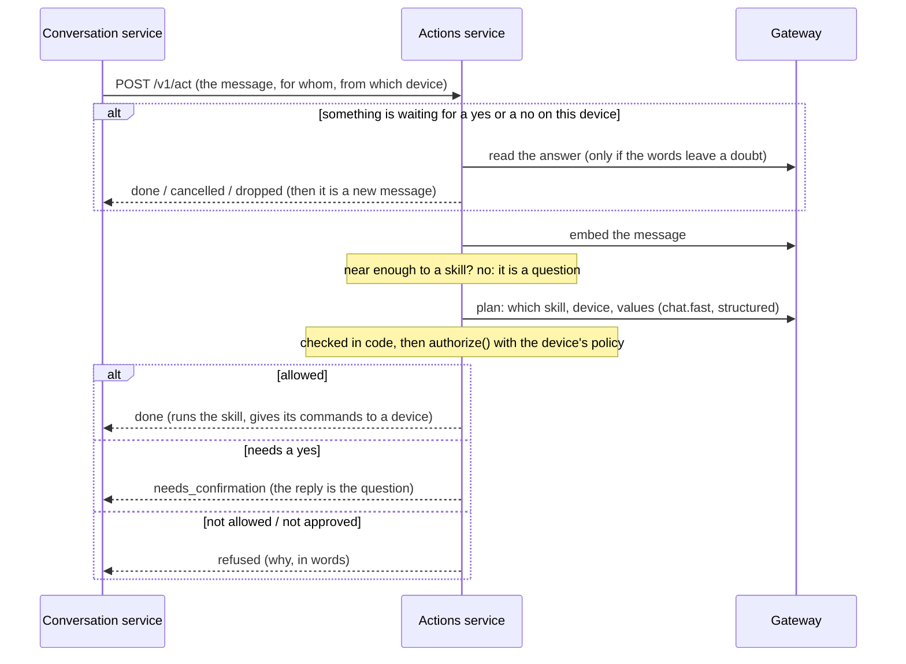

# The actions service

What a message asks to be **done**. The conversation service asks it, before it searches the
documents, whether a message is a request ("turn on the living room lamp") and not a question; if it
is, the actions service chooses the skill that does it, decides whether this device may have it done,
asks for a yes when it must, runs it and audits it. It **knows no model and no key** (a small model
reads the messages through the gateway, in the `chat.fast` role), and it **never runs anything on a
model's word**: the model proposes, and code decides ([ADR 0014](decisions/0014-actions-the-model-proposes-the-code-decides.md)).

*Implemented* (slice 5a): skills as folders in versions that never change, a catalog with review and
enabling, matching a message with the skills by meaning, the planner and the checks on what it says,
the decision with the policy of the device, confirmations (a yes or a no), approvals that fail
closed, the audit trail, English and Italian replies, the HTTP API, a container image, and the
asking from the conversation service. *Implemented* (slice 5b): **running a skill** (its script runs
in the isolated `runner`, [`runner.md`](runner.md)), **doing what a skill answers with on a device**
(over the edge), and **secrets for skills** (a file, for development). *Implemented* (slice 6):
**skills that are instructions**, which have no script: a model writes a plan from the notes, code
checks it, and the platform runs it in the sandbox ([`skills.md`](skills.md), [ADR
0016](decisions/0016-skills-that-are-instructions-a-model-writes-a-plan-the-code-decides.md)). *Not
yet*: approvals have no way to be asked (ADR 0007), a skill that needs a linked account does not run,
and the hub (slice 7) registers devices, keeps secrets and issues credentials.

## A message



The conversation service asks about **every** message. `NO_ACTION` is what most of them get, and it
costs one embedding and no model call when the message is far from every skill.

## Skills

A skill is a folder with a `SKILL.md` and, if it runs code, the scripts. The `SKILL.md` is YAML
frontmatter (the manifest of [ADR 0006](decisions/0006-skills-and-sandboxed-execution.md): name,
description, examples, target, parameters, required, device parameters, permissions, effect, confirm,
approval, entrypoint) between two lines of three dashes, then instructions or notes in markdown.
[`skills/`](../skills/README.md) has eight worked examples: a lamp, a garage door, a volume, the
weather and a router restart, each showing a different way an action is decided, and three that are
only instructions (an announcement, a scene for a movie, the air quality). How to write one is in
[`skills.md`](skills.md).

* **Versions never change.** A version is identified by the SHA-256 of the `SKILL.md` and of every
  other file, so changing a script is a new version and reading the same folder again is not one.
  Line ends and a byte-order mark make no difference. What is in a folder is limited (50 files,
  1 MB each, 5 MB in all), links are refused and a path cannot leave it.
* **One version runs, and enabling it is the review.** Installing a skill does nothing. An
  administrator reads what it declares (the catalog shows it) and *enables* a version: what that
  version declares (the hosts it may reach, the secrets it may be given, the accounts it may use) is
  granted as it is, and it becomes the version that runs. A new version does not run until it is
  enabled in its turn. Enabling an older version is going back.
* **Whose it is.** A person's skill is theirs and nobody else sees it, not even an administrator. The
  tenant's skills are its administrators' to manage and everybody's to use. Nothing about skills is
  managed through a device (ADR 0004): a call that arrives from one is refused.
* **Text or a folder.** `POST /v1/skills` takes the text of a `SKILL.md`, which cannot have scripts
  and so is for skills that only carry instructions (with no `entrypoint`, a skill is in
  *instructions* mode: it is followed by a model, see below). A skill with scripts comes from a folder
  (`FACTOTUM_ACTIONS_SKILLS_DIR`), read again with `POST /v1/skills/reload`. In development
  `FACTOTUM_ACTIONS_ENABLE_SKILLS_DIR=true` enables what is read as it is read, as if it had been
  reviewed: the service refuses to start with it anywhere else.
* **What a skill says about itself is what finds it.** Its description and each example are embedded
  with the embedding model of its owner and kept in that model's space. Enabling a version indexes it;
  one that could not be indexed (no model, the gateway away) is offered to the model unscored until it
  can be, so a skill works the moment it is enabled.

The protocol of a script is: parameters and the device's own parameters come in as JSON on standard
input (`{"params": ..., "device_params": ...}`), secrets it was granted as environment variables, and
it answers **one JSON object** `{"message", "data", "commands"}` on standard output, exits with 0, and
logs to standard error. A command is *data*: the platform gives it to a device after the checks, so
the sandbox needs no way back into the platform. **What is read is exactly those three fields**: a
script that misspells a key is a failure that names the key, and a script cannot say that nothing was
run. The examples follow it, and a test runs each of them as it is.

What loads is what can run: the entrypoint is a **Python** file, every file in the folder has a name a
container can be given (letters, digits, `.`, `-`, `_`), and a secret cannot be called what the runner
sets or what changes how a program starts (`PATH`, `HTTPS_PROXY`, `PYTHON*`, `LD_*`, `FACTOTUM_*`). A
script has the standard library and nothing installed.

## Choosing a skill

1. **Candidates by meaning.** The message is embedded and compared with what each enabled skill of
   the caller says about itself (the tenant's and their own). The skills that are at least
   `FACTOTUM_ACTIONS_MATCH_THRESHOLD` (0.45) near go on, the nearest first, up to six. If the
   message cannot be embedded the skills that could not be measured go on unscored, up to twelve.
   With no candidates the answer is `NO_ACTION` and no model is asked.
2. **A plan from a small model.** The model in `chat.fast` reads the message and the candidates, with
   the names of the devices the caller may use, and answers a structured `Plan`: *why* (a few words,
   which is what makes a small model get the rest right), which skill or none, which device, which
   values, the language, what to ask for a yes and what to ask for a missing value. It is shown 12
   examples as turns of the conversation it is in, and **it is never shown the conversation**, a
   document or a page: what plans an action is the message and nothing else. It is asked with the
   temperature at zero and cut off after 10 seconds.
3. **Checked in code.** The skill must be one of those offered. A skill that acts on a system device
   is aimed at the one named or, without a name, at the one that was spoken to (a name that is
   ambiguous is asked about). A skill that acts on an external device is aimed at the one named, or
   at the only one the caller may use that the skill is bound to; more than one is asked about, none
   is *there is no device set up for that*. Values are checked against what the skill declares:
   `"30"` for an integer becomes 30 and `"On"` becomes `"on"`, and a value outside the bounds or the
   choices, or a required one that is not there, is *needs more* and the reply asks for it. A
   sentence the model wrote to be spoken must be one printable line of moderate length or it is not
   said. **A plan that does not pass is not an action.**

A message the planner cannot read (the gateway is away, the model does not answer in time or with
something that is not a plan) is `NO_ACTION` with `degraded` set: it is answered as a question and
nothing runs, and the turn says in a warning that it could not be told whether it was a request.

## Deciding

What is left goes to `authorize()` (`factotum.common.authorization`), the one function that decides
whether an action may happen, with the policy of the device that was **spoken to**.

| The decision is | When | What happens |
| --- | --- | --- |
| **deny** | the skill or a device is not visible to the caller; the device's policy forbids the skill or its effect | refused, with the reason in words; audited |
| **require approval** | the skill asks for it (`approval: required`) or the device does | an approver is asked; none is set up, so refused (ADR 0007) |
| **require confirmation** | the effect is irreversible, the skill says `confirm: ask` for something with an effect, or there was untrusted text in the turn | the person is asked a plain yes or no |
| **allow** | otherwise | it is run |

The effect that counts is the more severe of the skill's and the device's: a garage door registered
with `sensitivity: irreversible` makes every action on it irreversible whatever the skill declares. A
shared device may by default start what can be undone (`max_effect: reversible`); a personal one may
start anything; a device may be given more or less in the file of devices.

With the example home: *"open the garage door"* to the **kitchen speaker** is refused (it may not
start what cannot be undone); to the **living room display**, whose administrator allowed it, the
answer is a question, and only a yes opens it; to the **phone** it is the same. The lamp is done at
once from any of them.

## A yes or a no

When the answer is to ask, what was understood is kept (the skill and its version, the values, the
device, the decision) for 60 seconds, **one at a time for a person on a device**, and the next
message on that device is read as the answer. It is read by its words where they leave no doubt
(*yes, sure, go ahead, sì, certo, fai pure...* and *no, don't, cancel, lascia stare, non ora...*)
and by the small model where they do, and **whatever is not clearly a yes is not one**: an answer
that adds something, a question, a message of more than 200 characters, a model that does not
answer are *other*, and *other* drops the question and takes the message as a new one.

* A yes is taken **once**: however many arrive, or however quickly, the thing is done once.
* When a yes is taken **nothing is assumed**. The version may have been disabled or replaced, the
  device removed, the policy made stricter: the action is decided again, and what is no longer
  possible is refused (`skill_not_enabled`).
* A yes authenticates nobody: it protects against a misunderstanding and against words that are not
  the person's own, and that is all it is asked to do (ADR 0004).
* A shared device has no history but it has this: what is asked on it is waited for on it.

## Approvals

An action that needs an approval goes to an `Approver`. There is no mechanism yet, so the
approver of a deployment answers *unavailable* at once and the action is refused: *"That needs
somebody's approval, and I have no way to ask for it."* Nothing is restarted by mistake because a
mechanism is missing. When there is one, an approval replaces the spoken yes, and the trail records
who approved.

## Running, and what a device is told

Two interfaces, each with a real implementation and a stand-in for when nothing is set up (what is
not set is not there, and the service says so when it starts):

* `SkillRunner.run(RunRequest) -> RunResult` runs a version of a skill with the values that were
  checked, the device's own parameters, what was granted and a time limit (the skill's own, and a
  margin). **`RemoteRunner`** runs the script in the runner service
  (`FACTOTUM_ACTIONS_RUNNER_URL`). **`DryRunRunner`**, without one, says what would have been run,
  marks it as such, and the trail records it as *not executed*.
* `CommandDispatcher.dispatch(tenant, device, command) -> CommandResult` gives a device a command
  the skill answered with, after checking that the device declared what the command needs.
  **`EdgeDispatcher`** gives it through the edge (`FACTOTUM_ACTIONS_EDGE_URL`, acting for the tenant).
  `NullDispatcher`, without one, reaches no device: the command is not done, and the person is told.

**What is settled on this side of the wire, before a script runs** (the runner knows nothing of
skills, tenants or devices):

* **The files** are those of the version that was enabled, read from the store: never what a caller
  sent, and never a newer version that has not been reviewed.
* **The secrets** are the ones the version declared, that were granted when it was enabled, and that
  are **its owner's own**. A skill a person wrote for themselves that asks for `HA_TOKEN` is given
  that person's, or does not run; it is never given the household's, however it is granted. A secret
  that is not set fails the run and is named (`the secret HA_TOKEN is not set`), never shown.
* **The hosts** are what the grant names, with the device's own host where it says `${device.host}`
  (one host, never a pattern, whatever the binding says). No hosts means no network.
* **A skill that needs a linked account** fails and says so: accounts come with the hub.

**What comes back** is read as a `SkillOutput` (`message`, `data`, `commands`, and nothing else) and
believed no further than that. A script that did not end well (a code that is not 0, too slow, killed
for memory), that printed something that is not one JSON document, or whose document is not one a
skill gives, is a failure of the skill, and **what the failure says is what is wrong and never what the
script said**. A command is given to a device only if the device declared what it needs, and a script
cannot choose the device: it is the one the skill was aimed at, or the one that was spoken to. What
the runner did not or could not do (unreachable, busy, does not know us) is `runner_unavailable`,
told to the person as *I cannot run that right now*.

**A skill that is instructions** goes through the same runner and the same `RunRequest`, and what is
different is what is run and how it came to be. There is no script: the notes are given to a model in
the `chat.main` role (`PlanWriter`), with the values the message gave, the *names* of what the skill
may reach and be given, and the language of the message, and it writes a **plan** (data: at most eight
steps, each a request or a command for a device, and what to say). `checks` decides whether the plan
may be run, against what the version was granted, before anything is sent, and the runner is given
`executor.py`, the program that does what a plan says, and the plan, in place of a script. What it
prints is read as a script's output is, and the commands go to a device the same way.
[`skills.md`](skills.md) is the language of a plan and what is checked. What is settled here:

* **The plan is written before the question.** When the decision is to ask a yes or a no, the plan is
  written and checked first, and kept in the confirmation with the rest of what was understood; the
  yes is read by its words as it always is, and when it comes the plan is checked once more against
  what is granted then. Nothing that a model writes comes after a yes.
* **A model is asked twice at most** for a plan (`FACTOTUM_ACTIONS_PLAN_ATTEMPTS`): a plan that the
  checks refuse is given back with which step and why, and the second is checked the same way.
  `FACTOTUM_ACTIONS_PLAN_TIMEOUT_S` is how long each question is waited for. A plan that could not
  be had is a `failed` outcome with a plain sentence, and the trail says `no plan: <why>`; what was
  run is `plan: POST host, ...`, without a value.
* **Without a runner, or without a gateway to ask, it is a dry run** as every skill is. The service
  starts to write plans only with `FACTOTUM_ACTIONS_RUNNER_URL` set.
* **The requests go out from the sandbox**, through the proxy, with the hosts the grant names: the
  actions service has no way to reach a network for a plan, so a plan cannot do what a skill that
  was not granted the host could not.

Everything before and after is as it was: the choice, the checks, the decision, the confirmation, the
reply, the trail. A skill that fails, times out or cannot be run is a `failed` outcome with a plain
sentence, and is audited; the log says why (which secret, which exit code, which status), with
nothing a script wrote but the end of its error output.

## The audit trail

Each step leaves a record: **asked** (the question was put), **declined**, **refused**, **executed**
(or *not executed*: a dry run, or something that was not there any more). A record has the skill, the
device that was spoken to and the one that was acted on, whom it acted for, the values (masked
where they look like a secret), the decision and its reasons, the confirmation, the approval and the
result. The contract refuses a record that says something ran without the confirmation or approval its
decision required, and there is no way to change or delete one. A trail that cannot be written is
logged; it does not turn an answer into an error.

Only the tenant's administrators read it (`GET /v1/audit`), never through a device, and
what each person did is theirs to see in the web app (slice 9).

## Replies

The answer to a request is not generated: it is one of a few sentences that say what happened, in the
language of the message, which the small model reads out of it. English and Italian are in
`phrases.py`; another language is answered in English until somebody adds it, and a test says that no
sentence is missing from either. What a skill says about its own result, and the question the model
wrote to ask for a yes, are said as they are.

## What goes wrong

| What | What happens |
| --- | --- |
| The gateway is away, or has no `chat.fast`, or the model is slow | the message is not an action: it is a question, and it is answered as one; the outcome says it was not read (`degraded`) and the turn warns |
| No embedding model, or it is slow | the skills that could not be measured go to the model unscored; without any, no action |
| The message is from a device that is not known | refused if it is an action, and nothing is done for it |
| A skill is disabled between the question and the yes | refused: *that is not available any more* |
| A skill fails or takes too long | `failed`, a plain sentence, audited; the log says why |
| The runner cannot be reached, is busy or does not know the service | `failed` with `runner_unavailable`: *I cannot run that right now* |
| A secret is not set, or the skill needs a linked account | `failed`; the log names the secret, never its value |
| A command is not done (the device is not connected, is slow, or the edge is away) | `failed` with `command_failed`: *I asked the device, and it did not do it* |
| The actions service is away (seen from the conversation service) | the turn goes on as a question and says so in a warning |
| The database is away | `/readyz` says so, and the calls fail |

## The HTTP API

Everything is under `/v1` and needs an authenticated caller (development headers until the hub).

| Route | What |
| --- | --- |
| `POST /v1/act` | `{message, untrusted_content_in_turn}` → the outcome: `status` (`no_action`, `done`, `needs_confirmation`, `needs_more`, `cancelled`, `refused`, `failed`), the `reply`, a `code` and the `reasons`; for `no_action`, `degraded` says the message could not be read |
| `GET /v1/skills`, `GET /v1/skills/{id}` | what is installed, which version runs, what was granted |
| `POST /v1/skills` | install the text of a `SKILL.md` (201; 200 if it is the very same skill) |
| `POST /v1/skills/reload` | read the folder of skills again (the tenant's, so an administrator's) |
| `POST /v1/skills/{id}/enable` | review a version (the latest, or `{"version": n}`) and enable it |
| `POST /v1/skills/{id}/disable`, `DELETE /v1/skills/{id}` | nothing runs of it / delete it with its versions |
| `GET /v1/audit` | the trail, the latest first: `before`, `limit` (up to 200), `skill`, `device` |
| `GET /healthz`, `GET /readyz` | liveness, and readiness (the database) |

Errors are `{"error": {"code", "message", "details"}}` like the other services. A skill that is
not there and one that is another person's are the same `404`.

## Configuration

`FACTOTUM_ACTIONS_*`, and the database is `FACTOTUM_POSTGRES_*`. Everything is documented in
[`.env.example`](../.env.example).

| Variable | Default | |
| --- | --- | --- |
| `_HOST`, `_PORT` | `127.0.0.1`, `8085` | loopback unless told otherwise |
| `_GATEWAY_URL` | `http://127.0.0.1:8081` | where the gateway is |
| `_RUNNER_URL` | none | where the runner is; without it a skill is a dry run |
| `_EDGE_URL`, `_EDGE_TIMEOUT_S` | none, `15` | where the edge is (without it commands are not done), and how long it is waited for to say what became of one |
| `_SECRETS_FILE` | none | the secrets skills are given (development only, `config/secrets.example.yaml`) |
| `_DEVICES_FILE` | none | the file of devices (development only), the one the edge reads too |
| `_SKILLS_DIR` | none | a folder of skills, read on `POST /v1/skills/reload` |
| `_ENABLE_SKILLS_DIR` | `false` | enable what is read as it is read (development only) |
| `_MATCH_THRESHOLD` | `0.45` | how near, by meaning, a message must be to a skill (0 to 1) |
| `_MATCH_CANDIDATES` | `6` | how many skills the model is shown |
| `_MATCH_TIMEOUT_S`, `_INDEX_TIMEOUT_S` | `4`, `8` | embedding a message, embedding a skill |
| `_PLANNER_TIMEOUT_S`, `_READER_TIMEOUT_S` | `10`, `6` | reading a message, reading a yes or a no |
| `_CONFIRMATION_SECONDS` | `60` | how long a yes or a no is waited for |
| `_APPROVAL_WAIT_S`, `_APPROVAL_MINUTES` | `20`, `10` | how long a turn waits for an approver, and how long a request is open |
| `_RUN_MARGIN_S` | `5` | added to the time limit of a skill |
| `_PLAN_TIMEOUT_S`, `_PLAN_ATTEMPTS` | `30`, `2` | how long a model is waited for to write the plan of a skill that is instructions (each try), and how many tries it has when the checks refuse a plan |
| `_MAX_DEVICES_SHOWN` | `10` | other devices the model is shown by name |

The conversation service is pointed at it with `FACTOTUM_CONVERSATION_ACTIONS_URL` (without one,
every message is a question) and told how long to wait with `FACTOTUM_CONVERSATION_ACTIONS_TIMEOUT_S`.

## Storage

Postgres, schema `actions`, migrations applied on start. Every table carries the tenant and every
query filters by it. `skills` (with the enabled version), `skill_versions` (the manifest, the
instructions, what was granted and by whom), `skill_files` (so that a version is whole),
`skill_vectors` (what a skill says about itself, by meaning, in the space of its owner's embedding
model), `confirmations` (one row at a time for a person on a device) and `audit` (only ever added
to). The vectors are compared exactly, not through an index: a home has tens of skills.

There are two implementations of the store, in memory and in Postgres, and the same tests run
against both.

## Trying it

The devices are those of [`config/devices.example.yaml`](../config/devices.example.yaml): copy it to
`config/devices.dev.yaml`, and put in it, as the `host` of the lamp and the garage door, where your
Home Assistant is (an address, or a name the DNS of the machine knows; `host.docker.internal` for one
on this machine). The secrets they need are in [`config/secrets.example.yaml`](../config/secrets.example.yaml):
copy it to `config/secrets.dev.yaml` and put your token in it. Bindings for the models are in
`config/bindings.dev.yaml` (see [model-gateway.md](model-gateway.md)); `chat.fast` and `embedding` are
the roles used here. The engine must be running (a script runs in a container of its own), and the
stack needs a key for the grants of the egress proxy, which is yours to make.

```bash
export FACTOTUM_POSTGRES_PASSWORD=dev FACTOTUM_ENVIRONMENT=development
export FACTOTUM_EGRESS_KEY=$(python -c "import secrets; print(secrets.token_urlsafe(48))")
export FACTOTUM_ACTIONS_ENABLE_SKILLS_DIR=true      # development: what is read is enabled
docker compose --profile services up -d --build --wait

# The examples are installed and enabled (and indexed by meaning), as an administrator:
curl -s -X POST http://127.0.0.1:8085/v1/skills/reload
curl -s http://127.0.0.1:8085/v1/skills | python -m json.tool

# A message, as the living room display (a device that may start what cannot be undone). The id of
# a device follows from its hardware id, so it is the same on every machine:
DISPLAY_ID=fa54fa4e-e63e-5b9a-b760-92a9c52f77bb
curl -s http://127.0.0.1:8083/v1/turns -H 'content-type: application/json' \
     -H 'x-factotum-dev-subject: tenant' -H "x-factotum-dev-device: $DISPLAY_ID" \
     -d '{"message": "open the garage door"}'
# ...a question ("Do you really want me to open the garage door?"), and the next message answers it
# (and the garage door is opened, through your Home Assistant, by a script in a container):
curl -s http://127.0.0.1:8083/v1/turns -H 'content-type: application/json' \
     -H 'x-factotum-dev-subject: tenant' -H "x-factotum-dev-device: $DISPLAY_ID" \
     -d '{"message": "yes"}'
```

Or as a device, which is how it will be used: `uv run factotum-terminal --profile smart-display`
and say *turn on the lamp*, *open the garage door* (it asks; say *yes*), *what is the weather in
Rome*, *restart the router* (it cannot be approved yet), *apri il garage*; and to the `speaker`
profile *set the volume to 30*, which the terminal shows as a command it was given (`[do] volume 30`).
Without `FACTOTUM_ACTIONS_RUNNER_URL` everything that is done is a dry run, and `GET /v1/audit` shows
the trail in either case.

## Tests

`uv run pytest` runs all of them, with no network and no model: the models are doubles that answer
what a test says, and every rule (the checks on a plan, the values, the decision, the confirmation,
the audit) is tested on its own and through the service. The store has one set of tests that runs
against both implementations; the ones that need Postgres are `integration` and skip without it. A
corpus of 82 messages (`factotum.actions.plan_cases`: 55 that ask for something, for the eight skills
that come with the project, and 27 that do not) is run through the whole service with a planner that
reads every one as it is meant, to keep the expectations honest; `tests/live` measures a real model
against it:

```bash
FACTOTUM_LIVE_TESTS=1 uv run pytest -m live services/actions/tests/live -s
# a model to try as the small one, and another way to embed:
FACTOTUM_LIVE_PLAN_MODELS=llama3.2:3b-instruct-q8_0,gemma3:4b  ...same command...
```

The plans of the skills that are instructions have a live test of their own
(`tests/live/test_live_instructions.py`, [`skills.md`](skills.md#what-was-measured)).

## Measured

On an RTX 3060 Ti (8 GB) with Ollama on Windows 11: `bge-m3` for the embeddings and a chat model in
the `chat.fast` role. The card was measured in two states, because it was in both: **shared** (something
else was using it, over half busy with nothing of ours running, so the models wrote 10 to 13 tokens
a second) and **idle** (60 tokens a second). The answers are the same in both, because the models
are asked with the temperature at zero, and the times are not, so they are given for each. One run of
each: read them as what to expect, not as exact figures. `tests/live` measures it again, and
measures any model you bind. The messages of slice 5a were the 61 that `factotum.actions.plan_cases`
had then, for five skills: 39 that ask for something to be done (some in the words of the skill's own
examples, some far from them, in English and Italian, said to the speaker, the display and the phone)
and 22 that do not, half of them worded to look like commands ("how do I turn on the lamp with Home
Assistant?", "should I close the garage door at night?"). Slice 6 added three skills and 21 messages,
and [its numbers](#eight-skills-slice-6) are further down.

### Telling commands from questions (slice 5a: five skills, 61 messages)

| | `llama3.1:8b-instruct-q4_K_M` | `llama3.2:3b-instruct-q8_0` |
| --- | --- | --- |
| Commands read exactly as meant (skill, device, values, what became of it) | 37 of 39 | 35 of 39 |
| Commands with the right skill | 39 of 39 | 38 of 39 |
| Questions left as questions | **21 of 22** | **14 of 22** |
| A message that is acted on, median (90th percentile), idle card | 2.5 s (2.9 s) | 0.83 s (0.93 s) |
| The same on the shared card | 8.1 s (9.1 s) | 4.4 s (4.8 s) |
| A yes or a no read as it was meant (22 replies, in both languages) | 22 of 22 | 20 of 22 |
| A yes or a no that a model has to read, median, idle card | 0.33 s | 0.20 s |
| A reply read as a yes that was not one | 0 | 0 |

The 8B model clears the bar the live test sets for a model in this role (85% of the questions left
as questions, 85% of the commands with the right skill, 75% exactly right). **The 3B model does not**:
it takes eight questions for requests, and that is the one mistake that matters, because it is the
one that does something nobody asked for. The checks in code stopped most of them (five ended as
*needs more*, three as *refused*), but one, a question about the weather in August, was *done*. A
model that small is fine for reading a yes or a no (it never took an answer for a yes that was not
one: what it got wrong, it got wrong on the safe side) and not for planning; both are the
`chat.fast` role, so the binding is one model, and the 8B is the one to bind.

What the 8B model got wrong, out of 61:

* *metti la luce al 50 per cento* was *needs more*: it left out that the lamp is to be **on**. The
  first example had `state` as a required value with nothing to say that a brightness alone means on
  (in English, the 40 percent one, it was right); the example now says so.
* *make the volume a bit lower* was **done**: it made up a level. No level was said, and the model
  was told never to make one up; the check in code cannot tell a made-up 20 from a said one, because
  it is a valid value. It is the limit of "the model proposes": see the limits.
* *what is the weather usually like in Rome in August?* was **done** as a request for the weather now.

### The meaning search

How near each message is, by `bge-m3`, to what the skills say about themselves (1 is the same):

| | Lowest | Median | Highest |
| --- | --- | --- | --- |
| A command, to the skill it asks for | 0.69 | 0.91 | 1.00 |
| A question, to the nearest skill | 0.37 | 0.65 | 0.86 |

| Threshold | Commands that go on to the model | Questions that do too |
| --- | --- | --- |
| 0.35 | 39 of 39 | 22 of 22 |
| 0.40 | 39 of 39 | 21 of 22 |
| **0.45** | 39 of 39 | 20 of 22 |
| 0.50 | 39 of 39 | 19 of 22 |
| 0.55 | 39 of 39 | 17 of 22 |
| 0.60 | 39 of 39 | 14 of 22 |

Meaning is **topic, not intent**. *How do I reset the router to factory settings?* is at 0.78 from
*restart the router*, and *should I close the garage door at night?* at 0.79 from *close the
garage*: no threshold separates a question about a lamp from a request to switch it, and the
questions in the corpus are chosen to be exactly those. What the threshold does is to spare the model
the questions about something else, which are nearly all of them (*what does the manual say about the
warranty?* never gets near). The nearest a command was to its skill was 0.69, a paraphrase; the
threshold is 0.45, so that no command is lost at the price of asking the model about the questions
that are on the subject of a skill. Raise it (0.55 loses no command here and lets through 17 of the
22 questions instead of 20) once you have seen where your messages fall; another embedding model puts unrelated texts
somewhere else.

### The cost of a message

A message that is far from every skill costs one embedding (0.07 s warm on the idle card, 0.15 to
0.6 s on the shared one). One that is near costs the model as well: 2.5 s with the 8B model on the
idle card, 0.8 s with the 3B, and 8 s and 4.4 s on the shared one. A yes or a no that the words
settle costs nothing; one that a model reads takes a fifth to a third of a second.

### In containers

The whole stack in containers (the five services and Postgres), Llama 3.1 8B in both chat roles and
`bge-m3`, the five example skills read from the folder and enabled as they were read, and messages
said to the kitchen speaker, the living room display and the phone through the conversation service,
and to the display and the speaker through the edge with the terminal client.

| | Idle card | Shared card |
| --- | --- | --- |
| Reading the five examples, enabling them and indexing them by meaning | | 2.7 s |
| A command (a lamp, the volume, the weather, a garage door that is asked about) | 2.7 to 3.3 s | 8 to 10 s |
| A yes or a no that the words settle ("yes", "no thanks") | 0.3 s | 0.5 to 0.7 s |
| A yes or a no that the model reads ("no, lascia stare") | 2.0 s | |
| A question about something else ("what is the capital of France?") | 2.0 to 6.6 s to the first text | 4.1 s |
| A question on the subject of a skill ("how do I reset the router?") | 3.6 s to the first text | 11.1 s |

What it said, in words: the lamp from the kitchen speaker is *(dry run) done*, in English or in
Italian (*Prova a vuoto: avrei eseguito lamp...*); the garage door from the kitchen speaker is
*"This device is not allowed to do that."*; from the display it is *"Do you want me to open the
garage door?"* (*"Vuoi davvero che apra il garage?"*), *yes* is *(dry run) done* and *no thanks* is
*"Okay, I will not do it."*; the router is *"That needs somebody's approval, and I have no way to
ask for it."*; *turn it up* is *"I still need: level."*; *turn on the lamp* from the phone, which
has two lamps, is *"Which one do you mean: Bedroom lamp, Living room lamp?"*, and *turn on my
lamp* is the bedroom one. Through the edge the display was sent `thinking`, then `acting`, then the
sentence to say and to show. `GET /v1/audit` had a record for each step (the question and the yes
are two): the skill, the decision, the confirmation, *not executed* (it is a dry run) and the
values (`{"action": "open"}`, `{"level": 30}`). With the actions container stopped, a message was
answered as a question with the `actions_unavailable` warning.

### Running skills (slice 5b)

The same stack plus the runner and the egress proxy, with the actions service pointed at both, on the
shared card (the desktop was using it: 44% and 7 of the 8 GB), with a stand-in for Home Assistant on the
host that checks the token, the five examples read from the folder and messages said to the display and
the speaker through the edge with the terminal client. **What a script does is the runner's**
([`runner.md`](runner.md#measured) has what a container costs); what is here is what the person
waits for.

| | |
| --- | --- |
| *yes*, to the question about the garage door: the door is opened by a script through the proxy, from the message to the reply (no model is asked) | **1.9 s** (the script took 1.8 s) |
| *what is the weather like in Rome* (two HTTPS requests to Open-Meteo through the proxy) | 5.2 s (the script 1.65 s) |
| *set the volume to 30* to the speaker: the command reaches the device 15 ms after the script ends | 5.0 s (the script 0.94 s) |
| *accendi la luce del salotto* to the speaker: the lamp is switched through the stand-in | 5.8 s (the script 1.44 s) |
| *restart the router* | 4.0 s: *That needs somebody's approval, and I have no way to ask for it.* |
| *open the garage door* to the speaker | 4.3 s: *This device is not allowed to do that.* |

What the stand-in for Home Assistant saw was exactly what should have reached it: the garage door
opened once and the lamp switched on once, each with the token and the entity of the binding. The
rest of the time is the models: on a card that is shared, the model that reads the message is 3 to 4
seconds of every command. The logs of the five services had no error; the three warnings were the
first messages after a pause, below.

### Eight skills (slice 6)

Slice 6 added three skills (a scene of two calls, a lookup of two requests, and an announcement that
only tells a device something) and the 21 messages for them: **82 messages, 55 that ask for
something and 27 that do not**, said to the speaker, the display and the phone, in English and
Italian. The 8B model in the `chat.fast` role and `bge-m3`, on the same card with only the desktop
on it (the whole live test took 2 minutes 12 seconds):

| | `llama3.1:8b-instruct-q4_K_M` |
| --- | --- |
| Commands read exactly as meant | 49 of 55 |
| Commands with the right skill | 53 of 55 |
| Questions left as questions | **27 of 27** |
| A message that is acted on, median (90th percentile) | 1.24 s (1.40 s) |
| A question that is passed over | 0.98 s |
| A yes or a no read as it was meant | 22 of 22, 0.30 s |

By skill: air quality 6 of 6, announcement 4 of 6, garage door 7 of 7, lamp 11 of 13, scene 3 of 4,
router 4 of 4, volume 7 of 8, weather 7 of 7. The 3B model was not measured again: it was the one that
took eight questions for requests with five skills, and it is not the model to bind to this role.
The times are those of a card with nothing on it, and half of what slice 5a measured on the same card
(2.5 s); the difference was not looked into.

What went wrong, six times in 82:

* *metti la luce al 50 per cento* was *needs more* and *make the volume a bit lower* was **done** with
  a level that nobody said: both as in slice 5a.
* *could you dim the lights to thirty percent* went to the scene (*dim the lights of the living room
  for watching a movie*) and not to the lamp, and *it is movie time* went to the announcement (*say
  that it is time to go*) and not to the scene: **two skills whose words overlap are confused**. Two
  of 55 commands went to the wrong skill, and none of 39 with five. The way out is in the skills
  (what each says about itself and its examples), not in the code.
* *annuncia che la cena è pronta* and *dì che è ora di andare* found the announcement, and the model
  gave it *Cena pronta* and *It's time to go* (translated) as what to say: a model does not always
  copy what it is asked to say aloud, even when the value says *as the person said it*.

Questions were better with more skills, not worse (27 of 27; 21 of 22 with five). The meaning search
does what it did: 55 of 55 commands go on to the model at a threshold of 0.45, the lowest at 0.69, and
25 of 27 questions do (the nearest, 0.86, is *what is the weather usually like in Rome in August?*).

Skills that are instructions have their own numbers, which are those of a model writing a plan and
not of one reading a message: [`skills.md`](skills.md#what-was-measured).

### What the measurements found

* **A run makes a container, and it is the cheapest part of the wait now.** About a second and a half
  where nothing else is going on; the model that reads the message is more than that on a card that
  is shared. Several runs at once wait for their turn (four at a time, five seconds) and are told
  that the runner is busy after that: the person hears *I cannot run that right now*.
* **A brightness alone still misses the lamp sometimes.** *Set the lamp to 30 percent* was answered
  *I still need: state* (the 8B model on the shared card left out that the lamp is to be on), after
  the example was changed to say that a brightness alone means on. It is the same weakness as in the
  table above, and a skill that a person writes will have it too: the way out is in the skill (a
  value that is optional and that the script defaults) and in slice 6, not in the code that checks.
* **A busy card makes the assistant deaf, and quietly.** The first run of the corpus, with the
  defaults (4 s to embed a message, 10 s to plan it), gave up on a third of the messages (14
  embeddings and 6 plans timed out): with the card shared a plan took 8 to 10 s. A message that
  cannot be read is answered as a question, so nothing ran that should not have, but nothing ran
  that should have either. Through the edge, on the shared card, **every** command was answered as a
  question ("I didn't find a way to turn on the lamp in your documents."), and one of them, *open
  the garage door*, was answered by the language model with "*beep* Open.". It is now reported: the outcome
  says that the message could not be read (`degraded`), and the turn says so in a warning; **the
  edge does not pass warnings on to devices**, so a device says nothing. On a card that is used for
  something else, raise `FACTOTUM_ACTIONS_PLANNER_TIMEOUT_S`, or bind a faster model.
* **Small models are far apart at telling a question from a request**, where they were not at telling
  whether a message refers to the past (`conversation.md`): the 3B model is right about 64% of the
  questions and the 8B about 95%.
* **Two things made the model miss the lamp, and were the example's**, not the model's: a required
  value that a person does not say, and Italian. Skills are read by a model: what they say about
  their values matters as much as what they say about themselves.
* **A model that is not loaded is a slow first message.** Ollama unloads a model after five minutes
  of silence, and the first message after that waits for it to be loaded (5 to 30 s), which is
  longer than the planner is waited for. The first two messages of the run in containers were
  answered as questions for that reason.

## Known limits

* **No approvals**: a skill that needs one is refused until there is a way to ask (ADR 0007). The
  router example cannot be restarted until then.
* **No linked accounts**: a skill that declares one fails and says so, until the hub links them
  (slice 7). Secrets are in a file for development, refused anywhere else, until the hub keeps them.
* **Scripts are Python and the standard library**, in a container of the level of isolation that
  ADR 0015 describes: fine for code the household wrote or trusts, not for a stranger's.
* **A skill installed as text has no scripts**, only instructions, which a model turns into a plan.
  A plan is a straight line of at most eight steps (no conditions, no loops), its requests are HTTP(S)
  (no MQTT: there is no broker to reach and the proxy tunnels to port 443 only), and a model never
  reads what a service answers, so a skill that has to decide on an answer is a script. How close
  the plan is to what the notes say depends on the model: see [`skills.md`](skills.md#what-was-measured).
* **The reply is one sentence per outcome** (in English or Italian): a request that is made of
  several actions ("turn on the lamp and open the garage") is read as one, and the model picks one.
* **The threshold is a property of the embedding model**: 0.45 was set with `bge-m3`. Another model
  puts unrelated texts nearer or further apart; the live test prints where they fall. And meaning
  is topic, not intent: a question about a skill's subject always reaches the model.
* **A value that a model makes up is a value.** The checks in code refuse what is not the type, the
  choice or the range the skill declares, and ask for what is missing; they cannot tell a level of
  20 that a person said from one that a model made up ("make the volume a bit lower"). A skill that
  has an effect and takes a number should be one that asks first, and the question the model writes
  says what will be done. A check that a value appears in the message is possible (numbers written as
  words in every language are what makes it not simple) and is not done.
* **A device is not told when the actions could not be asked.** The turn says so in a `warning`, and
  the edge does not pass warnings on to devices (`edge.md`), so a device whose planner was too slow
  answers a command as a question and does not say why. What a device should say about it (a spoken
  notice, a mark on a screen) is a decision about the voice, not about the protocol.
* **A question that the person is asked is not carried.** "Which one do you mean: Bedroom lamp,
  Living room lamp?" is answered by saying the whole request again ("turn on the bedroom lamp"): an
  answer such as "the bedroom one" is a new message, which is near no skill. Carrying the request
  over the question is a change to the conversation (it would have to know what was being asked).
* **A message that is several requests is one.** "Turn on the lamp and open the garage" is read as
  whichever the model picks, and the other is lost.
* **The audit trail can be a record short** if it cannot be written after something was done; it
  says so in the log.
* **The devices are a file** until the hub registers them.
