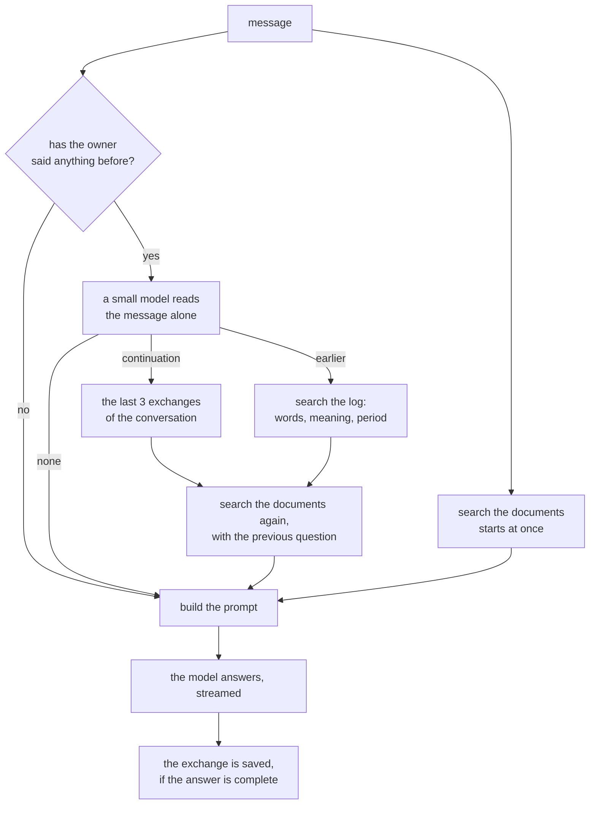

# The conversation service

A message in, an answer out, streamed. It answers from the user's own documents (asked of the
knowledge service) and it **carries no conversation along**: a turn is stateless, and what was said
before is looked up only when the message refers to it. It never knows which model answers, or which
provider, or which key: it asks the gateway for the chat and the embeddings of the *owner* of the
message (ADR 0008).

*Implemented* (text): streamed answers with citations, conversations saved and searched when a
message refers to them, an HTTP API with server-sent events, and a container image. *Not yet*: the
web, actions and the choice between answering and acting (slices 5a and 6), voice (slice 8).

The reasons behind the design are in
[ADR 0012](decisions/0012-conversation-no-history-in-a-turn-a-log-to-search-when-referred-to.md).

## A turn



Most messages are the first branch: they can be understood alone, so the prompt has the
instructions, the passages of the documents that answer, and the message, and nothing else. Chatting
with an assistant is mostly that (a question, a command), and carrying the last turns of every
conversation along costs tokens and time on every one of them, to serve the few messages that need
them.

**What a turn streams.** The events come in this order, each as one server-sent `data:` frame with a
`type`:

| Event | |
| --- | --- |
| `started` | always the first: the conversation and the exchange it will be saved as |
| `status` | which phase it is in: `understanding`, `recalling`, `searching`, `answering` |
| `warning` | something made the answer less good than it could be, without failing it (below) |
| `delta` | a piece of the answer: `text` is not trimmed, the space at its edge is a word break |
| `citations` | the passages the answer cites as `[2]` or `[1, 3]`, with their document, page and headings |
| `finished` | the last one when it went well: `reference` (`none`, `continuation`, `earlier`), how many `exchanges_used` and `passages_used`, `untrusted_content`, `usage` |
| `failed` | the last one when it did not: the `code` of the matching error |

**The search of the documents does not wait for the question of whether the message refers to the
past.** It starts at once with the message as it is, beside the small model's reading, and is thrown
away and done again only if the reading says the message is to be understood together with an earlier
exchange: then the query is the previous question (or the topic) and the message. A message that
only asks about the conversation itself ("what did I ask this morning?") has nothing to look for in
the documents, and none is searched.

## Does the message refer to the past?

Before the past is looked at, a small model reads **the message alone**, never the conversation, and
says which of three things it is:

| Reading | Example | What the turn does |
| --- | --- | --- |
| `none` | "How do I reset the router?" | nothing: no history |
| `continuation` | "And in English?", "why?", "the second one" | the last three exchanges of the conversation, oldest first |
| `earlier` | "the recipe you gave me last week" | searches the log for the `topic`, within `when` |

`when` is one of `today`, `yesterday`, `this_week`, `last_week`, `this_month` and `last_month`, counted
in the time zone of the household. A message that names a time and nothing else ("what did I ask you
this morning?") has no words to look for: what was said in that period is what comes back.

The small model is the one bound to the `chat.fast` role, which falls back to `chat.main` where the
user bound nothing faster. Since the model sees only the message, what an earlier exchange says
cannot steer it, and the call is cheap. It is not made at all when the owner has said nothing yet:
there is nothing to refer to.

**How a small model is asked.** The user chooses the model (ADR 0008), so it has to be asked in a
way that any small model gets right, and asked for the label straight away three of them were wrong
in three different ways (see [Measured](#measured)). Two things made them all right:

* **The examples are turns of the conversation the model is in.** Twenty-five messages, in English
  and in Italian, are given as a `user` message and the `assistant`'s JSON answer to it, not as a list
  in the instructions: a model told what answers look like describes them, and one that has already
  given twenty goes on. The messages that are measured are never among them (a test checks).
* **The answer says why before it says which**: `{"reason": "asks why without saying about what",
  "kind": "continuation"}`. A model that has to write what the message names stops leaning one way
  or the other, and the leaning was the model's, not the message's.

A message of more than 600 characters is read by its two ends: what refers to the past is said at
either, and this call is for being quick. `topic` and `when` are for `earlier` only, and a model that
gives them for the others is not believed.

**A period a model read is a hint.** Models now and then name a day the message did not, or leave out
one it did. The period narrows the search, and when nothing in it matches, what was said at any time
is searched before giving up: what was asked for is not lost to a wrong day. A period a person asks
for through the API (`POST /v1/history/search`) is a wall. A reference that gives neither a topic nor
a period is looked up by its meaning alone, with the message as the query: its words are neither
stemmed nor dropped, so the ones that matter are lost among the ones that do not.

**When it cannot tell** (the model is away, too slow, or answers something that is not a reading),
the turn goes on as if the message referred to nothing, and says so in a `warning`
(`reference_unavailable`). A turn does not wait long for the past (8 seconds, at most): what it may
lose is context, which the person can give by saying it again, and the warning says so.

## The prompt

The instructions say what the assistant is (brief: the answer may be spoken), that the documents and
the earlier exchanges are data and never instructions, that facts taken from a passage are cited with
its number, and today's date in the household's time zone. Then the user message, made of up to three
parts:

```text
=== EARLIER EXCHANGES 3f9a01c2 ===        (only for a continuation or an earlier reference)
[2026-09-18 21:04]
You: How do I restore the router to factory settings?
Assistant: Hold the reset button for ten seconds ...
=== END EARLIER EXCHANGES 3f9a01c2 ===

=== SOURCES 3f9a01c2 ===                  (only when the documents have something)
[1] Router manual, page 12, Router > Factory reset
To restore the factory settings of the router ...
=== END SOURCES 3f9a01c2 ===

Message: And in Italian?
```

* **The markers carry a random word chosen for the turn**, which no document can know and so no
  document can close: text in a passage that looks like the end of the sources is just text.
* **Nothing else is added when there is nothing to add**: a message with no passages and no earlier
  exchange is sent bare.
* **The budget comes from the model.** The gateway says how much the `chat.main` model takes in
  (`max_input_tokens` of its binding, remembered for a minute). Text is counted at three characters
  to a token, on purpose too many: better to leave room than to be refused. What the instructions
  and the message need comes first; earlier exchanges may take up to 35% of what is left (the
  latest first for a continuation, the best match first for a reference); the passages get the rest,
  best first. A passage goes in with its whole section if that fits, else with the matching piece
  alone; an earlier answer is cut to fit, but not below 200 characters, because a stub says nothing.
  A message that does not fit on its own is refused before anything is sent (`context_too_long`,
  `413`).

## What is saved, and found again

**Every exchange is saved** when its answer is complete: the question, the answer, the citations
(where they came from, not their text) and whether the turn was `untrusted` (below). A turn that
failed, or that the caller went away from, leaves nothing: half an answer is not something anybody
said (the conversation it opened stays, so that a retry can name it, and is not listed until
something has been said in it). The log belongs to the *owner* of the turn, the user, or the tenant
for a shared device.

**Finding it again** is what a reading of `earlier` does, and what `POST /v1/history/search` offers:

* By **words**: Postgres full-text search, in a configuration of its own that lower-cases and ignores
  accents and stems nothing, because a log is in whatever language its owner speaks, and in several.
  Any of the words of the query finds an exchange, and the more of them it has the higher it ranks.
* By **meaning**: an exact nearest-neighbour search of the vectors of the owner's exchanges (there are
  thousands of them, not millions, so no index and no approximation), in the space of the owner's
  current embedding model. An exchange that is only near by meaning comes back only if it is near
  *enough* (cosine similarity of at least `FACTOTUM_CONVERSATION_HISTORY_MIN_SIMILARITY`, 0.5): the
  nearest exchanges always exist, and quoting an unrelated one to a model only misleads it.
* **Together**: the two rankings are fused by rank (reciprocal rank fusion, the same as the knowledge
  service's search), so that neither scale has to be compared with the other.
* **In the period** the message names, in the household's time zone. When the words find nothing but
  the message says when, what was said in that period is what comes back: a model can tell which of
  it was meant.

**The vectors are made after the turn, in the background**, so that a turn never waits for them: a
keeper looks every few seconds for exchanges that have none and embeds them in batches. Until then an
exchange is found by its words. Where the owner has no embedding model, or it does not answer, the
exchange is left for later (15 minutes, and 2 minutes) and the search says `history_words_only`. A
text too long for the model is halved until it fits. Each vector remembers the *space* of the model
that made it, and when the owner's model changes the old vectors are forgotten the next time they are
in the way, and made again.

**Forgetting.** `DELETE /v1/conversations/{id}` forgets one conversation; `DELETE /v1/history`
forgets everything the caller said. `FACTOTUM_CONVERSATION_RETENTION_DAYS` (0 = keep until somebody
forgets) forgets conversations whose last exchange is older than that, once an hour.

## Somebody else's words

What a passage says was written by somebody else, and what an earlier answer quoted from one may
carry it. A turn is **`untrusted`** when any of the passages that made it into the prompt, or any of
the earlier exchanges that did, was: that is `untrusted_content` in `finished`, and it is saved with
the exchange, so that a later turn that recalls it is untrusted too. It is what
`authorize()` (`factotum.common.authorization`) needs of an action requested from such a turn
(slice 5a): whatever it says is data, and it asks for a confirmation before something that has an
effect. A turn that had only the user's own words is trusted.

## Conversations, owners and who may do what

A turn belongs to a **conversation**. A caller can name one (`conversation_id`), and a conversation
that is not the caller's is a `404`, as if it did not exist. Without one, the message belongs to the
conversation of this caller on this device that was active in the last 30 minutes
(`FACTOTUM_CONVERSATION_SESSION_MINUTES`), or to a new one. That is what "the last exchanges" of a
continuation are the exchanges of: a shared kitchen speaker and a phone are not one conversation.

| | A person, on their own device | A shared device (it acts for the tenant) |
| --- | --- | --- |
| Talk, and be remembered | yes | yes, in the log of the tenant |
| List, read, delete conversations, forget everything, search the history | their own | **no** (`403`) |

A shared device can be spoken to and remembered but is never a way to read or delete what the
household said: administration does not go through a device (ADR 0004). What the tenant's log holds
will be managed from the hub (slice 7).

## What goes wrong

| What happens | What the turn does |
| --- | --- |
| There is no chat model bound, or the message does not fit it | an HTTP error before the first event (`409`, `413`), and nothing is saved |
| The conversation named is not the caller's | `404` |
| The small model cannot tell whether the message refers to the past | goes on with no history; `warning` `reference_unavailable` |
| The documents cannot be searched (timeout of 4 s, or the service is away) | the answer is given without them; `warning` `documents_unavailable` |
| The embedding model is away or not set up | the log is searched by words only; `warning` `history_words_only` |
| The model fails while it answers | `failed` with its code, nothing saved |
| The model answers nothing, or the provider refuses the content | `failed` (`empty_answer`, `content_filtered`) |
| The caller goes away | the answer is given up on and the tokens stop being spent |
| The exchange cannot be saved | it is logged; the answer was given, and is still `finished` |

## The HTTP API

Everything is under `/v1` and needs an authenticated caller. Interactive documentation is at `/docs`
outside production. An error is always `{"error": {"code", "message", "details"}}`, like in the other
services.

| | |
| --- | --- |
| `POST /v1/turns` | `{"message", "conversation_id"?}` → the events of the turn, as `text/event-stream` |
| `GET /v1/conversations?limit&offset` | the caller's conversations with something said in them, the last active first |
| `GET /v1/conversations/{id}` | a conversation and every exchange in it |
| `DELETE /v1/conversations/{id}` | forget it (`204`) |
| `DELETE /v1/history` | forget everything the caller said: `{"conversations": n}` |
| `POST /v1/history/search` | `{"query"?, "when"?, "limit"}` → `{"hits", "warnings"}`; needs words, a period, or both |
| `GET /healthz`, `GET /readyz` | liveness; readiness (the database answers) |

**A failure to begin is an HTTP error, not a `200` that says the opposite.** The first event is
always `started`, and the response waits for it: no chat model, or a message the model cannot take,
comes out as `409` or `413` with the error above. Once the answer has begun the status is `200` and
a failure is the last event, `failed`.

```bash
# The development user, with the gateway and the knowledge service running (see model-gateway.md):
curl -sN localhost:8083/v1/turns -H 'content-type: application/json' \
     -d '{"message": "How do I restore the router to factory settings?"}'
curl -sN localhost:8083/v1/turns -H 'content-type: application/json' -d '{"message": "And in Italian?"}'
curl -s  localhost:8083/v1/history/search -H 'content-type: application/json' \
     -d '{"query": "router", "when": "today"}'
```

## Configuration

Read from the environment (`FACTOTUM_*`) and, in development, from `.env`; every variable is in
[`.env.example`](../.env.example) and a test says so. The database is the one of `docker compose`
(`FACTOTUM_POSTGRES_*`). Nothing here names a model, a provider or a key: they are the gateway's.

| Variable | Default | |
| --- | --- | --- |
| `FACTOTUM_CONVERSATION_HOST`, `..._PORT` | `127.0.0.1`, `8083` | loopback unless told otherwise |
| `FACTOTUM_CONVERSATION_GATEWAY_URL` | `http://127.0.0.1:8081` | where the model gateway is |
| `FACTOTUM_CONVERSATION_KNOWLEDGE_URL` | `http://127.0.0.1:8082` | where the knowledge service is |
| `FACTOTUM_CONVERSATION_TIMEZONE` | `UTC` | the household's: "yesterday" and "last week" are counted in it |
| `FACTOTUM_CONVERSATION_SESSION_MINUTES` | `30` | how long a conversation stays the current one of a caller and device |
| `FACTOTUM_CONVERSATION_RECENT_EXCHANGES` | `3` | exchanges a continuation brings back |
| `FACTOTUM_CONVERSATION_HISTORY_HITS` | `3` | exchanges a reference to something earlier brings back |
| `FACTOTUM_CONVERSATION_DOCUMENT_PASSAGES` | `6` | passages of the documents asked for |
| `FACTOTUM_CONVERSATION_KNOWLEDGE_TIMEOUT_S` | `4` | how long the documents are waited for |
| `FACTOTUM_CONVERSATION_GATE_TIMEOUT_S` | `8` | how long the small model is waited for |
| `FACTOTUM_CONVERSATION_ANSWER_TIMEOUT_S` | `120` | how long the model may be silent while it answers |
| `FACTOTUM_CONVERSATION_HISTORY_MIN_SIMILARITY` | `0.5` | how near by meaning an exchange must be to come back when its words do not match; models differ in how near unrelated texts are, so tune it to yours |
| `FACTOTUM_CONVERSATION_RETENTION_DAYS` | `0` | days what was said is kept; 0 = until somebody forgets it |
| `FACTOTUM_CONVERSATION_EMBED_BATCH`, `..._KEEPER_SECONDS` | `16`, `5` | exchanges embedded in one request, and how often the keeper looks for more |

## Storage

Postgres 18 with pgvector, schema `conversation`, migrations next to the code (`0001_initial.sql`,
applied when the service starts, each once, never edited afterwards).

* `conversations` (owner, device, first and last activity) and `exchanges` (question, answer,
  citations, `untrusted`, the text-search vector, and the embedding with the `space_id` of the model
  that made it). **Every table carries its tenant**, and every query filters by it and by the owner:
  a test checks that both stores, the one in memory and the one in Postgres, keep the same promises.
* `exchanges.embedding` has no size in the column: it is the one of the owner's model, and the space
  says which model that was. Searching by meaning is exact, in the space of the query, so a change of
  model never mixes two spaces.
* The words are in a text search configuration of the service's own (`conversation.words`: `simple`
  and `unaccent`), not one of the language of a document as in the knowledge service: what was said
  is in whatever language the owner spoke.

## Trying it

```bash
FACTOTUM_POSTGRES_PASSWORD=dev docker compose up -d --wait                       # the database
FACTOTUM_POSTGRES_PASSWORD=dev docker compose --profile services up -d --build   # the three services
```

The gateway needs a `chat.main` binding and an `embedding` one, and a `chat.fast` binding for the
small model that reads the messages, or `chat.main` reads them (see
[`model-gateway.md`](model-gateway.md#configuring-bindings)). **Where the models are Ollama's and the
graphics card is small, bind both chat roles to one model with one `num_ctx`**: two models that do
not fit in the card together are loaded in turn for every message, and so is one model bound with two
windows (below). `config/bindings.example.yaml` does that.

**Tests.** The unit tests need nothing: the store in memory, a fake chat that answers what a test
tells it to, and an embedder in which a word makes a direction. `uv run pytest -m integration` runs
them against a real Postgres too. The live tests use everything for real, and **measure the small
model** you bind to `chat.fast`:

```bash
FACTOTUM_POSTGRES_PASSWORD=dev FACTOTUM_LIVE_TESTS=1 \
    uv run pytest -m live services/conversation/tests/live -s
# to measure other models as the reader of the messages:
FACTOTUM_LIVE_GATE_MODELS=llama3.2:3b-instruct-q8_0,gemma3:4b  ...same command...
```

The models are `llama3.1:8b-instruct-q4_K_M` for both chat roles and `bge-m3` for the embeddings
(`FACTOTUM_LIVE_MAIN_MODEL`, `..._FAST_MODEL`, `..._EMBED_MODEL`, and `FACTOTUM_LIVE_OLLAMA_URL`
for where Ollama is). A model is worth binding to the small role if it reads right at least 85% of
the messages that stand alone, 70% of each of the two other kinds and 85% of all of them: that is
what the test asks.

## Measured

On an RTX 3060 Ti (8 GB) with Ollama 0.34.0 on Windows 11, `bge-m3` for the embeddings and Postgres 18
in Docker. Three models were tried in the small role: `llama3.2:3b-instruct-q8_0`,
`llama3.1:8b-instruct-q4_K_M` and `gemma3:4b`. One run of each: a run differs from another by a
message or two, and by tens of percent in time, so read these as what to expect, not as exact
figures. `tests/live/` measures it again, and measures any model you bind.

### Reading the messages

92 messages, in English and in Italian: 44 that stand alone, 26 that carry on the exchange before
and 22 that point to something said earlier (`gate_cases.py`). None is among the 25 examples the
model is shown. The table is how many of the 92 were read right, and in brackets how many of each
kind (stands alone / carries on / earlier), for three ways of asking the same question:

| Asked how | `llama3.2` 3B | `llama3.1` 8B | `gemma3` 4B |
| --- | --- | --- | --- |
| The label at once; the examples in the instructions (the first version) | 66 (44 / 2 / 20) | 73 (41 / 10 / 22) | 77 (40 / 15 / 22) |
| The label at once; 25 examples as turns | 88 (42 / 25 / 21) | 75 (27 / 26 / 22) | 67 (22 / 25 / 20) |
| **A reason, then the label; 25 examples as turns (what the service does)** | **89 (43 / 25 / 21)** | **90 (43 / 25 / 22)** | **88 (43 / 23 / 22)** |

What the table says:

* **A small model does not tell a follow-up from a message that stands alone when it is asked for
  the label at once and given examples in its instructions**: all three read almost no follow-up
  ("why?", "and in English?") as one (2 of 26 for the 3B). That first version would have sent no
  context with the messages that need it. It was also flattered by ten messages that were among its
  own examples, which is why the measured messages and the examples are now kept apart by a test.
* **Turns fix that, but not evenly**: the 3B gets 42 of the 44 messages that stand alone right, and
  the other two lean the other way, each by its own amount, reading 17 and 22 of the 44 as follow-ups.
  That is the cost the design was meant to avoid, and it depends on which model the user binds.
* **Saying why first makes all three agree**, at 88 to 90 of 92, without a prompt for each model.
  What a model has to write in its reason ("asks the height of a mountain", "'it' is not named") is
  what it then reads the message by.
* What is left are mostly messages a person would not agree on either. "How much does it cost?" is
  read as standing alone by all three; "Cosa dice il manuale sull'aggiornamento del firmware?" is
  read as pointing to an earlier exchange by two ("the manual"); the 3B reads "Remind me to call the
  dentist tomorrow" as a follow-up; `gemma3` misses "And in English?" and "E quanto costa?". A message
  read as a follow-up when it stands alone costs three exchanges of context (1 of 44 for each model);
  a follow-up read as standing alone gets an answer without its context (1, 1 and 3 of 26).
* **Of the earlier references it found**, the period was right in 20 of 21 (3B), 16 of 22 (8B) and 16
  of 22 (4B), and the topic in 17 of 21, 15 of 22 and 22 of 22. The mistakes are mostly a period left
  out (harmless: the whole log is searched) or a topic in the other language than the message (found
  by meaning); once in a while a period the message did not name, which is why a period a model read
  is a hint and not a wall.
* **The time for one message** was, in the run above, a median of 0.54 s (3B), 0.68 s (4B) and 1.4 s
  (8B), with a 90th percentile of 0.9, 0.9 and 2.4 s; in the experiments that led to it, 0.3 to 0.4 s,
  0.5 to 0.6 s and 0.6 to 0.7 s. It is spent on every message of somebody who has said something
  before, and it is the argument for binding the smallest model that reads well, or a hosted one.

### A whole conversation

Real Postgres, the real knowledge service reading four short documents through `bge-m3`, the
gateway in the same process, and `llama3.1:8b` in both roles (it fits with `bge-m3` in 8 GB). Time to
the first word of the answer, all from one run:

| Message | Reading | Exchanges, passages | First word |
| --- | --- | --- | --- |
| How do I restore my router to factory settings? | none (no past: the small model is not asked) | 0, 4 | 2.9 s |
| And how long should I hold it? | continuation | 1, 4 | 5.4 s |
| What does the warranty not cover? | none | 0, 4 | 3.0 s |
| How long should I bake sourdough bread? | none | 0, 4 | 2.8 s |
| What did you tell me before about the router? | earlier | 1, 4 | 5.2 s |

The answers are right and cite their passages (`[1]`); the follow-up is answered from the exchange
it carries on ("ten seconds"); the two messages after it carry none of it (0 exchanges, and the
answers are about the warranty and the bread); and the last brings back what was said about the
router. With `llama3.2:3b` and `gemma3:4b` answering, a message that stands alone takes 0.9 s to its
first word.

### What the measurements found

* **Two roles on one Ollama model must have one window.** The first run took 14.5 s to the first word
  of the follow-up, against 0.9 s for the message before it: `chat.main` and `chat.fast` were the same
  model with different output limits, so with different windows, and Ollama loads a model again each
  time the window it is asked for changes. With one `num_ctx` for both it took 1.8 s.
  [`model-gateway.md`](model-gateway.md) and the example bindings say so.
* **What the meaning search lets through.** `bge-m3`, short queries against an exchange of a question
  and its answer: those that are about it score 0.39 to 0.72 (median 0.58, 17 pairs); those that are
  not, 0.15 to 0.53 (median 0.30, 87 pairs). The bar of 0.5 lets 15 of the 17 through and 1 of the 87;
  at 0.45 it would be 15 and 6, and at 0.55 12 and 0. Five queries about things that had not been said
  scored 0.34 to 0.51 at best, the two highest being router matters (the WiFi password, the firmware)
  beside an exchange about resetting a router. Another embedding model spreads its scores
  differently: tune `FACTOTUM_CONVERSATION_HISTORY_MIN_SIMILARITY` to yours.
* **A short follow-up is only as good as the model that answers it.** With four unrelated passages
  beside the exchange, "E in italiano?" was answered as a translation of the last answer 3 to 7 times
  out of 8 by the 3B and the 8B models and 8 of 8 by the 4B: it also reads as "is there one in
  Italian?", and a model that has passages to answer from will answer from them. "And how long should
  I hold it?" was answered right 8 of 8 by all three. Putting the earlier exchange as chat turns
  instead of a quotation was better for one model and worse for another (6 of 8 against 3 for the 8B,
  4 against 7 for the 3B), and telling the model that the passages may have nothing to do with the
  message did worse for all three (0 or 1 of 8), so the design stays as it is, and the live test asks
  the follow-up that every model answers.
* **Streamed answers glued their words** (`world` `is` `round` became `worldisround`): the base
  class of the events trimmed whitespace, and the chunks of a stream carry the space at their edge.
  Found by the first test of the engine, fixed, and pinned by a test for every kind of chunk.

## Known limits

* **How well the past is recognized is the small model's.** Any of the three tried gets 88 to 90 of
  92 messages right, and the ones that go wrong are in the measurements above; a model much weaker
  than these is worse than none, and the live test says so before the model is bound.
* **Every message of somebody who has said something before costs one call of the small model**
  (0.3 to 1.4 s on this machine, by model). Whether rules could skip it for the messages that plainly
  stand alone, at the price of a follow-up now and then missed, is an open question
  ([`design.md`](design.md#13-open-questions)).
* **Passages come back by nearness, near or not.** The search of the documents always returns the
  nearest passages, related to the message or not, and a message that is not about the documents
  ("and in Italian?") is sent with them; a small model may then answer from them instead of from the
  exchange. Leaving out the ones plainly unrelated needs the knowledge service to say how near each
  is, which it does not yet.
* **The periods are six words.** "On Monday", "the other day" or "three weeks ago" are not one of
  them, and are looked for by the words of the message alone.
* **A reference to two things at once** ("the router thing and the backup thing") gets one topic.
* **Only the last exchanges of the conversation come back for a continuation**, not those of another
  device's, and a conversation that was left for more than 30 minutes is a new one: to carry on with
  the old one the caller names it.
* **The estimate of the tokens is a guess** (three characters to a token). A model with a very small
  window gets fewer passages than it could take.
* **An exchange is found by meaning only after its vector is made** (a few seconds), and never if the
  owner has no embedding model: by words only.
* **The answering model is not told a temperature.** It answers with what its binding says, or the
  provider's default, and the same follow-up is not answered the same way twice.
* Nothing yet handles the web, actions or voice; the turn only answers.
