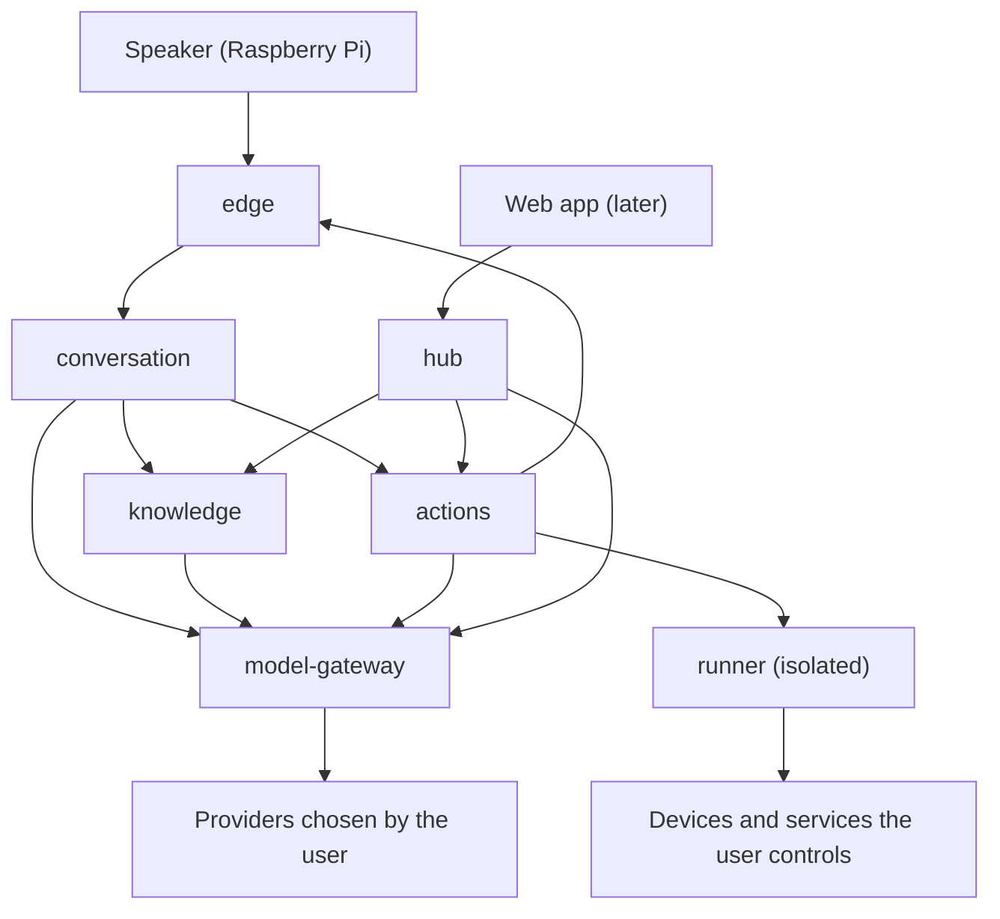

# Factotum: design (v1)

Status: **Slices 0 and 1 are implemented**: the foundations and shared contracts, and the
`model-gateway` service. The other services are not started yet. Sections say whether something is
*implemented* or *planned*. The reasons behind the biggest decisions live in
[`decisions/`](decisions/README.md); the gateway has its own document,
[`model-gateway.md`](model-gateway.md).

## 1. What Factotum is

A self-hosted voice assistant. It answers from the user's own documents (retrieval-augmented
generation) and from the web, performs actions (lights, media playback, ...), and runs on the models
the user chooses. Devices are small speakers with a microphone (a Raspberry Pi or similar); some have
a screen, some have no microphone. A web app to manage devices, linked accounts and documents comes
later.

## 2. Principles

1. **The user chooses the models.** Every model (chat, embeddings, speech, search) is provided by the
   user: a local server, or a hosted provider with the user's own key. Only the model gateway knows
   which one; no other service names or assumes a model.
2. **The user decides where their data goes, by choosing the deployment and the providers.** On
   premise with a local model nothing leaves the network; with a hosted provider what is sent goes
   there. The system does not ask for that choice again and does not police it (ADR 0010).
3. **Contracts live in one place.** Every interface between services is a pydantic model in
   `factotum.contracts`, tested. The previous prototype's worst bugs were contracts that had drifted.
4. **Permissions never depend on a voice.** They come from whom a device acts for, the device's
   policy, and the properties of the skill and its targets (ADR 0004).
5. **Fail closed.** Unknown, unavailable or unconfigured means refused (approvals, URLs, production
   environment).
6. **Tested by default.** Every piece of code ships with unit tests; unit tests never touch the
   network.
7. **On-premise first, multi-tenant capable.** One code base; on-premise is a deployment with a
   single tenant (ADR 0009).

## 3. Architecture (planned)



| Service | Responsibility | What it does not know |
| --- | --- | --- |
| `edge` | WebSocket API for system devices: authentication, sessions, a versioned protocol, capability-aware routing of response parts, device commands with acknowledgement; later the voice pipeline | documents, models |
| `conversation` | One conversation turn: routing with structured output, retrieval from `knowledge` and the web with timeouts and partial degradation, context budgeting, streamed answers with citations, short memory, the action path (skill selection, parameter extraction, confirmation) | which model or provider it uses, and any key |
| `knowledge` | Ingestion (loaders, chunking, embeddings through the gateway), storage and hybrid retrieval in Postgres + pgvector, document lifecycle, ownership | which model produces the embeddings |
| `model-gateway` | The only place that knows providers, addresses and keys. A normalized API for chat (streaming, structured output), embeddings, speech and web search; retries, timeouts, typed errors, redaction | conversations and document content (it only sees them in transit) |
| `actions` | Skills (validation, versions, matching), permissions and grants, the policy decision, approvals, audit, dispatch of device commands | how a model was chosen |
| `runner` | Runs skill scripts in isolation | everything else |
| `hub` | Tenants, users, devices and their pairing, spaces, linked accounts, provider bindings and skill secrets; backend of the web app; issues tokens | document content, plaintext keys |

Infrastructure: Postgres with pgvector (one schema per service; *implemented in compose*), SearXNG
or a keyed search API for the web.

## 4. Identity, ownership and permissions

*Implemented*: `factotum.contracts.identity`, `.authorization`, `.approval`, `.audit` and
`factotum.common.authorization`.

- A **tenant** is a household or an organization: the isolation boundary. A **user** is a person in
  exactly one tenant, with the role `admin` or `member`. A tenant is created together with its admin
  and always has at least one (enforced by the hub, planned).
- A **subject** is whoever a device acts for: a user *or the tenant itself*. The tenant has the same
  standing as a user: it can own skills, accounts, collections and model bindings, and permissions
  follow the same procedure for both.
- A **principal** is the authenticated context of a request: `tenant_id`, an optional `device_id`,
  and `acts_as` (a subject). A personal device acts as its owner; a communal device acts as the
  tenant. Shared spaces need no authentication, only tracing.
- An **owner** says who owns a resource: `tenant` (shared with everyone in the tenant), `user`
  (private) or `device` (available only while acting on that device, like a TV's own streaming
  account).
- **Administration** (users, devices, skills, secrets, policies) happens only through authenticated
  hub sessions. Through a device one *uses* the system; one does not administer it.

`can_access(principal, resource_tenant_id, owner, via_device)`: nothing crosses a tenant; a
tenant-owned resource is available to every subject of that tenant; a user-owned one only to that
user; a device-owned one only while acting on that device.

`authorize(principal, device_policy, action)` returns a `Decision`:

| Outcome | When |
| --- | --- |
| `DENY` | the skill or a target is not visible to the principal (`cross_tenant`, `skill_not_visible`, `target_not_visible`); the device's policy forbids the skill or the effect (`skill_not_allowed_on_device`, `exceeds_device_max_effect`) |
| `REQUIRE_APPROVAL` | the skill or the device asks for an out-of-band approval |
| `REQUIRE_CONFIRMATION` | the effective effect is irreversible; the skill's `confirm` policy says so; or untrusted content (web, documents) entered the turn and the action has an effect |
| `ALLOW` | otherwise |

The **effective effect** is the highest of the skill's `effect` and the `sensitivity` of its targets
(a generic on/off skill is harmless on a lamp and not on a garage door). A denial always wins. The
untrusted-content rule is the defence against prompt injection: a web page must not be able to order
an action.

**Audit**: every action records tenant, device, the subject acted for, skill, targets, redacted
parameters, the decision and its reasons, the answer to a confirmation, the approval trail (who
approved) and the result. The record refuses to describe an action that ran without the confirmation
or approval its decision required, and it has no speaker field.

**Approval** (`Approver`): an interface for asking an authorized person out of band (an email, a
one-time code, a push...). No mechanism is chosen yet; the platform will ship an approver that answers
`UNAVAILABLE`, and an action that requires approval is then refused (ADR 0007). The spoken yes/no
confirmation is a separate, lighter step: it protects against misunderstandings and injection but
authenticates nobody.

## 5. Devices

*Implemented*: `factotum.contracts.devices`, `.capabilities`, `.commands`, `.response`, and
`factotum.devices`.

There are two kinds (ADR 0005).

**System devices** are Factotum hardware. They have a `hardware_id` (a stable label for the physical
unit: it prevents duplicates and is *not* proof of identity, since a MAC can be forged), authenticate
with a credential issued at pairing, declare **capabilities**, and are driven through the ready-made
`SystemDevice` interface.

| Capability | Enables |
| --- | --- |
| `audio_in` | starting conversations |
| `audio_out` | speech and sound |
| `display` | text and cards (with dimensions and touch) |
| `media_player` | playing a URL or stream; pause, resume, stop |
| `buttons`, `led`, `sensors` | input events and status commands |

The **command vocabulary v1** is the single definition every other piece derives from. Each command
requires one capability: `speak`, `play_url`, `pause`, `resume`, `stop`, `set_volume`, `show_card`,
`clear_display`, `set_led`. `SystemDevice` has one ready-made method per command; a method refuses
with `CapabilityNotSupportedError` when the device did not declare the capability, and a test keeps
vocabulary and interface from diverging. Devices only receive commands they declared they can run,
never code.

The conversation service answers with typed **response parts** (`speech`, `text`, `card`, `media`,
`command`, `status`), each declaring the capability needed to render it, so the edge can adapt one
answer to a voice-only speaker or a screen without a microphone.

**External devices** (lights, a TV...) are registered by hand and have no built-in methods:
everything they can do is supplied by skills the user explicitly binds to them. A **binding**
attaches a skill to a device with the device's own parameters, so one skill serves many devices.
An external device has a `sensitivity` that raises the effect of any action on it.

Both kinds have an owner (a user or the tenant), tags, optional aliases and a space, and a
**policy**: `max_effect`, an optional list of allowed skills, and `requires_approval`. A communal
device defaults to `max_effect = reversible`; the tenant admin can raise it.

## 6. Skills

*Implemented*: the manifest (`factotum.contracts.skills`). *Planned*: loading, matching, running.

A skill teaches Factotum to do something. It is a folder with a `SKILL.md` (YAML frontmatter plus
markdown) and, optionally, scripts. The frontmatter is validated as a `SkillManifest`.

```yaml
---
name: living-room-lights
description: Turn the living room lights on or off, or set their brightness.
examples:
  - turn on the living room lights
target: external            # none | system | external
parameters:                 # change at every call
  state: { type: string, enum: ["on", "off"] }   # quote them: unquoted on/off are YAML booleans
  brightness: { type: integer, minimum: 0, maximum: 100 }
required: [state]
device_parameters:          # fixed for each device the skill is bound to
  entity_id: { type: string }
  host: { type: string }
permissions:
  network: ["${device.host}"]   # host names, or a device parameter resolved at binding time
  secrets: [HA_TOKEN]           # by name; never shown to the model
effect: reversible          # read_only | reversible | irreversible (required)
confirm: never              # never | ask | always
approval: none              # none | required
entrypoint: scripts/run.py  # omit for instructions mode
---
Markdown instructions for the model, or notes for humans.
```

- **Script mode** (an entrypoint): the script runs in the `runner`, receives its parameters as JSON on
  stdin and answers `{message, data, commands}` on stdout. It is a function from the platform's point
  of view: the world is affected through the network it was allowed, and commands for devices leave
  as *data* that the platform runs after the checks, so the sandbox needs no back channel.
- **Instructions mode** (no entrypoint): the model follows the markdown using only the platform's
  primitives (`http.request`, `mqtt.publish`, `device.command`) within the declared permissions. The
  model writes the plan; `actions` executes it and resolves secrets server-side.
- **Selection**: skill descriptions and examples are embedded and matched by similarity; a model of
  the `chat.fast` role picks the skill and extracts parameters with structured output, validated
  against the skill's schema. Native tool calling is not used, because it varies too much between
  providers; it may come later as an optimization behind a capability flag.
- **Permissions** are deny-by-default and reviewed by the user at installation and at every change.
  Permissions that depend on a device are resolved and approved when the skill is bound to it.
- **Sandbox**: a separate container, non-root, read-only filesystem, CPU / memory / time limits, an
  internal network whose only exit is a proxy with a per-skill allowlist, no access to the container
  runtime or to internal services. In v1 scripts speak HTTP(S) only; other protocols go through
  platform primitives. Isolation is at process level: fine for code the user wrote or trusts, not for
  strangers' code (ADR 0006). The `SkillRunner` interface allows a stronger backend later.

## 7. Models

*Implemented* for chat and embeddings, in `services/model_gateway`: how it works, how to configure
it and what each provider needs are in [`model-gateway.md`](model-gateway.md). What follows is the
design it was built from. *Planned* still: speech, reranking and web search roles, encrypted secrets
at rest and bindings managed by the hub.

- Services ask for a **role**, never a model: `chat.main`, `chat.fast`, `embedding`, `stt`, `tts`,
  `rerank`, `web_search`. Each user (or the tenant) binds a role to a **binding**: provider kind,
  address, key, model name and options. If `chat.fast` is not configured, `chat.main` is used.
- One adapter per provider kind: OpenAI, Anthropic, Google Gemini, Ollama (its native API, so the
  context window is set explicitly) and a generic OpenAI-compatible one (vLLM, LM Studio, llama.cpp,
  OpenRouter, Groq...). Adapters are written on `httpx` and pydantic, without vendor SDKs, so timeouts,
  retries and redaction are uniform.
- The API is normalized: streamed chat events, structured output (a JSON schema in, a validated
  object out, using each provider's native mechanism or validation with retries), typed errors.
- Callers never see a model name; they may ask for a **profile** of a role (maximum input tokens,
  streaming, native structured output) to size the context. The maximum input is declared by the
  user, because model catalogues change constantly.
- **Secrets**: plaintext only in the gateway's memory, encrypted at rest, write-only APIs, always in
  headers and never in URLs, redacted from every log (*implemented*: `factotum.common.redaction`
  and `factotum.common.logs`; for now a binding names an environment variable, and the gateway
  reads the key from it).
- **Where the data goes** is not a policy of the application (ADR 0010). The deployment and the
  providers the user bound decide it, and neither a collection, a request nor a binding says
  anything about it.
- **User-chosen addresses** go through the URL guard: only http(s), no credentials in the URL,
  link-local / metadata / multicast / reserved addresses always refused, private networks only in a
  single-tenant (on-premise) deployment, https for public ones, every resolved address checked, and
  the connection made to the checked address so that DNS cannot answer differently the second time.
- An **embedding space** (provider, model, dimension, as an opaque id) belongs to a collection. If the
  user changes the embedding model the collection is marked for re-indexing; two spaces are never
  mixed silently.

## 8. Knowledge

*Planned*. Postgres with pgvector holds metadata, chunks, vectors, full-text and jobs (ADR 0002).
Verified on the compose image (Postgres 18, pgvector 0.8.6): a `vector` column without a fixed
dimension with a partial HNSW expression index per collection, and an `halfvec` HNSW index for more
than 2000 dimensions. Retrieval is hybrid (vector plus full-text) with optional reranking. Documents
are chunked by structure, with a parent/child scheme. Every query is scoped by tenant, and ownership
follows section 4. With many tenants, pgvector's README recommends list partitioning by tenant and
iterative index scans, which stay behind the `VectorStore` interface.

## 9. Deployment

- **Compose** (*implemented for Postgres and the model gateway*): pinned images, no default
  database password, ports published on loopback only. The gateway image is built from the
  repository root, runs as a non-root user, and starts only with `--profile services`.
  `FACTOTUM_ENVIRONMENT` defaults to `production`, so forgetting to set it disables developer
  conveniences instead of enabling them.
- `FACTOTUM_TENANT_MODE`: `single_tenant` (on-premise: one tenant and its admin created at first
  start) or `multi_tenant` (cloud). The code paths are the same: `tenant_id` always comes from the
  token, never from a request body, and each tenant-owned table will carry `tenant_id` with
  row-level security.
- **Kubernetes** later, from the same configuration schema. Before offering a multi-tenant cloud:
  a stronger skill sandbox (gVisor or Kata, or only instructions-mode skills), a `DeviceRouter`
  over a bus so a command reaches the edge replica that holds the device, tenant partitioning of
  vectors, per-tenant quotas, keys and observability, and onboarding. The address rule for
  providers is already in place: a multi-tenant deployment reaches the public internet only
  (ADR 0010).

## 10. Quality

- Unit tests with every change, no real network (`pytest-socket` allows loopback only), warnings are
  errors, coverage floor 85%. Fakes over mocks; contract tests shared between a fake and the real
  implementation; property-based tests for the rules that must hold for every input; tests with two
  tenants wherever data is scoped; markers `integration` (Docker) and `live` (real providers, opt-in,
  never in CI).
- `ruff` (with security, datetime and blind-except rules), `mypy --strict`, `uv` with a lockfile.
- CI: lint, format, types, unit tests with coverage, compose validation; actions pinned to a commit.

## 11. Roadmap

| # | Content | Status |
| --- | --- | --- |
| 0 | Foundations: workspace, tooling, CI, shared contracts, `authorize()`, redaction and logging, settings, URL guard, `SystemDevice`, compose with Postgres | done |
| 1 | `model-gateway`: five adapters, structured output, streaming, retries, HTTP API, container image | done |
| 2 | `knowledge` | next |
| 3 | `conversation` (text) | |
| 4 | `edge` and a terminal client with device profiles | |
| 5a | `actions`: skills, permissions, confirmations, approvals, audit (with a fake runner) | |
| 5b | `runner` and device command dispatch | |
| 6 | Instructions-mode skills | |
| 7 | `hub` | |
| 8 | Voice and the Raspberry Pi client | |
| 9 | Web app | |
| 10 | Cloud gates (optional) | |

## 12. Open questions

- Asymmetric embedding models want a different prefix or task type for a query and for a document
  (`search_query:` and `search_document:`, Gemini's task types). The gateway does not model it yet;
  the knowledge service will decide where it belongs.
- Token counting: the gateway leaves it to the provider (`context_too_long`) and to the caller, who
  budgets with the profile. A tokenizer per model family is possible if that proves too coarse.

- Which mechanism approves risky operations (an email to the owner, a spoken one-time code, a push
  notification, something else), and which actions require it by default.
- Timers, alarms and routines (scheduled actions) are outside v1.
- The licence of the project is not chosen; dependencies are limited to permissive licences so that
  nothing is foreclosed (for instance PyMuPDF, AGPL, is avoided).
