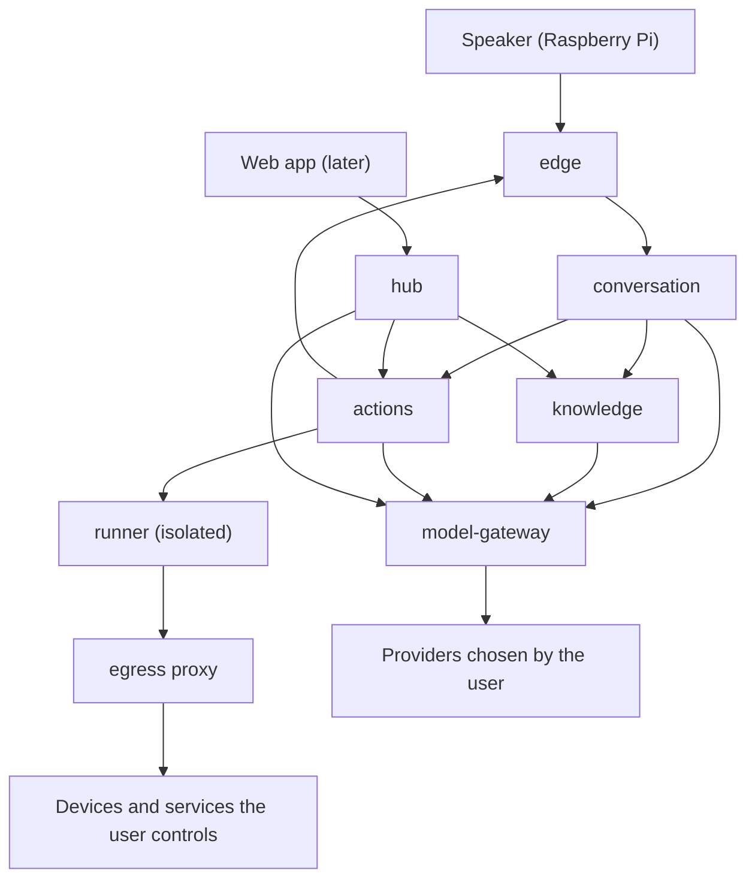

# Factotum: design (v1)

Status: **Slices 0 to 6 are implemented, and slices 7a-7d**: the foundations and shared contracts, the
`model-gateway`, `knowledge`, `conversation`, `edge`, `actions`, `runner`, `egress` and `hub`
services, a client core that every device's software is made of, a terminal client that is a device,
and the device application for a PC and a Raspberry Pi. Of the hub, its tenant, its users, the tokens every
service checks, a device's pairing, the external devices a skill is bound to, the models bound to a
role, and now the secrets a skill is given are there: its spaces and linked accounts are not slices
of their own yet, and a skill that needs a linked account or an approval does not run until they are.
Sections say whether something is *implemented* or *planned*.
The reasons behind the biggest decisions live in [`decisions/`](decisions/README.md); the services
have their own documents, [`model-gateway.md`](model-gateway.md), [`knowledge.md`](knowledge.md),
[`conversation.md`](conversation.md), [`edge.md`](edge.md), [`actions.md`](actions.md),
[`runner.md`](runner.md), [`hub.md`](hub.md) and, for a device's software, [`device.md`](device.md).

## 1. What Factotum is

A self-hosted voice assistant. It answers from the user's own documents (retrieval-augmented
generation) and from the web, performs actions (lights, media playback, ...), and runs on the models
the user chooses. Devices are small speakers with a microphone (a Raspberry Pi or similar); some have
a screen, some have no microphone. A web app to manage devices, linked accounts and documents comes
later.

## 2. Principles

1. **The user chooses the models.** Every model (chat, embeddings, speech, search) is provided by the
   user: a local server, or a hosted provider with the user's own key. Only the model gateway knows
   which one; no other service names or assumes a model.
2. **The user decides where their data goes, by choosing the deployment and the providers.** On
   premise with a local model nothing leaves the network; with a hosted provider what is sent goes
   there. The system does not ask for that choice again and does not police it (ADR 0010).
3. **Contracts live in one place.** Every interface between services is a pydantic model in
   `factotum.contracts`, tested. The previous prototype's worst bugs were contracts that had drifted.
4. **Permissions never depend on a voice.** They come from whom a device acts for, the device's
   policy, and the properties of the skill and its targets (ADR 0004).
5. **Fail closed.** Unknown, unavailable or unconfigured means refused (approvals, URLs, production
   environment).
6. **Tested by default.** Every piece of code ships with unit tests; unit tests never touch the
   network.
7. **On-premise first, multi-tenant capable.** One code base; on-premise is a deployment with a
   single tenant (ADR 0009).

## 3. Architecture (planned)



| Service | Responsibility | What it does not know |
| --- | --- | --- |
| `edge` (*implemented* for text, and for voice: what a person says streams in as they say it and stops the answer that is going on, and the sound of the answer streams out to a device that takes it, a clip for each sentence to one that does not) | WebSocket API for system devices: authentication, sessions, a versioned protocol, capability-aware routing of response parts, device commands with acknowledgement, turning a recording into words and an answer into one through the gateway | documents |
| `conversation` (*implemented* for text) | One conversation turn: retrieval from `knowledge` (and later the web) with timeouts and partial degradation, context budgeting, streamed answers with citations, and no history unless the message refers to it, when what was said is looked up in a log; later routing with structured output and the action path (skill selection, parameter extraction, confirmation) | which model or provider it uses, and any key |
| `knowledge` (*implemented*) | Ingestion (loaders, chunking, embeddings through the gateway), storage and hybrid retrieval in Postgres + pgvector, document lifecycle, ownership | which model produces the embeddings |
| `model-gateway` | The only place that knows providers, addresses and keys. A normalized API for chat (streaming, structured output), embeddings, speech and web search; retries, timeouts, typed errors, redaction | conversations and document content (it only sees them in transit) |
| `actions` (*implemented*) | Skills (validation, versions, matching by meaning), the catalog and its review, the planner and the checks on what it says, permissions and grants, the policy decision, confirmations, approvals, audit, the secrets a skill is given and whose they are, running a skill through the runner and giving a device its commands through the edge | how a model was chosen; how a container is made |
| `runner` (*implemented*) | Runs the script of a skill in a container of its own, made for the run and thrown away after it; the only service given the socket of the engine | skills, tenants, devices, models |
| `egress` (*implemented*) | The only way out of a script's container: lets a run reach the hosts its signed grant lists, and checks every address they resolve to | what a skill is, and anything but the key it shares with the runner |
| `hub` (*implemented* for tenants, users, tokens, devices and their pairing, model bindings and skill secrets) | Tenants, users, devices and their pairing, spaces, linked accounts, provider bindings and skill secrets; backend of the web app; issues tokens | document content, a provider's own key (a model binding only ever names where the gateway finds it) |

Infrastructure: Postgres with pgvector (one schema per service; *implemented in compose*), SearXNG
or a keyed search API for the web.

## 4. Identity, ownership and permissions

*Implemented*: `factotum.contracts.identity`, `.authorization`, `.approval`, `.audit` and
`factotum.common.authorization`.

- A **tenant** is a household or an organization: the isolation boundary. A **user** is a person in
  exactly one tenant, with the role `admin` or `member`. A tenant is created together with its admin
  and always has at least one: *implemented* for `single_tenant` (the hub makes one at its first
  start, slice 7a); a `multi_tenant` deployment making its own is still planned.
- A **subject** is whoever a device acts for: a user *or the tenant itself*. The tenant has the same
  standing as a user: it can own skills, accounts, collections and model bindings, and permissions
  follow the same procedure for both.
- A **principal** is the authenticated context of a request: `tenant_id`, an optional `device_id`,
  and `acts_as` (a subject). A personal device acts as its owner; a communal device acts as the
  tenant. Shared spaces need no authentication, only tracing.
- An **owner** says who owns a resource: `tenant` (shared with everyone in the tenant), `user`
  (private) or `device` (available only while acting on that device, like a TV's own streaming
  account).
- **Administration** (users, devices, skills, secrets, policies) happens only through authenticated
  hub sessions. Through a device one *uses* the system; one does not administer it.

`can_access(principal, resource_tenant_id, owner, via_device)`: nothing crosses a tenant; a
tenant-owned resource is available to every subject of that tenant; a user-owned one only to that
user; a device-owned one only while acting on that device.

`authorize(principal, device_policy, action)` returns a `Decision`:

| Outcome | When |
| --- | --- |
| `DENY` | the skill or a target is not visible to the principal (`cross_tenant`, `skill_not_visible`, `target_not_visible`); the device's policy forbids the skill or the effect (`skill_not_allowed_on_device`, `exceeds_device_max_effect`) |
| `REQUIRE_APPROVAL` | the skill or the device asks for an out-of-band approval |
| `REQUIRE_CONFIRMATION` | the effective effect is irreversible; the skill's `confirm` policy says so; or untrusted content (web, documents) entered the turn and the action has an effect |
| `ALLOW` | otherwise |

The **effective effect** is the highest of the skill's `effect` and the `sensitivity` of its targets
(a generic on/off skill is harmless on a lamp and not on a garage door). A denial always wins. The
untrusted-content rule is the defence against prompt injection: a web page must not be able to order
an action.

**Audit**: every action records tenant, device, the subject acted for, skill, targets, redacted
parameters, the decision and its reasons, the answer to a confirmation, the approval trail (who
approved) and the result. The record refuses to describe an action that ran without the confirmation
or approval its decision required, and it has no speaker field.

**Approval** (`Approver`): an interface for asking an authorized person out of band (an email, a
one-time code, a push...). No mechanism is chosen yet; the platform will ship an approver that answers
`UNAVAILABLE`, and an action that requires approval is then refused (ADR 0007). The spoken yes/no
confirmation is a separate, lighter step: it protects against misunderstandings and injection but
authenticates nobody.

## 5. Devices

*Implemented*: `factotum.contracts.devices`, `.capabilities`, `.commands`, `.response`, and
`factotum.devices`.

There are two kinds (ADR 0005).

**System devices** are Factotum hardware. They have a `hardware_id` (a stable label for the physical
unit: it prevents duplicates and is *not* proof of identity, since a MAC can be forged), authenticate
with a credential issued at pairing, declare **capabilities**, and are driven through the ready-made
`SystemDevice` interface.

| Capability | Enables |
| --- | --- |
| `audio_in` | starting conversations |
| `audio_out` | speech and sound |
| `display` | text and cards (with dimensions and touch) |
| `media_player` | playing a URL or stream; pause, resume, stop |
| `buttons`, `led`, `sensors` | input events and status commands |

The **command vocabulary** (version 2) is the single definition every other piece derives from. Each
command requires one capability: `speak`, `play_audio` (a clip, which the platform's own skills give:
[ADR 0026](decisions/0026-saying-something-on-a-device-play-audio-speak-through-the-edge-and-core-skills.md)),
`play_url`, `pause`, `resume`, `stop`, `set_volume` (to a level), `adjust_volume` (a direction and,
if a person said it, an amount; the step of the device otherwise: ADR 0028), `show_card`, `clear_display`, `set_led`. What a
skill, a script or a plan may give is that vocabulary but for `play_audio` (`SkillCommand`), and a
`speak` is made a voice by the edge for a device that takes clips. `SystemDevice` has one ready-made
method per command; a method refuses
with `CapabilityNotSupportedError` when the device did not declare the capability, and a test keeps
vocabulary and interface from diverging. Devices only receive commands they declared they can run,
never code.

The conversation service answers with typed **response parts** (`speech`, `text`, `card`, `media`,
`command`, `status`), each declaring the capability needed to render it, so the edge can adapt one
answer to a voice-only speaker or a screen without a microphone.

The **edge** (*implemented* for text, in `services/edge`) is where system devices connect, over a
WebSocket with a small versioned protocol (version 1: [`edge.md`](edge.md); the reasons in
[ADR 0013](decisions/0013-the-edge-typed-parts-filtered-by-what-a-device-can-render.md)). A device
says who it is and what it can do, and is told whether it is known. What a person said goes to the
conversation service, acting for whom the device acts for; the answer streams back and the edge cuts
it into sentences as they arrive and sends each as what the device can render (spoken by a speaker,
shown, with its sources, by a screen), so the first sound is heard after the first sentence. A
connection answers one utterance at a time and speaking over an answer interrupts it; the last
connection of a device wins. Commands go over the same connection and come back with a result
(`ok`, `failed`, `unsupported`, `timeout`, `offline`); inside the platform a connected device is a
`SystemDevice`. The hub registers and pairs them (slice 7b, [`hub.md`](hub.md)); without it, devices
are registered in a YAML file and the edge only runs in development. What every client does of the
protocol is one library, `factotum.client_core` ([ADR 0024](decisions/0024-the-client-core-one-implementation-of-the-protocol-for-every-client.md)):
a client is that and the ports of what its device has (a microphone, a speaker, a screen, hands for a
volume), and declares what it was given. `factotum-terminal` is a device in a terminal, with a
profile for each kind of device, and `factotum-device` is the program of a real one: a speaker with
a microphone, on a PC or a Raspberry Pi, that a person speaks to by a key or a wake word
([ADR 0025](decisions/0025-the-device-application-one-program-for-a-pc-and-a-raspberry-pi.md),
[`device.md`](device.md)).

**External devices** (lights, a TV...) are registered by hand, through the hub, and have no built-in
methods: everything they can do is supplied by skills the user explicitly binds to them. A
**binding** attaches a skill to a device, by the skill's name, with the device's own parameters, so
one skill serves many devices. An external device has a `sensitivity` that raises the effect of any
action on it.

Both kinds have an owner (a user or the tenant), tags, optional aliases and a space, and a
**policy**: `max_effect`, an optional list of allowed skills, and `requires_approval`. A communal
device defaults to `max_effect = reversible`; the tenant admin can raise it.

## 6. Skills

*Implemented* (slices 5a, 5b, 6 and 7d, [`actions.md`](actions.md), [`runner.md`](runner.md) and
[`skills.md`](skills.md)): the manifest (`factotum.contracts.skills`), loading and versioning, the
catalog with review and enabling, matching by meaning, the planner and the checks on it, the decision
and the confirmation, running a script in an isolated container and giving a device the commands it
answers with, secrets for skills (kept by the hub, [`hub.md`](hub.md)), and instructions mode.
*Planned*: linked accounts, not yet a slice of its own.

A skill teaches Factotum to do something. It is a folder with a `SKILL.md` (YAML frontmatter plus
markdown) and, optionally, scripts. The frontmatter is validated as a `SkillManifest`.

```yaml
---
name: living-room-lights
description: Turn the living room lights on or off, or set their brightness.
examples:
  - turn on the living room lights
target: external            # none | system | external
parameters:                 # change at every call
  state: { type: string, enum: ["on", "off"] }   # quote them: unquoted on/off are YAML booleans
  brightness: { type: integer, minimum: 0, maximum: 100 }
required: [state]
device_parameters:          # fixed for each device the skill is bound to
  entity_id: { type: string }
  host: { type: string }
permissions:
  network: ["${device.host}"]   # host names, or a device parameter resolved at binding time
  secrets: [HA_TOKEN]           # by name; never shown to the model
effect: reversible          # read_only | reversible | irreversible (required)
confirm: never              # never | ask | always
approval: none              # none | required
entrypoint: scripts/run.py  # omit for instructions mode
---
Markdown instructions for the model, or notes for humans.
```

- **Script mode** (an entrypoint, a Python file): the script runs in the `runner`, receives its
  parameters as JSON on stdin and answers `{message, data, commands}` on stdout. It is a function from
  the platform's point of view: the world is affected through the network it was allowed, and
  commands for devices leave as *data* that the platform runs after the checks, so the sandbox needs
  no back channel.
- **Instructions mode** (no entrypoint, *implemented*, [`skills.md`](skills.md), [ADR
  0016](decisions/0016-skills-that-are-instructions-a-model-writes-a-plan-the-code-decides.md)): a
  model (`chat.main`) reads the markdown and writes a **plan**, once: data, at most eight steps, each
  an HTTP request or a command for a device, with placeholders where a secret, a value or the answer
  of an earlier request goes. Code checks the plan against what the skill was granted (hosts, effect,
  secrets, commands) before anything is sent, and the platform runs it in the sandbox with a program
  of its own, which resolves the placeholders there. A model never reads what a service answers, so
  nothing a service says can steer what happens next. `mqtt.publish` is not among the primitives
  (there is no broker, and the proxy tunnels to port 443 only).
- **Core skills** (*implemented*, [`actions.md`](actions.md#skills-of-the-platform), [ADR
  0026](decisions/0026-saying-something-on-a-device-play-audio-speak-through-the-edge-and-core-skills.md)):
  skills that the platform provides, written in code and run in the actions service, for what a
  sandbox and a plan cannot do (a voice made by the gateway, for a clip to play on a device) and as
  blocks that other skills may use one day. They have a `SKILL.md`, which is what is matched and read,
  and are found, chosen, authorized, confirmed and audited as any skill is; what makes a version one of
  them is the hash of its text, and a skill of a person of the same name is run in the sandbox.
  `announce` is the first.
- **Selection** (*implemented*): skill descriptions and examples are embedded and matched by
  similarity; a model of the `chat.fast` role picks the skill and extracts parameters with structured
  output, validated against the skill's schema, and then checked in code (the model proposes, the
  code decides: [ADR 0014](decisions/0014-actions-the-model-proposes-the-code-decides.md)). Native tool calling is not used, because it varies too much between
  providers; it may come later as an optimization behind a capability flag.
- **Permissions** (*implemented*) are deny-by-default and reviewed by the user at installation and at
  every change: a version runs only once it has been enabled, which grants what it declares.
  Permissions that depend on a device are resolved and approved when the skill is bound to it.
- **Sandbox** (*implemented*, [`runner.md`](runner.md), [ADR 0015](decisions/0015-the-runner-a-container-for-each-run-and-a-proxy-that-checks-a-grant.md)):
  a container of its own for each run, unprivileged, with every capability dropped, ceilings on
  memory, CPU and processes, a small non-executable memory `/tmp` as the only place to write, and no
  network at all unless the skill was granted hosts, and then an internal network whose only exit is a
  proxy that checks a signed per-run grant and every address a host resolves to. It has no access to
  the container runtime or to internal services; a script is given only the secrets that are its
  owner's own and that were granted. In v1 scripts are Python and speak HTTP(S) only; other protocols
  go through platform primitives. Isolation is at the level of a container: fine for code the user
  wrote or trusts, not for strangers' code (ADR 0006). The `SkillRunner` interface allows a stronger
  backend later.

## 7. Models

*Implemented* for chat and embeddings, in `services/model_gateway`: how it works, how to configure
it and what each provider needs are in [`model-gateway.md`](model-gateway.md). What follows is the
design it was built from. Bindings are managed by the hub (slice 7c, [`hub.md`](hub.md)), still only
by reference to a key, never the key itself (not the "encrypted secrets at rest" once planned here:
[`model-gateway.md`](model-gateway.md#known-limits) says why). Speech (`stt`, `tts`) is implemented,
served locally (slice 8, [`model-gateway.md`](model-gateway.md#speech)). *Planned* still: reranking
and web search roles.

- Services ask for a **role**, never a model: `chat.main`, `chat.fast`, `embedding`, `stt`, `tts`,
  `rerank`, `web_search`. Each user (or the tenant) binds a role to a **binding**: provider kind,
  address, key, model name and options. If `chat.fast` is not configured, `chat.main` is used.
- One adapter per provider kind: OpenAI, Anthropic, Google Gemini, Ollama (its native API, so the
  context window is set explicitly) and a generic OpenAI-compatible one (vLLM, LM Studio, llama.cpp,
  OpenRouter, Groq...). Adapters are written on `httpx` and pydantic, without vendor SDKs, so timeouts,
  retries and redaction are uniform.
- The API is normalized: streamed chat events, structured output (a JSON schema in, a validated
  object out, using each provider's native mechanism or validation with retries), typed errors.
- Callers never see a model name; they may ask for a **profile** of a role (maximum input tokens,
  streaming, native structured output) to size the context. The maximum input is declared by the
  user, because model catalogues change constantly.
- **Secrets**: plaintext only in the gateway's memory, encrypted at rest, write-only APIs, always in
  headers and never in URLs, redacted from every log (*implemented*: `factotum.common.redaction`
  and `factotum.common.logs`; for now a binding names an environment variable, and the gateway
  reads the key from it).
- **Where the data goes** is not a policy of the application (ADR 0010). The deployment and the
  providers the user bound decide it, and neither a collection, a request nor a binding says
  anything about it.
- **User-chosen addresses** go through the URL guard: only http(s), no credentials in the URL,
  link-local / metadata / multicast / reserved addresses always refused, private networks only in a
  single-tenant (on-premise) deployment, https for public ones, every resolved address checked, and
  the connection made to the checked address so that DNS cannot answer differently the second time.
- An **embedding space** (provider, model, dimension, as an opaque id) belongs to a collection. If the
  user changes the embedding model the collection is marked for re-indexing; two spaces are never
  mixed silently.

## 8. Knowledge

*Implemented*, in `services/knowledge`: how it works, its API and its configuration are in
[`knowledge.md`](knowledge.md), and the reasons in
[ADR 0011](decisions/0011-knowledge-pieces-to-search-and-sections-to-read.md). In short: Postgres
with pgvector holds metadata, pieces, vectors, full-text and jobs (ADR 0002). Documents (plain text,
Markdown, HTML, PDF, Word) are read in an isolated process and cut by structure into sections and the
pieces inside them; the pieces are embedded through the gateway. Retrieval is hybrid, by meaning and
by words fused by rank, and degrades with a warning instead of failing. A `vector` column has no
fixed dimension; a collection that has grown gets a partial HNSW expression index for its size
(`halfvec` above 2000 dimensions), and a small one is searched exactly. Every table carries its
tenant, every query filters by it, and ownership follows section 4. With many tenants, pgvector's
README recommends list partitioning by tenant and iterative index scans, which stay behind the store
interface.

## 9. Conversation

*Implemented* (text), in `services/conversation`: how it works, its API and its configuration are in
[`conversation.md`](conversation.md), and the reasons in
[ADR 0012](decisions/0012-conversation-no-history-in-a-turn-a-log-to-search-when-referred-to.md).
In short: a turn answers a message from the user's documents (asked of `knowledge`) and **carries no
history**. Every exchange is saved in a log of its own, and a small model in the `chat.fast` role,
reading the message alone, says whether the message refers to an earlier one: to the exchange just
before (the last three come back) or to something said earlier (the log is searched by words and by
meaning, in the period the message names). Nothing else brings the past into a turn. The model is
shown examples as turns of its own conversation and says why before it says which: that is what
made three different small models read the messages alike (measured in `conversation.md`). The
answer is streamed with its citations, and a turn that had somebody else's words in it (a passage of
a document, or an earlier exchange that had) says so, which is what `authorize()` needs of the
actions. A shared device is stateless: it sees only the last minute of what was said on it.

A turn begins by asking the `actions` service whether the message asks for something to be done;
if it does, what that service says is the answer, and if it cannot be asked the message is a
question and the turn says so. Not there yet: the web, routing with structured output between an
answer and other things than actions, voice.

## 10. Deployment

- **Compose** (*implemented for Postgres and the five services*): pinned
  images, no default database password, ports published on loopback only. The service images are
  built from the repository root, run as a non-root user, and start only with `--profile services`;
  the knowledge service waits for the database and finds the gateway by its name, the edge waits for
  the conversation service and has no database, the conversation service asks the actions service
  but does not need it, and only the gateway gets provider keys. `FACTOTUM_ENVIRONMENT` defaults to `production`, so forgetting to set
  it disables developer conveniences instead of enabling them.
- `FACTOTUM_TENANT_MODE`: `single_tenant` (on-premise: one tenant and its admin created at first
  start) or `multi_tenant` (cloud). The code paths are the same: `tenant_id` always comes from the
  token, never from a request body, and each tenant-owned table will carry `tenant_id` with
  row-level security.
- **Kubernetes** later, from the same configuration schema. Before offering a multi-tenant cloud:
  a stronger skill sandbox (gVisor or Kata, or only instructions-mode skills), a `DeviceRouter`
  over a bus so a command reaches the edge replica that holds the device, tenant partitioning of
  vectors, per-tenant quotas, keys and observability, and onboarding. The address rule for
  providers is already in place: a multi-tenant deployment reaches the public internet only
  (ADR 0010).

## 11. Quality

- Unit tests with every change, no real network (`pytest-socket` allows loopback only), warnings are
  errors, coverage floor 85%. Fakes over mocks; contract tests shared between a fake and the real
  implementation; property-based tests for the rules that must hold for every input; tests with two
  tenants wherever data is scoped; markers `integration` (Docker) and `live` (real providers, opt-in,
  never in CI).
- `ruff` (with security, datetime and blind-except rules), `mypy --strict`, `uv` with a lockfile.
- CI: lint, format, types, unit tests with coverage, compose validation; actions pinned to a commit.

## 12. Roadmap

| # | Content | Status |
| --- | --- | --- |
| 0 | Foundations: workspace, tooling, CI, shared contracts, `authorize()`, redaction and logging, settings, URL guard, `SystemDevice`, compose with Postgres | done |
| 1 | `model-gateway`: five adapters, structured output, streaming, retries, HTTP API, container image | done |
| 2 | `knowledge`: five formats, hybrid search, re-indexing, HTTP API, container image | done |
| 3 | `conversation` (text): a turn with no history, a log searched when a message refers to it, streamed answers with citations, container image | done |
| 4 | `edge` and a terminal client with device profiles: protocol v1 over a WebSocket, answers by sentences and by what a device can render, interruption, commands with an acknowledgement, container image | done |
| 5a | `actions`: skills, permissions, confirmations, approvals, audit (with a fake runner), asked first by the conversation service | done |
| 5b | `runner` (a container for each run) and `egress` (a proxy with a signed grant), device command dispatch through the edge, secrets for skills | done |
| 6 | Instructions-mode skills: a plan that a model writes, code that checks it, the sandbox that runs it | done |
| 7a | `hub`: a tenant and its administrator, logging in, and the signed tokens every service checks | done |
| 7b | `hub`: a device's pairing, the external devices a skill is bound to | done |
| 7c | `hub`: model bindings, the gateway reading them from it, a real delegation for `actions`, `conversation` and `knowledge` | done |
| 7d | `hub`: skill secrets, the actions service reading them from it | done |
| 8 | Voice: wake word on the device, speech-to-text and text-to-speech through the gateway; what a person says streams in to the edge and interrupts the answer as it begins (ADR 0022), and the sound of the answer streams out, from the gateway through the edge to a device that says it takes it (ADR 0023); the client core that every client shares (ADR 0024); the device application, push to talk first and the wake word behind the same port, over a library of the sound hardware (ADR 0025); what a skill has a device say: a clip that the platform's own skills give (`play_audio`), a text that any skill gives (`speak`) made a voice by the edge, and the first skill of the platform, `announce` (ADR 0026); still owed: a conversation by voice tried on the hardware, and hearing a wake word over the device's own voice | beta |
| 9 | Web app | |
| 10 | Cloud gates (optional) | |

## 13. Open questions

- Asymmetric embedding models want a different prefix or task type for a query and for a document
  (`search_query:` and `search_document:`, Gemini's task types). Neither the gateway nor the
  knowledge service models it yet: the prefix is per model, so its natural home is an option of the
  embedding binding, applied by the gateway.
- Reading scanned pages needs OCR, which is not done.
- A vocabulary for speech-to-text that follows the home. The names of what is in it and of its skills
  are what a command is about, and Whisper mishears the ones that are words of another language
  (`garage`, `router`). The `stt` binding can list words (`options.vocabulary`, off unless it does,
  [`model-gateway.md`](model-gateway.md#speech)); a list that is derived from the registry and the
  skills of a home, so that nobody writes it by hand and it follows them, is not built. The gateway
  knows no device and no skill, so what gives it would be the edge or the hub, with the recording.
- Whether a message needs a model to tell that it refers to the past. The small model costs a call
  on every turn of somebody with a past, 0.3 to 1.4 s by model (measured in `conversation.md`);
  rules could skip it for messages that are plainly self-contained, at the price of a reference now
  and then missed.
- Passages come back by nearness, near or not: the conversation service does not yet leave out the
  ones that are plainly unrelated to the message, and a small model may answer a follow-up from them.
  It needs the knowledge service to say how near each passage is.
- A citation marker that points to no passage (`[3]` when the prompt had one) is dropped from the
  citations by the conversation service but stays in the text that was already streamed, so a
  screen shows it. The service knows how many passages the prompt has before it streams, so it
  could drop the markers beyond them from the stream itself (a marker arrives in pieces, so this
  wants a small lookahead, as the edge's sentence chunker has). Not done.
- Token counting: the gateway leaves it to the provider (`context_too_long`) and to the caller, who
  budgets with the profile. A tokenizer per model family is possible if that proves too coarse.

- Which mechanism approves risky operations (an email to the owner, a spoken one-time code, a push
  notification, something else), and which actions require it by default.
- Timers, alarms and routines (scheduled actions) are outside v1.
- The licence of the project is not chosen; dependencies are limited to permissive licences so that
  nothing is foreclosed (for instance PyMuPDF, AGPL, is avoided).
