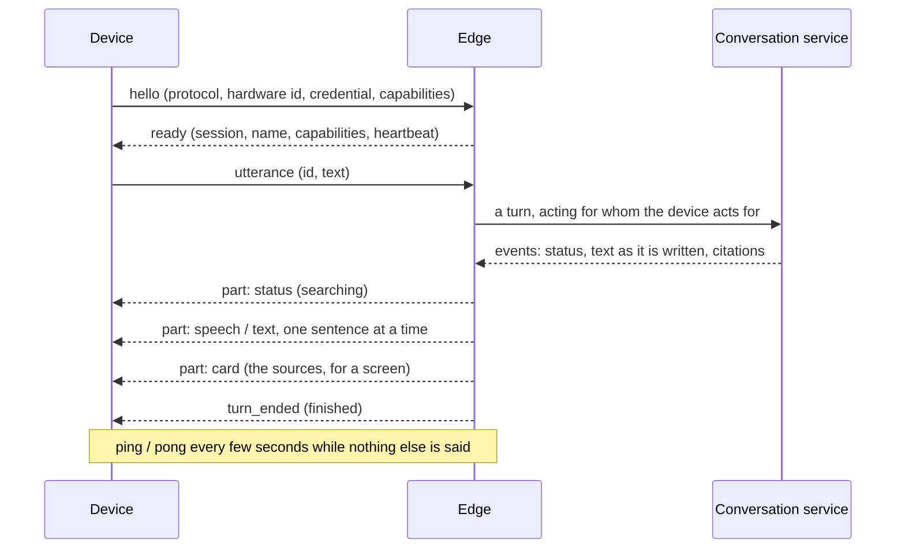
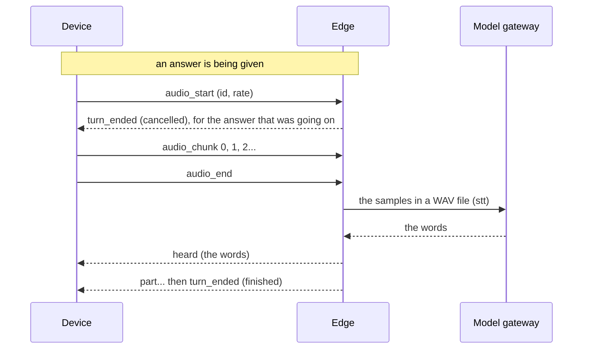
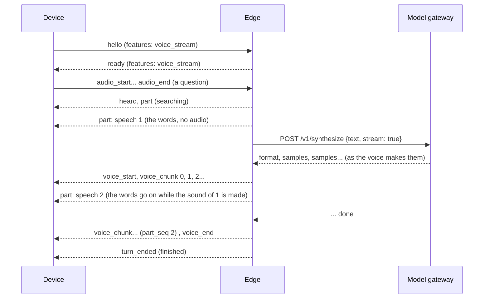

# The edge

The door of the system devices: a speaker, a screen, a phone connect to it over a WebSocket, say who
they are, and talk. It asks the conversation service for every answer and hands it back in pieces a
device can render, asks the model gateway to turn a recording into words and an answer into one, and
it lets the rest of the platform have a device do something (set the volume, show a card) and learn
what became of it. It **knows no document and no key**: what an answer says is the conversation
service's business; what a device is sent of it, and whether it is heard or spoken aloud, is the
edge's.

*Implemented*: the protocol (text; since slice 8 a recording in and a spoken answer out; since
[ADR 0022](decisions/0022-audio-in-is-streamed-to-the-edge-and-the-device-ends-the-utterance.md)
what a person says streamed in as they say it, which stops the answer that is going on the moment
they begin; and since
[ADR 0023](decisions/0023-audio-out-the-voice-of-an-answer-is-streamed-from-the-gateway-to-the-device.md)
the sound of the answer streamed out, to a device that says it takes it), sessions, answers adapted to what a device can do, interruption, commands with an
acknowledgement, a registry of devices read from a file (development) or from the hub, which
registers and pairs them (slice 7b, [`hub.md`](hub.md)), an HTTP API, a container image, the client
core that the software of every device is made of
([ADR 0024](decisions/0024-the-client-core-one-implementation-of-the-protocol-for-every-client.md)),
a terminal client that is a device (`factotum-terminal`, with `--voice` for a real microphone and
speaker, and `--wav-in` and `--wav-out` for none), the program of a real device for a PC and a
Raspberry Pi (`factotum-device`, [`device.md`](device.md), [ADR
0025](decisions/0025-the-device-application-one-program-for-a-pc-and-a-raspberry-pi.md)), and (slice
5b) the `actions` service giving a device the
commands a skill answers with, through the endpoint below, once it has decided that the device may
have something done ([`actions.md`](actions.md)). *Not yet*: partial transcripts, the edge
deciding where speech ends, pacing the sound it sends, and a device hearing its wake word over its
own voice (see the limits, below).

The reasons behind the design are in
[ADR 0013](decisions/0013-the-edge-typed-parts-filtered-by-what-a-device-can-render.md).

## A conversation



The device speaks first. Frames are JSON text, each an object with a `type`, at most 4 MiB (big
enough for a recording, base64 and all, since slice 8; a text frame is a few bytes). A frame that is
not one of the protocol is refused without being echoed (it may be a credential in the wrong place).
Version 1 is the whole of `factotum.contracts.edge`, which is the definition; this is a reading of
it.

### From the device

| Frame | Says |
| --- | --- |
| `hello` | `protocol_version`, `hardware_id`, `token` (the credential of the device), `capabilities`, optional `display` (`width`, `height`, `touch`), `client` (software and version, for the logs) and `features` (what it takes beyond version 1: `voice_stream` and `play_audio`, which both need `audio_out`; left out when there is none). It is the first frame, and the only time the credential is sent |
| `utterance` | `id`, `text`: what a person said, as text. Only a device with `audio_in` can start a conversation |
| `audio_utterance` | `id`, `audio` (format, sample rate, the recording as bytes): what a person said, recorded after the device's own wake word. The edge transcribes it through the model gateway and runs the result through the same turn an `utterance` would; blank or untranscribable ends the turn, `failed` (`nothing_heard`), instead of asking the conversation service to answer silence. Needs `audio_in`, the same as `utterance` |
| `audio_start` | `id`, `format` (`pcm_s16le`: 16-bit little-endian samples, one channel, no container), `sample_rate` (8000 to 48000; 16000 is what the models read): a person has begun to talk to the device. It stops the answer to the last utterance at once and opens a stream (below). Needs `audio_in`, and an edge that has speech |
| `audio_chunk` | `id`, `seq` (0, 1, 2... with no gap), `data` (the samples, base64, at most 64 KiB: two seconds at 16 kHz; a device sends 100 to 200 ms at a time) |
| `audio_end` | `id`: the person has stopped talking. The edge puts what it was sent in a WAV file, has it transcribed and runs the result through the same turn an `utterance` would |
| `cancel` | `id`: stop answering that utterance, or end that stream |
| `ack` | `id`, `result`: what became of a command (`status`, a `detail`, and `data`: what a device answers to a question, such as `get_state`, or says of what it did, such as the level the volume came to; small, and for the skill of the platform that asked) |
| `ping` | I am here |
| `bye` | I am going on purpose |

### From the edge

| Frame | Says |
| --- | --- |
| `ready` | The device is known: `session_id`, `device_id`, `name`, `capabilities` (what it declared, of what it is registered for), `unregistered` (what it declared without being registered for: ignored, and said, so that whoever installs a device finds out), `heartbeat_s`, and `features` (what the edge will do for it of what it declared: left out when there is none) |
| `heard` | `utterance_id`, `text`: what a recording (a clip or a stream) was taken for, said before the answer to it begins. Only a device that sent a recording is told, and what a device can render does not filter it: it is not a part of the answer. A recording that was taken for nothing is not heard; its turn ends `failed` (`nothing_heard`) |
| `part` | `utterance_id`, `seq` (0, 1, 2... with no gap), `part`: one piece of the answer, of a kind the device can render (below) |
| `voice_start` | `utterance_id`, `format` (`pcm_s16le`), `sample_rate`: the sound of the answer begins. Only a device that declared `voice_stream` is sent any of the three (below) |
| `voice_chunk` | `utterance_id`, `seq` (0, 1, 2... with no gap, in a track), `part_seq` (the `seq` of the `speech` part whose sound this is), `data` (whole samples, base64, at most 64 KiB; about a tenth of a second is what is sent) |
| `voice_end` | `utterance_id`: the sound is all sent |
| `turn_ended` | `utterance_id`, `status` (`finished`, `failed`, `cancelled`) and, for a failure, a stable `code` and a `message` |
| `command` | `id`, `command`: something to do (the command vocabulary of the design: `speak`, `play_audio`, `play_url`, `pause`, `resume`, `stop`, `set_volume`, `adjust_volume`, `set_mute`, `get_state`, `set_timer`, `cancel_timer`, `set_alarm`, `cancel_alarm`, `postpone_alarm`, `move_alarm`, `stop_ringing`, `show_card`, `clear_display`, `set_led`). The device answers with an `ack`. A `play_audio`, a `set_timer` and a `set_alarm` carry a clip, and are sent only to a device that declared `play_audio` (below): a device that did not is answered `unsupported` without being sent anything, since there are no words to ring with in place of a clip |
| `pong` | Me too |
| `error` | `code`, `message`, `fatal` (the connection is closed after it), `ref` (the utterance, stream or command it is about) |

### What a device is sent of an answer

The conversation service streams text as the model writes it. A speaker cannot wait for the end (it
would be silent for as long as the model takes) and cannot say half a word, so the edge cuts the
text into sentences as it arrives and sends each one as soon as it is whole: **the first sound is
heard after the first sentence, not after the answer.** What a sentence becomes depends on the
device, and a part a device cannot render is never sent to it:

| The answer has | `audio_out` (speaker) | `display` (screen) | Neither |
| --- | --- | --- | --- |
| Progress (thinking, searching) | `status` | `status` | `status` |
| Each sentence | `speech`, without the citation markers `[1]` and without markdown | `text`, as written, markers included | nothing |
| The documents it drew on | nothing: a speaker would only read them out | one `card` titled Sources, with each document and where in it | nothing |
| A failure | a `speech` apology | a `text` apology | nothing |

A device with both gets both, the speech first. The parts of an answer are a sentence each: a screen
shows them one after another (the terminal client puts a line for each). Sentences shorter than 24
characters are held back and said with the next ("Yes." on its own is a click); a stretch of 280
characters with no end to a sentence in it is cut at a comma or a space; a number such as 3.5 is not
a sentence; and a citation marker is kept with the sentence it follows.

Since slice 8, a `speech` part sent to a device that declared `audio_out` also carries `audio` (the
sentence, synthesized through the model gateway's `tts` role): the device plays it, or speaks the
text itself, or both. Without a `tts` binding, `audio` is left out and only the text travels, exactly
as before slice 8. A device that says it takes `voice_stream` is sent the same part with no `audio`,
and the sound as chunks, apart (next section).

When the answer cannot be given the device is told in words it can render, chosen by why: *I have no
model to answer with yet* (`chat_not_configured`), *That is too long for me to answer*
(`context_too_long`), *I cannot reach my brain right now* (`conversation_unavailable`), *Sorry, I
could not answer that* (anything else). What was written before the failure comes first, and
`turn_ended` says `failed` with the code.

### One turn at a time

A connection answers one utterance at a time. **A new utterance interrupts the answer to the one
before**: the person spoke over it. The edge stops reading the conversation service's stream (which
stops the model), sends `turn_ended` with `cancelled` for the old one, and answers the new one.
`cancel` does the same with nothing after it. The parts of an answer that was interrupted stop
where they were. What a person says as a stream interrupts it **when they begin** (`audio_start`),
not when they have finished.

### Audio in: a stream

A recording does not have to be made whole before it is sent. A device that hears a person begin to
talk sends `audio_start`, an `audio_chunk` for each hundred milliseconds or so of what it hears, and
`audio_end` when they stop (its own silence detection, a button released, a maximum). It is the
same for the real microphone of a device and for a file that the terminal client says: they differ
in where the sound comes from and in nothing else ([ADR
0022](decisions/0022-audio-in-is-streamed-to-the-edge-and-the-device-ends-the-utterance.md)).



- **A stream is an utterance.** Its `id` is in the same namespace as that of an `utterance`, and
  what answers it (`heard`, `part`, `turn_ended`, an `error` with a `ref`) says it. **Every stream
  the edge accepts ends with exactly one `turn_ended`**: `finished`, `failed` with a code, or
  `cancelled`. One that it did not accept (below) gets an `error` and no `turn_ended`.
- **It begins by interrupting.** `audio_start` stops the answer to the last utterance there and
  then, and ends a stream that was still open (`cancelled`); so does an `utterance`, an
  `audio_utterance` or a `cancel` of it. A device that wants a wake word heard while it plays an
  answer to interrupt it stops its own playback and sends `audio_start`: what is played is the
  device's, and so is the echo of its speaker in its microphone.
- **The device says where speech ends** (`audio_end`). The edge does not listen for silence: that
  would be a model, and a model is the gateway's to name.
- **What it ends with is what a clip would.** The samples are put in a WAV file at the rate the
  stream began with, and transcribed through the gateway's `stt` role; the words are said to the
  device (`heard`) and answered as an `utterance` would be. A stream with no sample in it (nothing,
  or one byte) is `failed` (`nothing_heard`), as is one the model hears nothing in.
- **A stream is bounded**, and one that breaks a bound is dropped and told once, and the device
  stays:

| What | The limit | The stream ends |
| --- | --- | --- |
| A chunk | 64 KiB of samples | `failed`, `chunk_too_big` |
| The order of the chunks | `seq` 0, 1, 2... with no gap, none twice | `failed`, `stream_out_of_order` |
| The whole of it | what a clip may hold: 2 MiB less its header, about 65 s at 16 kHz | `failed`, `audio_too_long` |
| Between two chunks | `FACTOTUM_EDGE_STREAM_STALL_S` (5 s) | `failed`, `stream_stalled`: a device that died in the middle of a sentence, which is not a device that is idle |
| Something else said | an `utterance`, a recording, another `audio_start` | `cancelled` |
| A `cancel` | with the stream's `id` | `cancelled` |

- **A frame of a stream that is not the open one** (it was dropped, it is over, it never was) is an
  `error` with its `ref` (`unknown_stream`) and nothing else happens: a late chunk of one that was
  dropped does not drop the one that is open. A client stops sending when it has been told.
- **Refused before it begins.** A device with no `audio_in` is refused at `audio_start`
  (`capability_missing`), and so is one when the edge has no speech (`speech_not_configured`), as
  for a clip: an `error` with the `ref`, and nothing else, so the answer that is going on is not
  interrupted by a person who was not heard.
- **Chunks count as the device saying something** for its idle timeout; a ping does not keep a
  stalled stream alive. The edge keeps the samples of a stream in memory only, at most what a clip
  may hold, until it ends or is dropped: nothing is written to disk, and no audio is logged (a
  dropped stream is logged with its code).

### Audio out: a stream

A device with a speaker that says in its `hello` that it takes `voice_stream` is not sent a clip in
each `speech` part: it is sent the words of each sentence at once, and the sound of them as the voice
makes it ([ADR
0023](decisions/0023-audio-out-the-voice-of-an-answer-is-streamed-from-the-gateway-to-the-device.md)).



- **Negotiated, and nothing is taken away.** The edge answers with the `features` it will do (what
  the device declared, of what it has and of what the device is registered for: a device that is not
  registered for `audio_out` is not sent a voice whatever it said). A device that declared none is
  sent a clip in each `speech` part, as before; an empty set of features is not put in a frame, so
  that a device or an edge from before them still reads every frame. A `hello` with `features` is a
  frame an edge from before them does not know: upgrade the edge first.
- **The words do not wait for the sound.** A sentence is sent as soon as it is whole, as it always
  was, and its sound is made on a task of its own while the text of the answer goes on; the sound of
  a sentence is made when the one before has been said. `part_seq` on a chunk says which `speech`
  part it is the sound of, so that a screen can show each sentence as it is spoken.
- **A track, from `voice_start` to `voice_end`.** The sound of an answer is one track: play the
  chunks one after the other with no gap. A voice that changes its rate in the middle of an answer
  (another was bound) ends the track and begins another, counted from 0 again.
- **Everything of a voice comes before the end of its turn**, and nothing after it: a turn that ends
  cut short (`cancelled`, `failed`) has no `voice_end`, and its `turn_ended` ends the track. A device
  that is speaking over the answer stops its own playback and sends `audio_start` (or a `cancel`);
  what is still in flight for the turn it left is ignored by its `utterance_id`.
- **A sentence that cannot be said has no sound**, and its words were sent: the next is tried. With
  no `tts` bound there is no voice and no warning; any other failure is logged with its code.
- **The edge does not pace.** It sends a frame as the voice makes it, faster than it plays, and
  the socket holds it back; the device buffers what it has not played yet (a minute of speech at
  22 kHz is 2.6 MB).

### Audio out: a clip that a command carries

What a skill has a device say is not an answer: it is content for the device, often another one than
the person spoke to ([ADR
0026](decisions/0026-saying-something-on-a-device-play-audio-speak-through-the-edge-and-core-skills.md)).
It travels as a command, `play_audio` (`text`, the words; `audio`, a clip of them, a WAV file of at
most 2 MiB), which a device takes when it declared the feature `play_audio` (it has a speaker and a
way to play a clip or a track, and `audio_out`).

- **`speak` is made a voice here.** A skill, a script or a plan can give a device `speak` (a text).
  When the device declared `play_audio` the edge cuts the text into sentences as it does for an
  answer, asks the gateway for the voice of each, one after the other (`tts` role), and sends each as
  a `play_audio` as soon as it is made: the first sound is heard after the first sentence (and whoever
  asked waits for all of them: the actions service waits for the edge `FACTOTUM_ACTIONS_EDGE_TIMEOUT_S`,
  15 s, so a long text on a slow voice wants it raised). The result
  is `ok` when every sentence was accepted, `failed` when one could not be made (no `tts` bound, the
  gateway away: `the voice could not be made (code)`) or accepted, and `failed` for a text that has
  nothing to say. A device that did not declare the feature is sent the text, as before, and a
  `play_audio` for it is sent as a `speak` of the words it carries: a clip that a device cannot play
  is a text that it may say, or show.
- **A skill of the platform gives clips.** What a skill of the platform (`announce`) says is made into
  clips by the actions service, once, with the same gateway, and given to the device that was named:
  the platform's `play_audio` is not in what a script or a plan can give (`SkillCommand`).
- **`ok` is *accepted*, not played.** A device answers at once and says the clip when nothing else is
  being said (no answer is being given on it, nothing is playing), in the order the clips came, from
  a task of its own, so that a ping, a command and a person speaking never wait for it. A person who
  speaks cuts the clip that is being said; what waits is said after their answer. A device holds at
  most 12 MiB of what it has been given and has not said (`failed`: *there is too much waiting to be
  said*), and a clip that is not a 16-bit mono WAV is `failed` too. Whoever asked is not to wait for
  the end of what it asked: the chain from a message to a speaker is a request and an answer, and a
  trail that said *played* would mean a request that is open for as long as the sentence lasts.
- **What a device is not sent.** A `play_audio` for a device that did not declare `audio_out` is
  `unsupported`, and nothing is sent, as for any command. A device that has `audio_out` and did not
  declare the feature is sent the words as a `speak`. A device that is sent a clip it did not say it
  plays (an edge that is wrong) answers `unsupported` and says so (`Renderer.violation`).

### Sessions

- A connection that does not say hello within `FACTOTUM_EDGE_HELLO_TIMEOUT_S` (10 s) is refused
  (`hello_required`).
- The device pings every `heartbeat_s` (20 s) and the edge answers. A device that says **nothing at
  all** for `FACTOTUM_EDGE_IDLE_TIMEOUT_S` (60 s) is taken to be gone (`idle`, close 4002). One that
  has a stream open and sends no chunk for `FACTOTUM_EDGE_STREAM_STALL_S` (5 s) is not idle: its
  stream is dropped (`stream_stalled`).
- **The last connection of a device wins**: when the same device connects again, the old connection
  is closed with 4001. The old one may be a dead one nobody has noticed yet, and a device that
  restarted is the one that is there.
- When the edge stops, every device is told it is going away (close 1001).
- Sending one frame to a device may take `FACTOTUM_EDGE_SEND_TIMEOUT_S` (10 s); a device that does
  not take a frame in that time is taken to be gone.

Close codes: 1000 normal, 1001 the edge is going away, 1002 a frame that is not the protocol, 1008
refused (no hello, unknown device, wrong credential), 1009 a frame that is too big (closed by the
server before the edge reads it), 1011 the edge failed, 4001 replaced by the same device, 4002
idle, 4003 protocol version not supported.

## Commands

Something wants a device to do something (the `actions` service does, when what a skill answers
with contains a command, after its checks; a person can with `curl`):

```bash
curl -s localhost:8084/v1/devices                    # who is connected
curl -s localhost:8084/v1/devices/$ID/commands -H 'content-type: application/json' \
     -d '{"command": {"name": "set_volume", "level": 30}}'
# {"status": "ok", "detail": null}
```

The edge sends the device a `command` frame and waits up to `FACTOTUM_EDGE_COMMAND_TIMEOUT_S` (10 s)
for the `ack` with the same `id` (for a `speak` made a voice, for each sentence). The body of the
request may be a frame: a command may carry a clip. What became of it is always a result with an HTTP `200`, never an
error, because a device that is not there is a normal state of a home:

| `status` | Means |
| --- | --- |
| `ok` | The device did it |
| `failed` | The device tried and could not (`detail` says why: nothing is playing) |
| `unsupported` | The device did not declare the capability the command needs. Nothing was sent |
| `timeout` | The device did not answer in time |
| `offline` | The device is not connected |

A device that does not exist for the caller's tenant is a `404`. Inside the platform a device is an
`EdgeDevice`, an implementation of the `SystemDevice` interface whose methods (`speak`,
`set_volume`...) go over the connection: the same interface the fake device of the tests implements.

## Registering devices

Every device that connects must be registered: a name, a `hardware_id`, a credential, an `owner` and
the `capabilities` it may use. In production this is the hub ([`hub.md`](hub.md)): pairing a device
there (`POST /v1/devices`) hands back a credential shown once, and the edge fetches the tenant's
devices from it once, in its own lifespan (`FACTOTUM_EDGE_HUB_URL`), checking what a device presents
against the hash the hub keeps, never asking it again per connection. **Without the hub this is a
YAML file, for development only**: the file registry and the development authentication refuse to be
built when `FACTOTUM_ENVIRONMENT` is anything but `development` or `test`, and it defaults to
`production`, so forgetting to set it disables them instead of enabling them.

```bash
cp config/devices.example.yaml config/devices.dev.yaml     # git ignores *.dev.yaml
# and set FACTOTUM_EDGE_DEVICES_FILE=config/devices.dev.yaml
```

[`config/devices.example.yaml`](../config/devices.example.yaml) documents each field and has one
device per kind: a speaker, a display with a speaker and a microphone, a screen with neither, a
streamer with no microphone and a personal phone. A test loads it and authenticates every device in
it.

- **Whom it acts for.** An `owner: tenant` device is shared: it acts for the tenant, has no
  conversation of its own and sees only the last minute of what was said on it (ADR 0012). An
  `owner: user` device is personal: it acts for that user, with their whole history.
- **Registered and declared.** A device may declare less than it is registered for (a phone with
  the microphone off), never more: the edge uses the intersection and, when the device declared
  something it is not registered for, says so in `ready.unregistered` and in a log line.
- **Its id** is derived from the tenant and the hardware id, so a conversation on a personal device
  carries on from one start of the edge to the next.
- **What may be done from it** is in the same file: a `policy` (`max_effect`, `requires_approval`) on
  a device, the external devices (a lamp, a garage door) and which skill drives each. The edge reads
  only the system devices; the actions service reads all of it ([`actions.md`](actions.md)).
- **The credential** is compared in constant time, and the answer to a device that does not exist
  takes as long as the answer to one whose credential is wrong. It is never in a log or in an error
  frame; a refusal is logged with the hardware id that was claimed and the code, so that whoever
  installs a device can find out why it does not connect.

## The HTTP API

| | |
| --- | --- |
| `GET /v1/connect` | the WebSocket of the devices (the upgrade) |
| `GET /v1/devices` | the caller's tenant's devices that are connected: id, name, hardware id, capabilities, display, session, since when |
| `POST /v1/devices/{id}/commands` | have a device do something: `{"command": {...}}` gives a result (a body is at most one frame, 4 MiB) |
| `GET /healthz`, `GET /readyz` | liveness; readiness (the conversation service answers) |

Errors have the shape of the other services, `{"error": {"code", "message", "details"}}`.
Interactive documentation is at `/docs` outside production.

## Configuration

Read from the environment (`FACTOTUM_*`) and, in development, from `.env`; every variable is in
[`.env.example`](../.env.example) and a test says so.

| Variable | Default | |
| --- | --- | --- |
| `FACTOTUM_EDGE_HOST`, `..._PORT` | `127.0.0.1`, `8084` | loopback unless told otherwise (the image says `0.0.0.0`, and compose publishes the port on loopback) |
| `FACTOTUM_EDGE_CONVERSATION_URL` | `http://127.0.0.1:8083` | where the conversation service is |
| `FACTOTUM_EDGE_DEVICES_FILE` | none | the registered devices (development only). A file that is named and is not there stops the edge; with none, no device is known |
| `FACTOTUM_EDGE_HELLO_TIMEOUT_S` | `10` | how long a connection may take to say who it is |
| `FACTOTUM_EDGE_HEARTBEAT_S` | `20` | how often a device with nothing to say says it is there |
| `FACTOTUM_EDGE_IDLE_TIMEOUT_S` | `60` | how long a device may say nothing at all: a good few heartbeats |
| `FACTOTUM_EDGE_COMMAND_TIMEOUT_S` | `10` | how long a device is given to answer a command |
| `FACTOTUM_EDGE_TURN_TIMEOUT_S` | `130` | how long the conversation service may be silent while it answers: a little more than its own limit on its model, so that the reason is its |
| `FACTOTUM_EDGE_SEND_TIMEOUT_S` | `10` | how long sending one frame to a device may take |
| `FACTOTUM_EDGE_STREAM_STALL_S` | `5` | how long a stream of audio may wait for its next chunk before it is dropped (a device sends one every 100 to 200 ms) |
| `FACTOTUM_EDGE_GATEWAY_URL` | none | where the model gateway is, for a recording to be heard and an answer to be said. Without it a recording is refused and a spoken answer is words alone |
| `FACTOTUM_EDGE_GATEWAY_TIMEOUT_S` | `60` | how long the gateway may be silent while it hears a recording or says a sentence: Piper takes 4.9 s to say its first sentence after a start (it loads its voice then), and a bigger Whisper longer than that to read a recording on a processor. Connecting gives up after three seconds |

The edge has no database, no model and no key. It runs uvicorn with the WebSocket implementation
that is not deprecated (`websockets-sansio`) and a limit of one frame of the protocol, whatever a
client sends.

## The client core

Every client of the edge is made of `factotum.client_core` (`libs/client_core`,
[ADR 0024](decisions/0024-the-client-core-one-implementation-of-the-protocol-for-every-client.md)):
the protocol, the sound of an answer, a conversation by voice, staying connected, and none of the
hardware. A client is the core and the ports of what its device has, and declares to the edge what it
was given:

```python
client = DeviceClient(
    await WebSocketConnection.open(url),  # or a fake: what a test plays the edge on
    identity,  # hardware id, credential, capabilities, display
    renderer,  # what it shows, or says, of each part
    CommandRouter(volume, light),  # the hands of the device, a driver for each part
    voice_sink=speaker,  # takes the sound as it arrives: asks for voice_stream
)
await client.connect()  # hello, ready (or Refused)
lost = await VoiceLoop(microphone).serve(client)
```

| Port | Is | What a device without it gets |
| --- | --- | --- |
| `Identity` | who the device is, its credential, what it can do and its screen | (every client has one) |
| `Renderer` | what is shown or said of each part, what the edge took a recording for, what is wrong | (every client has one; a renderer may do nothing with what the device cannot show) |
| `CommandDriver`, `CommandRouter` | the hands of one part of a device; a command goes to the driver that has the capability it needs | a command nobody can run is `unsupported` |
| `VoiceInput` | what a person says, a recording or an `AudioStream`; how they were heard (a wake word, a key, a file) is its business | the device cannot start a conversation by voice |
| `VoiceOutput` | plays a clip whole | no clip is played |
| `VoiceSink`, `MarkedSink` | takes the sound as it arrives (`begin`, `write`, `finish`, `abort`) and, for a `MarkedSink`, is told which sentence it is saying | no `voice_stream`: the edge sends a clip in each speech part |

What the core does, so that a client does not:

- **Says what the device has and nothing else**: `capabilities` from the identity, `voice_stream` if
  there is a sink and a speaker, `play_audio` if there is a sink or a speaker of clips and `audio_out`. A device with no microphone cannot start a conversation
  (`CannotConverse`).
- **Plays the sound of an answer from a task of its own** (`VoicePlayer`), so that what reads from the
  edge never waits for a speaker: a ping, a command and a person speaking over the answer are served
  while the sound is played. A speaker that fails loses the track and is tried again at the next.
- **Says what a command had it say** (`play_audio`): accepts the clip at once and says it when
  nothing else is, in order, from a task of its own; a person who speaks cuts it, and what is queued
  is dropped with the connection.
- **Cuts the sound before the edge is told**: `say`, `say_audio`, `say_audio_stream` and `cancel`
  stop what plays (what is queued is dropped, the speaker told to stop) and leave the answer going on;
  what is still on its way for it is let go of in silence.
- **Says what the edge gets wrong** (`Renderer.violation`): sound to a device that did not ask for it,
  chunks out of order or outside a track, a track that begins in the middle of another, a clip to a
  device that takes a stream, parts that cannot be rendered, a second `ready`.
- **Converses by voice** (`VoiceLoop`): what a person says is sent as they say it; the answer is
  waited for, and its sound played, before the next is heard, or (`listen_while_answering=True`, for
  a device that does not hear itself) it is heard while the answer plays, and speaking over the answer
  stops it. The microphone is opened once and is kept across connections.
- **Stays connected** (`stay_connected`, `Backoff`): a device that loses the edge asks again after one
  second, then two, four... up to thirty, each a quarter more or less by chance, and the waits start
  over after a connection that held; it does not ask again when the edge refused the device, replaced
  it with its twin or has no use for it.

A client is tried with `factotum.client_core.testing`: a connection that a test plays the edge on
(`MemoryConnection`), a client with a fake for each port (`ClientRig`), and speakers that remember
what they were given (`FakeVoiceOutput`, `FakeVoiceSink`, `FakeMarkedSink`, `FakeSpeaker`).

A client with a real sound card has the hardware that is the same for every one of them in a library
of its own, `factotum.client_audio` (a microphone, a speaker with a volume, where speech ends, a key
and a wake word as a `VoiceInput`, all behind a backend that a test plays): the terminal and the
device application are made of it. The device application (`factotum-device`,
[`device.md`](device.md)) is the core, that library and its settings, and runs `stay_connected`.

## The terminal client

`factotum-terminal` is a client of the core with the hardware of a terminal: a console for a renderer
and for the hands of the device, a keyboard, optionally a microphone with a wake word and a speaker,
or files for both. It is a device in a terminal, and the way to look at the edge from the side of a
speaker, of a screen, of a phone before there is one. What is typed is what a person said; what the
edge sends comes out as what that device would do:

```bash
uv run factotum-terminal                                       # a speaker
uv run factotum-terminal --profile smart-display --url ws://127.0.0.1:8084/v1/connect
uv run factotum-terminal --voice                                # a real microphone and speaker
uv run factotum-terminal --wav-in question.wav --wav-out answer.wav   # files, no hardware
```

With `--voice` (only on a profile with `audio_in`) a real microphone and speaker replace the
keyboard and the screen: say the wake word (`--wake-word`, default `hey_jarvis`), then what you
would say, and wait for the answer before saying it again. What is said is sent **as it is said**, a
chunk at a time, from the wake word until 1.2 s of quiet or twelve seconds; the answer is
interrupted by the edge when you begin (see the known limits for what the terminal does not yet
do). The word is watched for by openWakeWord, which needs no account and no key but its models:
`factotum-device wake-word download` fetches them once ([ADR
0027](decisions/0027-the-wake-word-without-a-key-openwakeword-behind-the-same-port.md); `--engine
porcupine` needs an AccessKey that Picovoice gives to companies). It needs the model gateway
configured with `stt` and `tts` bindings ([`model-gateway.md`](model-gateway.md#speech)) to hear or
say anything; without the gateway, `--voice` still connects but every recording is refused.

**The client that tests the whole stack with no hardware** is `--wav-in`: each file (16-bit mono
WAV, any rate from 8 to 48 kHz; give the option again for each utterance) is said in the order
given, as if said after the wake word, in the same frames and chunks (100 ms) that the microphone
sends, as fast as the edge takes them or at the pace of a microphone with `--realtime`. The answer
to each is waited for before the next is said, and the run ends when the last has been answered
(exit code 0). `--wav-out` writes what the assistant says to a WAV file instead of playing it, the
sentences of the answers one after the other, and works with a keyboard and with a microphone as
well; the file takes the voice as a stream, as the speaker of a real device does (ADR 0023), so it is
also how that is tried with no hardware. A file that is missing, is not 16-bit mono PCM or is at a rate that is not streamed is said
(with its name) before the edge is reached.

| Profile | Is | Sees |
| --- | --- | --- |
| `speaker` | a microphone, a speaker and a light | speech |
| `smart-display` | the same, with an 800x480 touch screen | speech, text, the sources |
| `screen` | a screen and nothing else: it cannot start a conversation | what it is sent |
| `player` | a streamer with a speaker and no microphone | what it is told to play |
| `phone` | a personal device, with the screen and the voice | speech, text, the sources |

Each profile is a device of `config/devices.example.yaml` (a test says so): its hardware id and
credential are those of the example, which `--hardware-id` and `--token` (or
`FACTOTUM_DEVICE_TOKEN`) override. The terminal behaves as the hardware would: it renders only what
that hardware could and executes the commands it is sent (it keeps a volume, a light, a music
player and a screen, and `/state` says what they are doing), answering each with an `ack`.

```
--       connected as Kitchen speaker (audio_in, audio_out, led)
--       type what you would say (/help)
[...]    searching
[say]    Hold the recessed reset button for ten seconds with a paperclip.
[say]    Release the button and wait two minutes for the router to restart.
```

and with files:

```
--       connected as Kitchen speaker (audio_in, audio_out, led)
--       saying 1 recording from files, as if said after the wake word
[heard]  Come si pulisce il filtro della lavatrice?
[say]    Dai tuoi documenti: per pulire il filtro apri lo sportello in basso a destra.
--       wrote 7.3 s of what was said to answer.wav
```

Tags: `[say]` speech, `[show]` text, `[card]` a card, `[play]` music, `[...]` progress, `[do]` a
command that was run, `[heard]` what the edge took a recording for, `[stop]` an answer that was
interrupted, `[!]` an answer that failed, `[edge!]` something the edge said is wrong, `--` the
terminal itself. Typing while an answer is
coming interrupts it. Lines that begin with a slash are for the terminal: `/cancel`, `/state`,
`/caps`, `/help`, `/quit` (end of input does the same, after the last answer). The exit code is 0
when the person left, 1 when the edge could not be reached, refused the device or closed the
connection (which is said at once, without waiting for anything to be typed), and 2 for wrong
arguments.

**The terminal also checks the edge.** A part that this device could not render, parts out of
order, an answer that nobody asked for, a second `ready`, what was heard said twice, of what was
typed or after the answer began: the edge does none of it, and a device that saw it would say
`[BUG]`. That is what a client is good for before there is a real one. And it does not wait for an
answer that cannot come: an utterance that the edge says it did not take (`capability_missing`,
`speech_not_configured`) ends the wait for it as a failed answer with that code, and a stream that
the edge has ended is not sent any more.

## Trying it

With the whole stack (the models are the ones of the gateway's bindings; see
[`model-gateway.md`](model-gateway.md#running-it)):

```bash
cp config/devices.example.yaml config/devices.dev.yaml
FACTOTUM_POSTGRES_PASSWORD=dev FACTOTUM_ENVIRONMENT=development \
    docker compose --profile services up -d --build --wait
uv run factotum-terminal --profile smart-display
```

Put a document in first (`docs/knowledge.md` shows how) for there to be something to answer from.
Without the conversation service the edge is up and every answer is an apology.

To try it with a real voice instead, bind `stt` and `tts` to `whisper_local` and `piper_local`
([`model-gateway.md`](model-gateway.md#speech)), set `FACTOTUM_EDGE_GATEWAY_URL`, fetch the models
of the wake word, and say it:

```bash
uv run factotum-device wake-word download            # once: the models of "hey jarvis"
uv run factotum-terminal --profile speaker --voice
```

Or, with no microphone and no key, say a recording that is in a file and keep what is said back:

```bash
uv run factotum-terminal --profile speaker --wav-in question.wav --wav-out answer.wav
```

Or be the real device on this machine, with a push to talk (Enter) and no key for a wake word
([`device.md`](device.md#trying-it)):

```bash
uv run factotum-device init                                              # once: the file of settings
FACTOTUM_DEVICE_TOKEN=kitchen-dev-token uv run factotum-device doctor    # what is wrong, if anything
FACTOTUM_DEVICE_TOKEN=kitchen-dev-token uv run factotum-device           # press Enter and speak
```

## Tests

The edge is tested through its interfaces: sessions over an in-memory wire and a conversation
service that answers as told; the chunker of sentences as a property (however the text arrives in
pieces, the sentences are the same); and on a real socket, with uvicorn serving the edge and the
client library that devices use on the other side, for what only a real connection shows (what the
peer sees when it is closed, a frame bigger than the protocol allows). A stream is tested the same
way plus as a property (however the samples are cut into chunks, what is listened to is the same),
and with the clock: a stall is a few hundredths of a second. The client core is tested with an edge
that a test plays over an in-memory connection, and a speaker that is given the sound as it arrives;
the terminal client is tested against an edge served the same way as the edge's own, so that the two halves of the protocol are shown to fit, including a
person who speaks over an answer on a real socket, and where speech ends is a function that is given
frames as a microphone hands them over. A voice is tested the same way on the other side: the
session over an in-memory wire with a voice that is told what to do (frames, an error, a wait, a
gate that the test opens), and on a real socket with a gate in the voice, which shows the first of
the sound on the device while the voice has not made the rest. What needs everything behind the edge
as well (a question by voice answered aloud from a document, a person speaking over an answer, all
the way back to the model that was writing it) is in `e2e`, with the real conversation, knowledge
and model-gateway services ([`development.md`](development.md#end-to-end-tests)), where a probe that
is no client reads the frames the edge sent and a voice is served from the gateway on a real
socket. A series of more than eighty commands, said to three devices of the example home at once and
each on the one connection it holds, is judged from what the planner proposed to what each device
did and what the audit trail says ([`development.md`](development.md#end-to-end-tests)). The
device application is run against the whole assistant in the same place, with a sound card and a
key that a test plays and the edge on a real socket (`e2e/tests/test_e2e_device_app.py`).

## Measured

A speaker, a smart display and a phone against the whole stack in containers: Llama 3.1 8B (q4_K_M)
through Ollama on an RTX 3060 Ti for the answers, bge-m3 for the embeddings, a short manual of
three sections as the document, one turn at a time.

| | Time after the utterance |
| --- | --- |
| The first progress part (searching) | 10 to 40 ms |
| The first spoken sentence, model warm | 0.8 to 1.0 s |
| The whole answer of two sentences, model warm | 1.1 s |
| A follow-up (a small model first reads whether it refers to the past) | `thinking` at once, the first sentence in 0.8 to 1.0 s |
| The first spoken sentence, model cold (it is loaded by the first call) | 7.4 s |
| The first spoken sentence of the question after that one, while the models were still being swapped on the card | 3.3 s |

Speaking over an answer three seconds into it stopped that answer (`[stop] interrupted`) and
answered the new question. A command sent over HTTP to a connected display was run and acknowledged
(`ok`); one to a speaker that was not connected came back `offline`.

What the run found: a device that was refused for a wrong credential left no trace in the logs
(fixed: a warning with the hardware id it claimed, never the credential); and the small model
sometimes writes a citation marker that points to no passage (`[3]` with one passage found), which
the conversation service drops from the citations but a screen shows as written (see the limits).

## Known limits

- **A file without the hub.** Once `FACTOTUM_HUB_TOKEN_SECRET` and `FACTOTUM_EDGE_HUB_URL` are set,
  devices and their credentials come from the hub, which registered and paired them
  ([`hub.md`](hub.md), slice 7b); without either, this is still a development-only file, and a
  device's own credential (what it presents at `hello`) is only checked against it. What the edge
  presents *to the other services* on a device's behalf is likewise the hub's real, signed token once
  `FACTOTUM_HUB_TOKEN_SECRET` is set (slice 7a); without one this is development headers, and the
  edge only runs with `FACTOTUM_ENVIRONMENT=development`. A device's credential cannot be rotated or
  revoked yet: a lost one means pairing the device again, under a new name.
- **Who may command a device is not decided here.** The command endpoint asks for an authenticated
  caller of the device's tenant and no more: grants, the device's policy (`max_effect`,
  `requires_approval`) and `authorize()` belong to the `actions` service, which decides whether the
  device that was spoken to may have an action done ([`actions.md`](actions.md)). What the actions
  service sends through this endpoint (`EdgeDispatcher`, acting for the tenant, and only a command
  that the device declared it can run) has been through that decision.
- **Warnings of a turn are not passed on.** The conversation service says in a `warning` when it went
  on without something (the documents, the past, the actions service); the edge drops them, so a
  device answers as if nothing had been missing. What a device should say about it is a decision
  about the voice, not about the protocol.
- **What a person says and what the assistant says both stream.** The first sound of an answer
  is heard when its first sentence has been written and the voice has made the first piece of it
  (Piper makes one for each sentence: the time to the first sound is a sentence's, as it was; what
  changed is that nothing after it waits and a stop is immediate). Not yet, and each additive to the
  protocol: pacing what is sent (a device that cannot hold a minute of speech has no way to say so),
  making the sentence after the one being sent while it is sent, partial transcripts while a person
  is still talking (the model of the gateway takes a clip, and a window of 30 s whatever its length,
  so a stream does not make its transcription shorter; what it gives is the moment the edge learns
  that somebody is speaking), and the edge deciding where speech ends (a model for it is the
  gateway's to name; a stream is what it would be decided on).
- **The first answer after a start is slow to be heard.** Piper loads its voice when it is first asked
  to say something, and that took 4.9 s; the sound of the first sentence begins then. Warming the voice
  up when the gateway starts is not done.
- **The echo of a speaker in its own microphone is the device's.** A device that listens while an
  answer plays and stops it to send the stream of whoever speaks over it has to cancel what it is
  playing out of what it hears before it can hear a wake word; it is the first thing a real device
  will meet. The terminal's `--voice` does not: it waits for an answer to end before it listens
  again (`VoiceLoop(listen_while_answering=True)` does, and is for a device that cancels its echo or
  has a key to push to talk). Speaking over an answer is what typing does in the terminal, and what
  `audio_start` does to the edge, shown on a real socket and end to end.
- **Where a stream and a whole recording differ.** Only the stream interrupts before it is over; the
  clip is the simpler way in, and the one a device that does not stream, and every test that does
  not care, use. The same goes for the voice out: a clip in each `speech` part is what a device that
  did not say `voice_stream` is sent.
- **No TLS.** The edge speaks `ws://`. The compose port is on loopback; what puts it on a network
  (a reverse proxy with certificates) is a deployment matter (slice 10).
- **One process holds the connections.** A command reaches a device only through the edge process
  that holds it; running several needs a bus between them (the `DeviceRouter` of the design).
- **A dangling marker on a screen.** When the model writes a citation marker that points to no
  passage, the conversation service drops the citation but the text has already been streamed: a
  screen shows `[3]` beside a sentence with no source card. A speaker never says a marker. The fix
  belongs to the conversation service (an open question in [`design.md`](design.md#13-open-questions)).
- **One turn at a time per connection**, and a very long answer with no end to a sentence in it is
  cut at 280 characters to be spoken.
