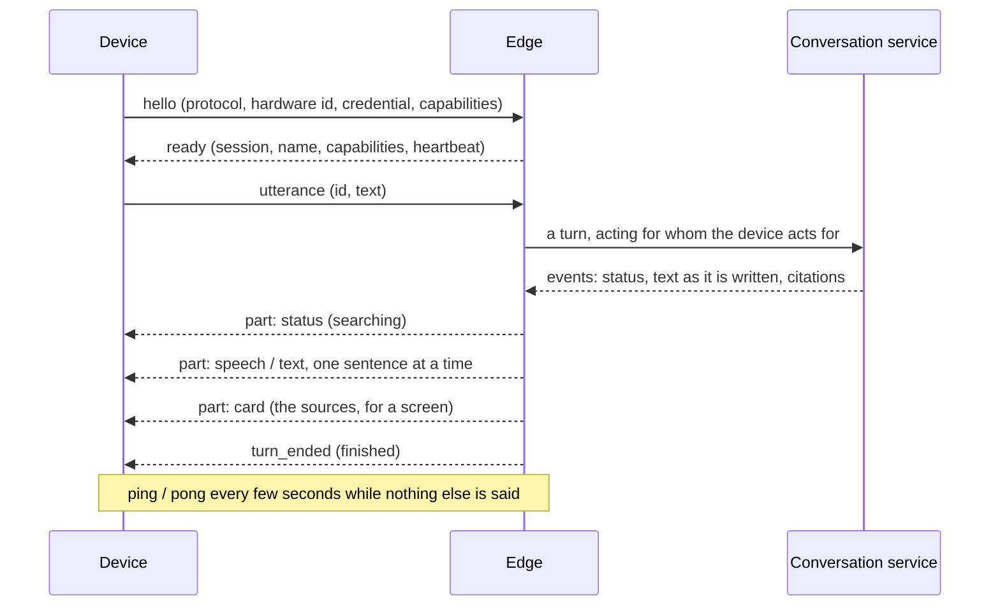

# The edge

The door of the system devices: a speaker, a screen, a phone connect to it over a WebSocket, say who
they are, and talk. It asks the conversation service for every answer and hands it back in pieces a
device can render, and it lets the rest of the platform have a device do something (set the volume,
show a card) and learn what became of it. It **knows no model, no document and no key**: what an
answer says is the conversation service's business; what a device is sent of it is the edge's.

*Implemented* (text): the protocol, sessions, answers adapted to what a device can do, interruption,
commands with an acknowledgement, a registry of devices read from a file (development only), an HTTP
API, a container image, and a terminal client that is a device (`factotum-terminal`). *Not yet*:
audio (voice is slice 8: the protocol carries text today), devices registered and paired by the hub
(slice 7), and who may command a device (`authorize()` and the device policy are slice 5a).

The reasons behind the design are in
[ADR 0013](decisions/0013-the-edge-typed-parts-filtered-by-what-a-device-can-render.md).

## A conversation



The device speaks first. Frames are JSON text, each an object with a `type`, at most 64 KiB. A frame
that is not one of the protocol is refused without being echoed (it may be a credential in the wrong
place). Version 1 is the whole of `factotum.contracts.edge`, which is the definition; this is a
reading of it.

### From the device

| Frame | Says |
| --- | --- |
| `hello` | `protocol_version`, `hardware_id`, `token` (the credential of the device), `capabilities`, optional `display` (`width`, `height`, `touch`) and `client` (software and version, for the logs). It is the first frame, and the only time the credential is sent |
| `utterance` | `id`, `text`: what a person said, as text. Only a device with `audio_in` can start a conversation |
| `cancel` | `id`: stop answering that utterance |
| `ack` | `id`, `result`: what became of a command |
| `ping` | I am here |
| `bye` | I am going on purpose |

### From the edge

| Frame | Says |
| --- | --- |
| `ready` | The device is known: `session_id`, `device_id`, `name`, `capabilities` (what it declared, of what it is registered for), `unregistered` (what it declared without being registered for: ignored, and said, so that whoever installs a device finds out), `heartbeat_s` |
| `part` | `utterance_id`, `seq` (0, 1, 2... with no gap), `part`: one piece of the answer, of a kind the device can render (below) |
| `turn_ended` | `utterance_id`, `status` (`finished`, `failed`, `cancelled`) and, for a failure, a stable `code` and a `message` |
| `command` | `id`, `command`: something to do (the command vocabulary of the design: `speak`, `play_url`, `pause`, `resume`, `stop`, `set_volume`, `show_card`, `clear_display`, `set_led`). The device answers with an `ack` |
| `pong` | Me too |
| `error` | `code`, `message`, `fatal` (the connection is closed after it), `ref` (the utterance or command it is about) |

### What a device is sent of an answer

The conversation service streams text as the model writes it. A speaker cannot wait for the end (it
would be silent for as long as the model takes) and cannot say half a word, so the edge cuts the
text into sentences as it arrives and sends each one as soon as it is whole: **the first sound is
heard after the first sentence, not after the answer.** What a sentence becomes depends on the
device, and a part a device cannot render is never sent to it:

| The answer has | `audio_out` (speaker) | `display` (screen) | Neither |
| --- | --- | --- | --- |
| Progress (thinking, searching) | `status` | `status` | `status` |
| Each sentence | `speech`, without the citation markers `[1]` and without markdown | `text`, as written, markers included | nothing |
| The documents it drew on | nothing: a speaker would only read them out | one `card` titled Sources, with each document and where in it | nothing |
| A failure | a `speech` apology | a `text` apology | nothing |

A device with both gets both, the speech first. The parts of an answer are a sentence each: a screen
shows them one after another (the terminal client puts a line for each). Sentences shorter than 24
characters are held back and said with the next ("Yes." on its own is a click); a stretch of 280
characters with no end to a sentence in it is cut at a comma or a space; a number such as 3.5 is not
a sentence; and a citation marker is kept with the sentence it follows.

When the answer cannot be given the device is told in words it can render, chosen by why: *I have no
model to answer with yet* (`chat_not_configured`), *That is too long for me to answer*
(`context_too_long`), *I cannot reach my brain right now* (`conversation_unavailable`), *Sorry, I
could not answer that* (anything else). What was written before the failure comes first, and
`turn_ended` says `failed` with the code.

### One turn at a time

A connection answers one utterance at a time. **A new utterance interrupts the answer to the one
before**: the person spoke over it. The edge stops reading the conversation service's stream (which
stops the model), sends `turn_ended` with `cancelled` for the old one, and answers the new one.
`cancel` does the same with nothing after it. The parts of an answer that was interrupted stop
where they were.

### Sessions

- A connection that does not say hello within `FACTOTUM_EDGE_HELLO_TIMEOUT_S` (10 s) is refused
  (`hello_required`).
- The device pings every `heartbeat_s` (20 s) and the edge answers. A device that says **nothing at
  all** for `FACTOTUM_EDGE_IDLE_TIMEOUT_S` (60 s) is taken to be gone (`idle`, close 4002).
- **The last connection of a device wins**: when the same device connects again, the old connection
  is closed with 4001. The old one may be a dead one nobody has noticed yet, and a device that
  restarted is the one that is there.
- When the edge stops, every device is told it is going away (close 1001).
- Sending one frame to a device may take `FACTOTUM_EDGE_SEND_TIMEOUT_S` (10 s); a device that does
  not take a frame in that time is taken to be gone.

Close codes: 1000 normal, 1001 the edge is going away, 1002 a frame that is not the protocol, 1008
refused (no hello, unknown device, wrong credential), 1009 a frame that is too big (closed by the
server before the edge reads it), 1011 the edge failed, 4001 replaced by the same device, 4002
idle, 4003 protocol version not supported.

## Commands

Something wants a device to do something (the `actions` service will; today a person with `curl`):

```bash
curl -s localhost:8084/v1/devices                    # who is connected
curl -s localhost:8084/v1/devices/$ID/commands -H 'content-type: application/json' \
     -d '{"command": {"name": "set_volume", "level": 30}}'
# {"status": "ok", "detail": null}
```

The edge sends the device a `command` frame and waits up to `FACTOTUM_EDGE_COMMAND_TIMEOUT_S` (10 s)
for the `ack` with the same `id`. What became of it is always a result with an HTTP `200`, never an
error, because a device that is not there is a normal state of a home:

| `status` | Means |
| --- | --- |
| `ok` | The device did it |
| `failed` | The device tried and could not (`detail` says why: nothing is playing) |
| `unsupported` | The device did not declare the capability the command needs. Nothing was sent |
| `timeout` | The device did not answer in time |
| `offline` | The device is not connected |

A device that does not exist for the caller's tenant is a `404`. Inside the platform a device is an
`EdgeDevice`, an implementation of the `SystemDevice` interface whose methods (`speak`,
`set_volume`...) go over the connection: the same interface the fake device of the tests implements.

## Registering devices

Every device that connects must be registered: a name, a `hardware_id`, a `token` (its credential),
an `owner` and the `capabilities` it may use. **Until the hub exists this is a YAML file, and only
in development**: the file registry and the development authentication refuse to be built when
`FACTOTUM_ENVIRONMENT` is anything but `development` or `test`, and it defaults to `production`, so
forgetting to set it disables them instead of enabling them.

```bash
cp config/devices.example.yaml config/devices.dev.yaml     # git ignores *.dev.yaml
# and set FACTOTUM_EDGE_DEVICES_FILE=config/devices.dev.yaml
```

[`config/devices.example.yaml`](../config/devices.example.yaml) documents each field and has one
device per kind: a speaker, a display with a speaker and a microphone, a screen with neither, a
streamer with no microphone and a personal phone. A test loads it and authenticates every device in
it.

- **Whom it acts for.** An `owner: tenant` device is shared: it acts for the tenant, has no
  conversation of its own and sees only the last minute of what was said on it (ADR 0012). An
  `owner: user` device is personal: it acts for that user, with their whole history.
- **Registered and declared.** A device may declare less than it is registered for (a phone with
  the microphone off), never more: the edge uses the intersection and, when the device declared
  something it is not registered for, says so in `ready.unregistered` and in a log line.
- **Its id** is derived from the tenant and the hardware id, so a conversation on a personal device
  carries on from one start of the edge to the next.
- **The credential** is compared in constant time, and the answer to a device that does not exist
  takes as long as the answer to one whose credential is wrong. It is never in a log or in an error
  frame; a refusal is logged with the hardware id that was claimed and the code, so that whoever
  installs a device can find out why it does not connect.

## The HTTP API

| | |
| --- | --- |
| `GET /v1/connect` | the WebSocket of the devices (the upgrade) |
| `GET /v1/devices` | the caller's tenant's devices that are connected: id, name, hardware id, capabilities, display, session, since when |
| `POST /v1/devices/{id}/commands` | have a device do something: `{"command": {...}}` gives a result |
| `GET /healthz`, `GET /readyz` | liveness; readiness (the conversation service answers) |

Errors have the shape of the other services, `{"error": {"code", "message", "details"}}`.
Interactive documentation is at `/docs` outside production.

## Configuration

Read from the environment (`FACTOTUM_*`) and, in development, from `.env`; every variable is in
[`.env.example`](../.env.example) and a test says so.

| Variable | Default | |
| --- | --- | --- |
| `FACTOTUM_EDGE_HOST`, `..._PORT` | `127.0.0.1`, `8084` | loopback unless told otherwise (the image says `0.0.0.0`, and compose publishes the port on loopback) |
| `FACTOTUM_EDGE_CONVERSATION_URL` | `http://127.0.0.1:8083` | where the conversation service is |
| `FACTOTUM_EDGE_DEVICES_FILE` | none | the registered devices (development only). A file that is named and is not there stops the edge; with none, no device is known |
| `FACTOTUM_EDGE_HELLO_TIMEOUT_S` | `10` | how long a connection may take to say who it is |
| `FACTOTUM_EDGE_HEARTBEAT_S` | `20` | how often a device with nothing to say says it is there |
| `FACTOTUM_EDGE_IDLE_TIMEOUT_S` | `60` | how long a device may say nothing at all: a good few heartbeats |
| `FACTOTUM_EDGE_COMMAND_TIMEOUT_S` | `10` | how long a device is given to answer a command |
| `FACTOTUM_EDGE_TURN_TIMEOUT_S` | `130` | how long the conversation service may be silent while it answers: a little more than its own limit on its model, so that the reason is its |
| `FACTOTUM_EDGE_SEND_TIMEOUT_S` | `10` | how long sending one frame to a device may take |

The edge has no database, no model and no key. It runs uvicorn with the WebSocket implementation
that is not deprecated (`websockets-sansio`) and a limit of one frame of the protocol, whatever a
client sends.

## The terminal client

`factotum-terminal` is a device in a terminal, and the way to look at the edge from the side of a
speaker, of a screen, of a phone before there is one. What is typed is what a person said; what the
edge sends comes out as what that device would do:

```bash
uv run factotum-terminal                                       # a speaker
uv run factotum-terminal --profile smart-display --url ws://127.0.0.1:8084/v1/connect
```

| Profile | Is | Sees |
| --- | --- | --- |
| `speaker` | a microphone, a speaker and a light | speech |
| `smart-display` | the same, with an 800x480 touch screen | speech, text, the sources |
| `screen` | a screen and nothing else: it cannot start a conversation | what it is sent |
| `player` | a streamer with a speaker and no microphone | what it is told to play |
| `phone` | a personal device, with the screen and the voice | speech, text, the sources |

Each profile is a device of `config/devices.example.yaml` (a test says so): its hardware id and
credential are those of the example, which `--hardware-id` and `--token` (or
`FACTOTUM_DEVICE_TOKEN`) override. The terminal behaves as the hardware would: it renders only what
that hardware could and executes the commands it is sent (it keeps a volume, a light, a music
player and a screen, and `/state` says what they are doing), answering each with an `ack`.

```
--       connected as Kitchen speaker (audio_in, audio_out, led)
--       type what you would say (/help)
[...]    searching
[say]    Hold the recessed reset button for ten seconds with a paperclip.
[say]    Release the button and wait two minutes for the router to restart.
```

Tags: `[say]` speech, `[show]` text, `[card]` a card, `[play]` music, `[...]` progress, `[do]` a
command that was run, `[stop]` an answer that was interrupted, `[!]` an answer that failed,
`[edge!]` something the edge said is wrong, `--` the terminal itself. Typing while an answer is
coming interrupts it. Lines that begin with a slash are for the terminal: `/cancel`, `/state`,
`/caps`, `/help`, `/quit` (end of input does the same, after the last answer). The exit code is 0
when the person left, 1 when the edge could not be reached, refused the device or closed the
connection (which is said at once, without waiting for anything to be typed), and 2 for wrong
arguments.

**The terminal also checks the edge.** A part that this device could not render, parts out of
order, an answer that nobody asked for, a second `ready`: the edge does none of it, and a device
that saw it would say `[BUG]`. That is what a client is good for before there is a real one.

## Trying it

With the whole stack (the models are the ones of the gateway's bindings; see
[`model-gateway.md`](model-gateway.md#running-it)):

```bash
cp config/devices.example.yaml config/devices.dev.yaml
FACTOTUM_POSTGRES_PASSWORD=dev FACTOTUM_ENVIRONMENT=development \
    docker compose --profile services up -d --build --wait
uv run factotum-terminal --profile smart-display
```

Put a document in first (`docs/knowledge.md` shows how) for there to be something to answer from.
Without the conversation service the edge is up and every answer is an apology.

## Tests

The edge is tested through its interfaces: sessions over an in-memory wire and a conversation
service that answers as told; the chunker of sentences as a property (however the text arrives in
pieces, the sentences are the same); and on a real socket, with uvicorn serving the edge and the
client library that devices use on the other side, for what only a real connection shows (what the
peer sees when it is closed, a frame bigger than the protocol allows). The terminal client is tested
against an edge served the same way, so that the two halves of the protocol are shown to fit.

## Measured

A speaker, a smart display and a phone against the whole stack in containers: Llama 3.1 8B (q4_K_M)
through Ollama on an RTX 3060 Ti for the answers, bge-m3 for the embeddings, a short manual of
three sections as the document, one turn at a time.

| | Time after the utterance |
| --- | --- |
| The first progress part (searching) | 10 to 40 ms |
| The first spoken sentence, model warm | 0.8 to 1.0 s |
| The whole answer of two sentences, model warm | 1.1 s |
| A follow-up (a small model first reads whether it refers to the past) | `thinking` at once, the first sentence in 0.8 to 1.0 s |
| The first spoken sentence, model cold (it is loaded by the first call) | 7.4 s |
| The first spoken sentence of the question after that one, while the models were still being swapped on the card | 3.3 s |

Speaking over an answer three seconds into it stopped that answer (`[stop] interrupted`) and
answered the new question. A command sent over HTTP to a connected display was run and acknowledged
(`ok`); one to a speaker that was not connected came back `offline`.

What the run found: a device that was refused for a wrong credential left no trace in the logs
(fixed: a warning with the hardware id it claimed, never the credential); and the small model
sometimes writes a citation marker that points to no passage (`[3]` with one passage found), which
the conversation service drops from the citations but a screen shows as written (see the limits).

## Known limits

- **Development only.** The devices come from a file and the edge acts for a device towards the
  conversation service by headers that only the development authentication reads. The hub (slice
  7) registers and pairs devices, keeps only hashes of their credentials and issues what the edge
  presents to the other services; until then the edge only runs with
  `FACTOTUM_ENVIRONMENT=development`.
- **Who may command a device is not decided here.** The command endpoint asks for an authenticated
  caller of the device's tenant and no more: grants, the device's policy (`max_effect`,
  `requires_approval`) and `authorize()` belong to the `actions` service (slice 5a).
- **Text, not audio.** The protocol carries what was said and what is to be said as text; the
  speech-to-text and text-to-speech pipeline and the audio frames come with the Raspberry Pi client
  (slice 8) and will be a new part of the protocol, not a change to this one.
- **No TLS.** The edge speaks `ws://`. The compose port is on loopback; what puts it on a network
  (a reverse proxy with certificates) is a deployment matter (slice 10).
- **One process holds the connections.** A command reaches a device only through the edge process
  that holds it; running several needs a bus between them (the `DeviceRouter` of the design).
- **A dangling marker on a screen.** When the model writes a citation marker that points to no
  passage, the conversation service drops the citation but the text has already been streamed: a
  screen shows `[3]` beside a sentence with no source card. A speaker never says a marker. The fix
  belongs to the conversation service (an open question in [`design.md`](design.md#13-open-questions)).
- **One turn at a time per connection**, and a very long answer with no end to a sentence in it is
  cut at 280 characters to be spoken.
